# sEMG 손동작·팔꿈치 각도 분류

제출용 핵심: [1. 코드 설명](#submission-code) · [2. 모델 성능 비교](#submission-models) · [3. 혼동행렬 분석](#submission-confusion) · [4. 최종 결과](#submission-final). 실험별 실패·비용·변경은 [전체 이력](#experiment-history)에 보존했다.


5채널 표면근전도(sEMG)에서 손동작 4종과 팔꿈치 각도 2종을 구분하는 수업 프로젝트다. 강의 4개를 읽고 원본 CSV부터 새로 구현했다. 현재 사용자의 요청에 따라 <strong>RF·XGBoost·SVM을 각각 단독 분류기로 평가</strong>한다. 입력은 현재 <strong>200ms·100ms 이동·시행당 19창</strong>, 기존 시행 분할과 전체 개발 1,536시행·64기록을 유지한다.

같은 내부 분할의 단독 평균은 <strong>XGB 800회 90.31%, 단일 SVC 86.30%, RF 200트리의 직접 8분류 82.20%·64목표 84.42%</strong>였다. SVC는 최종 한 모델의 `predict`만 사용하며 확률 보정기나 다른 모델 출력을 쓰지 않는다. 단독 XGB의 바깥 개발 선택 절차는 <strong>90.9608% → 91.0773±0.3460%</strong>로, 같은 29,184창에서 정답이 <strong>26,546→26,580개(+34개)</strong> 늘었다. 각 평가창은 XGB 한 모델로 분류했다. 내부 선택에 따라 fold0·2는 깊이4·800회, fold1은 깊이3·1,600회를 썼다. 따라서 새 고정 설정 하나의 전체3-fold 점수라고 부르지 않는다. 당시 후보 생성은 결합 지표를 참고했지만, 단독 내부 정답을 비교해도 XGB800은 XGB400보다 세 분할 모두 높았다. 이 개발 자료의 반복 노출과 후보 생성 이력을 숨기지 않는다.

후속 v34에서 현재 200ms 안의 네 50ms 구간별 상대 주파수 파워 80개를 추가해 단독 XGB를 시험했지만 <strong>91.0739%(26,579/29,184)</strong>로 기존 v33보다 정답 1창 적었다. 내부 3fit·선택된 바깥 1fit와 모델 4개 복원, 전체 83개 검사를 완료했다. <strong>개선은 확인되지 않아 기존 v33을 보존</strong>한다. 새 바깥 모델은 55.59MB·관측 학습 199.54초였으며 추가 지연 측정은 생략했다. 실패와 진단의 한계까지 [v34 결과](results/local_spectrum_v34/summary.json)와 아래 실험 기록에 남겼다.

새 설정이 선택된 바깥 fold1의 동일 380창 비교에서, 모델 크기는 <strong>55.44→92.47 MB</strong>, 관측 학습시간은 <strong>176.15→267.85초</strong>, 현재창 특징 계산을 포함한 추론 중앙값은 <strong>5.83→7.32 ms</strong>였다. 작은 정확도 증가에 비용 증가가 따랐으며, 효율 기준인 기존 XGB800도 보존했다. 내부 3fit·바깥 1fit와 저장 모델 4개 복원, 단일 SVC 3개 복원, 전체 77개 검사 및 원시 비용 재집계를 완료했다. [단독 실험 결과](results/standalone_xgb_v33/summary.json), [검증](results/standalone_xgb_v33/verification.json), [같은 창 비용](results/standalone_xgb_v33/cost_summary.csv).

<strong>논문과의 차이를 먼저 대조했다.</strong> 강의 RF100·25개 특징 구현은 일치하며 전체 5-fold 창 정확도는 64.54±0.35%다. 개발 전 29,184창을 독립 수식으로 재계산해 ZC·SSC가 모두 일치했다. 공식 Fig.5의 분모는 384개이고 현재 기준선은 7,296창이다. 기존 RF 기준 예측의 시행 다수결 보조값은 5-fold 95.78%로 크게 다르지만, 논문이 이 방법을 썼다는 증거는 없다. 2초 전체를 쓰는 시행 투표를 단일 200ms 개선으로 세지 않는다. 1.5–3.5초 구간은 강의의 실습 가정이며 제공자 원자료와 논문 원자료의 동일성도 미확인이다. [논문·강의·구현 비교표](docs/PAPER_IMPLEMENTATION_COMPARISON.md)에 근거와 필요한 자료를 정리했다.


<a id="submission-code"></a>

## 1. 코드 설명

### 주요 파일의 역할

|실제 파일|역할과 실행 경로|
|---|---|
|[`run.sh`](run.sh)|기준 검사·원본 준비·기준 학습·개발 비교·검산·그림 생성의 진입점. `bash run.sh <단계>`로 실행하며 단계는 `test`, `prepare`, `baseline`, `improve`, `verify`, `analyze` 중 하나다.|
|[`src/semg/data.py`](src/semg/data.py)|64개 파일 조합, 레이블·채널·시간·마커 검증과 시행별 1.5–3.5초 구간 추출.|
|[`src/semg/features.py`](src/semg/features.py)|200ms 창/100ms 이동, RMS·MAV·WL·ZC·SSC 및 주파수 특징. 별도 원신호용 필터 함수는 제공 bandpass 입력에 재적용하지 않는다.|
|[`src/semg/evaluation.py`](src/semg/evaluation.py)|시행 단위 층화 분할, 창 펼치기, 8클래스 macro 지표. 시행 다수결은 보조 이력용이다.|
|[`src/semg/models.py`](src/semg/models.py)|강의 SVC·RF·XGB 생성자와 단독 예측 함수.|
|[`scripts/prepare.py`](scripts/prepare.py), [`scripts/audit_splits.py`](scripts/audit_splits.py)|원본에서 캐시·시행 목록·분할 생성, 분할 교집합 검사. 공개판에서는 원본별 목록과 시행 정보를 `private/`에 기록한다.|
|[`scripts/run_experiments.py`](scripts/run_experiments.py)|기준 hold-out/5-fold와 초기 개발 후보 학습. scaler는 각 학습 부분에만 fit하고 모델·개별 예측은 `private/`에 저장한다.|
|[`scripts/verify_results.py`](scripts/verify_results.py)|독립 스칼라 특징, 저장 예측의 지표·레이블·시행 집계·scaler 검산.|
|[`scripts/analyze.py`](scripts/analyze.py)|공개용 전체 집계표·그림과 기준 혼동행렬 생성. 개인별 출력은 비공개 경로에 둔다.|
|[`run_extensions.sh`](run_extensions.sh)|후속 특징·진단·학습·비용·검증을 단계 이름으로 실행. 아래 전체 이력 재실행 명령을 따른다.|
|[`experiments/standalone_xgb_v33/inventory.py`](experiments/standalone_xgb_v33/inventory.py)|저장된 단독 RF/SVC/XGB 내부 예측을 같은 분할로 비교한다. 새 학습은 없다.|
|[`experiments/standalone_xgb_v33/experiment.py`](experiments/standalone_xgb_v33/experiment.py)|`run`은 내부 후보 학습→선택 고정→선택된 바깥 fit, `verify`는 분할·모델 복원·지표 검증. 기존 의존 산출물이 있는 별도 실행 디렉터리가 필요하다.|
|[`experiments/standalone_xgb_v33/cost.py`](experiments/standalone_xgb_v33/cost.py), [`report.py`](experiments/standalone_xgb_v33/report.py)|대표 단일 모델의 특징+추론 비용 측정과 결과 그림·요약 생성.|
|[`scripts/submission_report.py`](scripts/submission_report.py)|저장 예측 21파일에서 제출용 클래스별 집계를 재계산. `--aggregate-only`는 공개 집계만 검산·렌더링한다. 학습 기능은 없다.|

### 문제와 데이터

입력은 전완 3채널과 상완 2채널의 시계열이며, 출력은 동작과 각도를 묶은 8클래스다. 예를 들어 `30_fist`는 30° 조건에서 주먹을 쥔 시행을 뜻한다. 단일 8클래스 모델은 두 축의 결합을 직접 학습한다. 두 축을 따로 예측하면 모델 역할은 분명해지지만 출력 결합 규칙이나 단계 간 오류 전달을 추가로 검토해야 한다. 각도 조건을 K개로 늘리면 클래스 수는 4K개가 되므로 조건별 반복 수와 학습 범위도 함께 확장해야 한다.

|원본에서 직접 확인한 항목|값|
|---|---:|
|피험자 수|8명|
|기록|64 CSV = 8명 × 4동작 × 2각도|
|신호 열 / 보조 열|bandpass 1–5 / time, onset, mark|
|시간 간격|1ms, 즉 1kHz|
|총 행 수|9,711,953|
|시행|기록당 30개, 총 1,920개|
|클래스당 시행|240개|
|결측·무한값|0개|
|기준 분석창|36,480개, 창당 25특징|

파일명 동작 코드는 `fist/open/pro/extor`다. 2차 진단에서 [제공자 문서의 고정 버전](https://github.com/TestUser-alt-dev/sEMG-Hand-Gesture-Elbow-Angle-Dataset/blob/cb64ded658b83ae97e6388dd373efad0e97bc47c/README.md)을 확인했고, 로컬 원본 64개의 Git blob 해시가 해당 버전의 64개 파일과 모두 일치했다. 문서는 `pro`를 회내, `extor`를 회외로 명시한다. 최초 명세에서는 이 대응을 가정으로 남겼으나 현재는 제공자의 설명으로 확인했다. 지표와 그림에는 원본 코드를 유지했다. 클래스 순서는 `30_extor, 30_fist, 30_open, 30_pro, 60_extor, 60_fist, 60_open, 60_pro`다. [입력 규모와 재현 해시 집계](results/data_summary.json)과 [제공자 버전 대조](results/diagnostic_v2/provider_verification.json)를 제공한다.

강의의 채널 순서는 다음과 같다(1주차 5쪽, 통합 20쪽). CSV의 1–5열을 이 순서에 대응한다.

|열|강의의 근육|부위|
|---|---|---|
|1|요측수근신근(ECR)|전완|
|2|총지신근(ED)|전완|
|3|천지굴근(FDS)|전완|
|4|상완이두근(Biceps)|상완|
|5|상완삼두근(Triceps)|상완|

### 전처리와 특징

각 파일에는 `mark=1`이 30개 있고, 첫 `onset=1`과 첫 mark가 일치한다. 마커 간격은 4999–5001표본이다. 파일 전체를 한 시행으로 취급하면 29시행을 놓치므로 실제 마커 인덱스마다 시행 ID를 만들었다. <strong>mark를 시행 시작으로 해석</strong>하고, 1500표본 뒤에서 2000표본을 자른다. 이 구간은 강의 2주차 10쪽의 1.5–3.5초 실습 설정이다.

CSV 열 이름은 이미 bandpass 처리를 표기한다. 제공자 문서는 60Hz 노치와 20–450Hz 4차 Butterworth 처리를 명시하지만 실제 계수·노치 Q·위상 처리·실행 순서는 공개하지 않는다. 기준 실험에는 추가 필터를 적용하지 않았다. 강의의 60Hz 노치(Q=30)와 20–450Hz 4차 Butterworth 함수는 별도로 구현해 합성 신호로 검증했다. 따라서 이번 입력은 필터 이전 원신호에서 시작하는 강의 예제와 시작점이 다르다.


그림 2. 기록별 30시행의 100ms RMS 중앙값을 채널별 최대값으로 정규화한 후, 전체 64기록의 중앙값으로 모은 5개 곡선이다. 개인·기록별 프로파일은 포함하지 않는다. 붉은 영역은 분석 구간 1.5–3.5초, 점선은 강의 도식의 동작 구간 2–3초다. 전체 집계의 큰 반응은 대체로 1.5–1.8초 부근에 나타났다. 마커 가정과 강의 도식의 정렬은 미확인이다. 이 관찰을 근거로 시험 점수에 맞춰 구간을 이동하지 않았다. [곡선의 전체 집계값](results/marker_profile_summary.csv)을 제공한다.

2000표본을 200표본 창으로 100표본씩 이동하면 19창을 얻는다. 각 창에서 RMS, MAV, WL, ZC, SSC를 5채널에 계산한다. 벡터는 특징 우선 순서로 RMS1–5, MAV1–5, WL1–5, ZC1–5, SSC1–5를 연결한다. ZC는 서로 반대 부호인 인접 표본의 차이가 0.01 이상일 때만 세며, SSC는 기울기 부호 변화만 센다. [수식과 구현](docs/PROTOCOL.md#특징)을 함께 기록했다.

### 학습과 평가 분할

<strong>분할 단위는 시행이고, 주평가 단위는 창이다.</strong> 같은 시행의 19창은 항상 같은 집합에 놓인다.

|검증|학습 시행|평가 시행|목적|
|---|---:|---:|---|
|강의 hold-out|1,536|384|세 기준모델 비교|
|전체 층화 5-fold|1,536/fold|384/fold|강의 기준 평균·표준편차|
|개발 층화 5-fold|1,228 또는 1,229/fold|308 또는 307/fold|hold-out 학습 부분 안에서 후보 선택|

분할 seed는 42다. StandardScaler는 각 모델의 해당 학습 창으로만 fit한다. 실제 시행 ID 목록은 재실행 시 비공개 `private/split_manifest.csv`에 생성하며, 교집합 집계는 [split_checks.csv](results/split_checks.csv)에 있다. 각 분할 안의 학습·평가 시행 교집합은 0이며, 개발 5-fold는 hold-out 시험 384시행과 교집합이 0이다. Hold-out 양쪽 모두 64기록·8명·8클래스를 포함한다. 기록별 시험 시행 수는 1–10개로 균일하지 않다.

전체 5-fold와 hold-out은 같은 1920시행을 다르게 나눈 평가다. 고정 시험 384시행 전부가 전체 CV에서 각각 네 번 학습, 한 번 평가에 사용됐다. 각 fold의 학습에는 이 중 291–317시행이 들어간다. 따라서 고정 시험은 프로젝트 전체에서 완전히 미관측인 외부 시험자료가 아니다. 개발 후보 선택과 해당 모델의 학습에는 이 384시행을 넣지 않았다. 원천 데이터에는 이전 프로젝트 사용 이력도 있다. 현재 평가는 같은 피험자와 같은 기록의 다른 시행이 양쪽에 포함되는 성능이며, 새 피험자나 새 기록에 대한 성능은 측정하지 않았다.

### 실행 방법

Python 3.13과 지원되는 NVIDIA 드라이버를 준비한다. 새 가상환경에서는 다음처럼 공식 패키지를 설치한다. 이번 작업의 버전은 [requirements.txt](requirements.txt)에 고정했다.

```bash
python3 -m venv .venv
.venv/bin/python -m pip install -r requirements.txt
export SEMG_PYTHON="$PWD/.venv/bin/python"
export SEMG_RAW="/path/to/original_csv_directory"
export SEMG_RUN_DIR="$PWD/private/reproduction_01"

bash run.sh test
bash run.sh prepare
bash run.sh baseline
bash run.sh verify
# 기준 결과를 확인한 뒤
bash run.sh improve
bash run.sh verify
bash run.sh analyze
```

`SEMG_RUN_DIR`를 새 디렉터리로 지정하면 저장된 결과를 덮어쓰지 않고 재실행한다. 같은 출력 위치에 이미 baseline이 있으면 prepare와 baseline을 중단한다. 결과는 `$SEMG_RUN_DIR/results`, 예측·모델·캐시는 `$SEMG_RUN_DIR/private`에 생긴다. XGB는 CUDA가 실제로 활성화됐는지 검사하므로 GPU 접근이 막히면 CPU 결과로 조용히 대체하지 않는다.

원자료가 없는 공개 저장소에서는 아래 명령으로 <strong>공개 클래스별 집계 검산과 그림 재생성</strong>을 할 수 있다. 실제 학습 재현에는 별도로 제공받은 64개 CSV가 필요하다.

```bash
"$SEMG_PYTHON" scripts/submission_report.py --aggregate-only --output results/submission_review
```

이미 완료된 로컬 실행을 읽어 새 제출용 집계를 만들 때는 존재하지 않는 출력 폴더를 지정한다. 기존 예측과 결과를 덮어쓰지 않는다.

```bash
"$SEMG_PYTHON" scripts/submission_report.py --run-root "$SEMG_RUN_DIR" --output "$SEMG_RUN_DIR/results/submission_review"
# v33의 선행 특징·분할·참조 모델을 재현한 뒤에만 실행
export PYTHONPATH="$PWD/src"
"$SEMG_PYTHON" experiments/standalone_xgb_v33/experiment.py run
"$SEMG_PYTHON" experiments/standalone_xgb_v33/experiment.py verify
```

<a id="submission-models"></a>

## 2. 모델 성능 비교

### 강의 설정 기준실험: 과거 hold-out과 전체 5-fold

SVM은 RBF, C=1, gamma=scale, RF는 100트리, XGBoost는 400회·깊이 6·학습률 0.05·subsample 0.9·colsample 0.8이다. RF와 SVM은 CPU, XGBoost는 TITAN Xp CUDA에서 실행했다. 입력 규모나 트리 수를 줄이지 않았다. XGBoost의 400회는 8클래스에서 총 3200트리이며 저장 설정에서도 확인했다. [생성자 전체 설정](configs/model_parameters.json)과 [실제 XGB 설정](configs/effective_xgb.json)을 제공한다.

|모델|Hold-out 창 정확도|Macro precision|Macro recall|Macro F1|전체 5-fold 창 정확도 평균±SD|
|---|---:|---:|---:|---:|---:|
|SVM|49.62%|50.48%|49.62%|49.74%|48.56±0.45%|
|RF|64.38%|64.51%|64.38%|64.41%|64.54±0.35%|
|XGBoost|63.34%|63.51%|63.34%|63.38%|62.97±0.39%|


그림 3. 같은 분할과 25특징으로 비교한 기준 성능. 5-fold 오차막대는 5개 정확도의 모집단 표준편차(ddof=0)다. 모든 모델에서 384시험 시행 × 19창 = 7296창을 평가했다. [fold별 수치](results/baseline.csv)를 제공한다.

같은 5개 fold를 짝지은 t검정의 p값은 SVM–RF 1.80×10⁻⁷, SVM–XGB 7.50×10⁻⁷, RF–XGB 0.000979였다. 이번 분할에서는 차이를 검출했으나, 학습 집합이 겹치는 5개 fold의 탐색적 비교이므로 독립 반복실험의 확증으로 해석하지 않는다. 강의가 인용한 논문의 ‘차이 미검출’과 결론이 다르다.

|모델|학습 시간(s)|단일 창 추론(ms)|로컬 직렬화 크기(MB)|
|---|---:|---:|---:|
|SVM|29.31|1.35|8.26|
|RF|1.83|13.08|175.56|
|XGBoost|5.87|30.42|11.43|

학습 시간은 scaler와 모델의 fit 시간이다. 추론은 표준화된 한 창을 100회 호출한 평균으로, RF의 병렬 호출과 XGB의 DMatrix 생성·GPU 전송 비용을 포함한다. 신호 취득 2초와 특징 추출 지연은 제외했다. 작은 배치의 호출 비용이 커서 이 표를 GPU 처리량이나 실제 배포 지연으로 해석할 수 없다. [환경과 측정 범위](docs/ENVIRONMENT.md)를 참고한다.


이 hold-out 384시행은 이전 전체 CV에서 이미 사용된 자료다. 새 외부 시험으로 부르지 않는다. 아래 분석에서는 저장 예측만 다시 집계했으며, 모델 재학습이나 시험 후 설정 선택은 하지 않았다. 이 조건의 최고는 RF, 최저는 SVM이다.

### 최신 단독 분류기의 같은 내부 분할 비교

사용자가 결합을 제외하라고 요청한 뒤, RF·XGBoost·SVM의 단독 출력만 비교했다. 모든 행은 같은 410특징·내부 학습 768시행/평가 256시행·19창·3개 분할이다. 이전91.98% 결합의 바깥값을 이 표와 비교하지 않는다.

|단독 모델|Accuracy 평균±SD (%)|Macro Precision (%)|Macro Recall (%)|Macro F1 (%)|
|---|---:|---:|---:|---:|
|RF200, 직접 8목표|82.2026±1.0008|82.3315|82.2026|82.1724|
|RF200, 64목표 → 8클래스|84.4161±0.8225|84.4991|84.4161|84.3814|
|SVC C100, 보정 없는 한 모델|86.3007±0.0861|86.3664|86.3007|86.2730|
|XGB400 / 깊이 6|89.6587±0.8358|89.7012|89.6587|89.6551|
|XGB800 / 깊이 4|90.3098±0.7658|90.3398|90.3098|90.3007|


|단독 모델|평균 모델 크기|관측 평균 모델 fit 시간|
|---|---:|---:|
|RF200, 직접 8목표|94.47MB|127.54초|
|RF200, 64목표 → 8클래스|511.62MB|181.77초|
|SVC C100, 보정 없는 한 모델|60.80MB|17.82초|
|XGB400 / 깊이 6|33.62MB|기존 v10 기록 참조|
|XGB800 / 깊이 4|52.49MB|137.66초|

RF/SVC는 CPU, XGB는 TITAN Xp의 CUDA 실행이다. 시간은 해당 원래 학습의 관측값이며 동시 부하를 완전히 통제한 장비 비교가 아니다. SVC는 이전 보정 학습 중 전체 학습 부분에 fit한 마지막 모델 하나를 재사용했고, 위17.82초는 그 한 fit이다. 과거 보정용3fit의 소요시간을 단독 모델 학습비용으로 더하지 않았다. 보정기 없이 그 모델의 predict 결과를 독립 복원하여 전14,592개 내부 관측에서 일치했다. 미래 재학습에도 StandardScaler+SVC를 한 번 fit하면 되며 보정용 CV를 요구하지 않는다.

RF64와 XGB64는 한 분류기의64출력을 조건별8개로 해독한다. 서로 다른 학습모델의 출력 결합은 아니다. 다만64학습목표가64기록과 일대일이라는 한계는 그대로다. 원래 피험자·기록을 공유하는 시행 분리 성능이며 독립 기록 일반화를 뜻하지 않는다. [단독 집계](results/standalone_xgb_v33/standalone_inner.csv), [SVC 복원 검증](results/standalone_xgb_v33/standalone_inventory_verification.json).


모든 지표는 <strong>창 단위</strong>이며, Precision·Recall·F1은 각 분할의 8클래스를 같은 가중치로 평균한 macro 값이다. 위 표는 그 값을 다시 <strong>3개 분할에 대해 단순 평균</strong>했다. 정확도 SD는 ddof=0이며 신뢰구간이 아니다. 세 내부 평가 부분에는 총 768시행 관측(14,592창)이 있지만 고유 시행은 682개이므로 완전 OOF나 독립 반복 표본으로 부르지 않는다. [15개 원래 fold 지표](results/standalone_xgb_v33/standalone_inner.csv)와 [독립 재계산 평균](results/submission_review/inner_mean_metrics.csv)이 일치했다. 혼동행렬은 세 분할의 건수를 더하므로 그 행렬에서 구한 pooled Precision·F1과 위 평균은 다를 수 있다.

내부 평균에서는 XGB800이 90.3098%로 가장 높고 RF200 직접 8목표가 82.2026%로 가장 낮다. 410특징과 평가 시행은 같지만 학습 목표·결정 경계·용량이 다르므로 점수 차이를 알고리즘 종류 하나의 효과로 단정하지 않는다.
### 최종 단일 모델 선택 절차: v33의 바깥 개발 평가

|평가|창 수 / 정답 수|Accuracy (%)|Macro Precision (%)|Macro Recall (%)|Macro F1 (%)|
|---|---:|---:|---:|---:|---:|
|v33 바깥 3분할 예측을 합산|29,184 / 26,580|91.0773|91.0952|91.0773|91.0818|

개발 1,536시행을 바깥 평가에서 한 번씩 예측한 <strong>pooled 지표</strong>다. 바깥 학습은 분할당 1,024시행, 평가는 512시행이다. 내부 선택으로 fold0·2는 깊이 4·800회, fold1은 깊이 3·1,600회를 사용했다. 각 창에는 XGB 한 모델만 사용하며, 이 수치는 고정 설정 하나의 점수가 아닌 <strong>단일 모델 선택 절차의 평가</strong>다. 내부 후보 표와 직접 순위를 매기지 않는다. 정확도의 fold SD는 0.3460%p다. [원래 집계](results/standalone_xgb_v33/pooled.csv), [선택 기록](results/standalone_xgb_v33/selection.json), [새 재검산](results/submission_review/prediction_verification.json).

같은 바깥 fold1의 380창 비용 대조에서 깊이 4·800회는 55.44MB·학습 176.15초·특징+추론 중앙값 5.83ms, 깊이 3·1,600회는 92.47MB·267.85초·7.32ms였다. 학습 시간은 원래 실행 시점의 관측값이고 지연은 CPU 6스레드에서 현재창 특징 계산을 포함한다. 입력 취득·파일 로딩은 제외했다. 정확도 0.1165%p 증가에 저장·학습·추론 비용도 늘었다. [같은 창 비용표](results/standalone_xgb_v33/cost_summary.csv).

<a id="submission-confusion"></a>

## 3. Confusion Matrix 분석

행은 정답 클래스, 열은 예측 클래스다. 숫자는 창 수이고 새 그림의 색은 각 정답 클래스 내 비율(%)이다. `pro`는 제공자 설명의 회내, `extor`는 회외다. 최고·최저 클래스는 대각선 정답 수를 해당 행의 전체 창 수로 나눈 <strong>Recall</strong>로 정했다. [클래스별 분석 근거](results/submission_review/class_error_analysis.json), [집계 지표](results/submission_review/pooled_metrics.csv)를 제공한다. 지표와 행렬 방향은 [scikit-learn의 macro 정의](https://scikit-learn.org/stable/modules/generated/sklearn.metrics.precision_recall_fscore_support.html)와 [혼동행렬 정의](https://scikit-learn.org/stable/modules/generated/sklearn.metrics.confusion_matrix.html)에 맞춰 독립 수식과 대조했다.

### 강의 기준 세 모델: 이전에 사용한 hold-out 7,296창

각 모델은 같은 384시행 × 19창이며 각 클래스 지원 수는 912창이다. 이 자료는 이미 전체 CV에서 사용됐다.

|모델|최고 Recall 클래스|최저 Recall 클래스|주요 방향별 오분류 (정답 → 예측)|
|---|---|---|---|
|SVM|`30_extor` 59.32%|`60_pro` 42.76%|`60_extor → 30_extor` 183창; `60_pro → 30_pro` 154창; `30_pro → 30_extor` 137창|
|RF|`30_fist` 68.97%|`30_pro` 59.65%|`30_pro → 60_pro` 106창; `60_open → 30_open` 104창; `30_fist → 60_fist` 98창|
|XGB|`30_open` 67.76%|`30_pro` 58.33%|`30_pro → 60_pro` 112창; `30_fist → 60_fist` 111창; `60_open → 30_open` 108창|

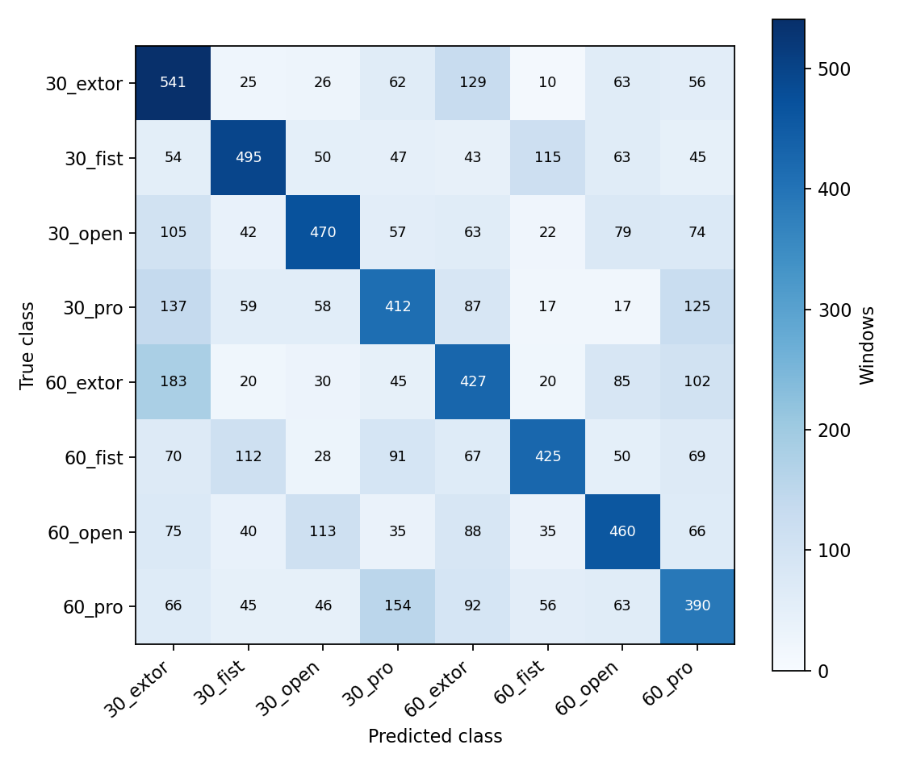

SVM: 3,620/7,296창 정답. [행렬 CSV](results/submission_review/confusion_legacy_SVM.csv).


RF: 4,697/7,296창 정답. [행렬 CSV](results/submission_review/confusion_legacy_RF.csv).

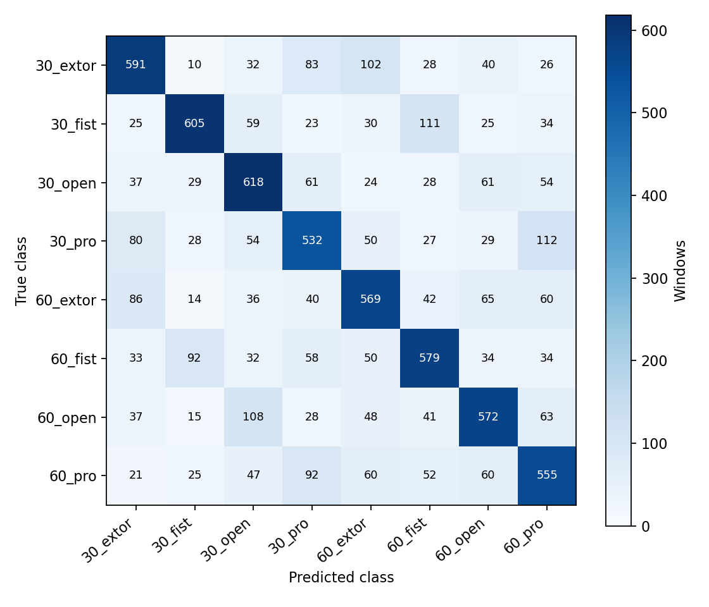

XGB: 4,621/7,296창 정답. [행렬 CSV](results/submission_review/confusion_legacy_XGB.csv).

SVM은 같은 동작의 두 각도를 혼동한 `60_extor → 30_extor`가 가장 컸다. RF와 XGB는 `30_pro → 60_pro`가 가장 컸다. <strong>가능한 원인 가설</strong>은 25개 시간 특징만으로 짧은 창의 각도별 근활성 차이를 충분히 구분하기 어렵다는 것이다. 같은 동작의 각도 혼동뿐 아니라 서로 다른 동작 오류도 있으므로 각도 하나로 원인을 설명할 수 없다. 고정 구간의 전이·휴식 포함, 전극·기록 차이도 후보 원인이지만 이 혼동행렬만으로 인과관계를 확정하지 않는다.

### 최신 단일 후보: 같은 내부 3분할의 건수 합계

각 그림은 14,592창 관측, 클래스당 1,824창이다. 중복 평가된 시행을 포함하므로 독립 768시행이나 전체 개발 OOF로 해석하지 않는다. 위 내부 비교표와 같은 분할·예측을 사용했다.

|모델|최고 Recall 클래스|최저 Recall 클래스|주요 방향별 오분류 (정답 → 예측)|
|---|---|---|---|
|RF200, 직접 8목표|`30_fist` 87.12%|`60_open` 75.33%|`60_pro → 30_pro` 144창; `60_open → 60_pro` 114창; `60_fist → 30_fist` 108창|
|RF200, 64목표 → 8클래스|`60_extor` 89.58%|`60_open` 78.18%|`60_pro → 30_pro` 102창; `30_extor → 30_pro` 91창; `60_open → 60_fist` 88창|
|SVC C100, 보정 없는 한 모델|`60_extor` 91.78%|`60_open` 81.96%|`60_fist → 30_fist` 91창; `60_pro → 30_pro` 86창; `30_open → 30_fist` 83창|
|XGB400 / 깊이 6|`60_extor` 92.38%|`60_open` 86.35%|`60_open → 60_pro` 77창; `60_pro → 30_pro` 66창; `30_extor → 30_pro` 63창|
|XGB800 / 깊이 4|`60_extor` 93.20%|`60_open` 86.40%|`60_open → 60_pro` 72창; `60_pro → 30_pro` 60창; `30_extor → 30_pro` 60창|

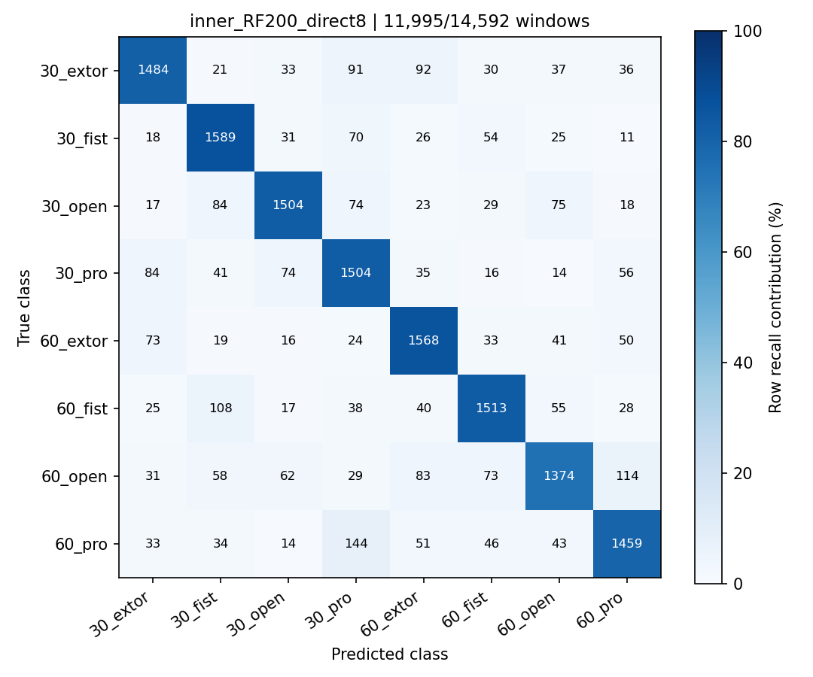

RF200, 직접 8목표. [행렬 CSV](results/submission_review/confusion_inner_RF200_direct8.csv).


RF200, 64목표 → 8클래스. [행렬 CSV](results/submission_review/confusion_inner_RF200_latent64.csv).


SVC C100, 보정 없는 한 모델. [행렬 CSV](results/submission_review/confusion_inner_SVC100_raw.csv).


XGB400 / 깊이 6. [행렬 CSV](results/submission_review/confusion_inner_XGB400_depth6.csv).

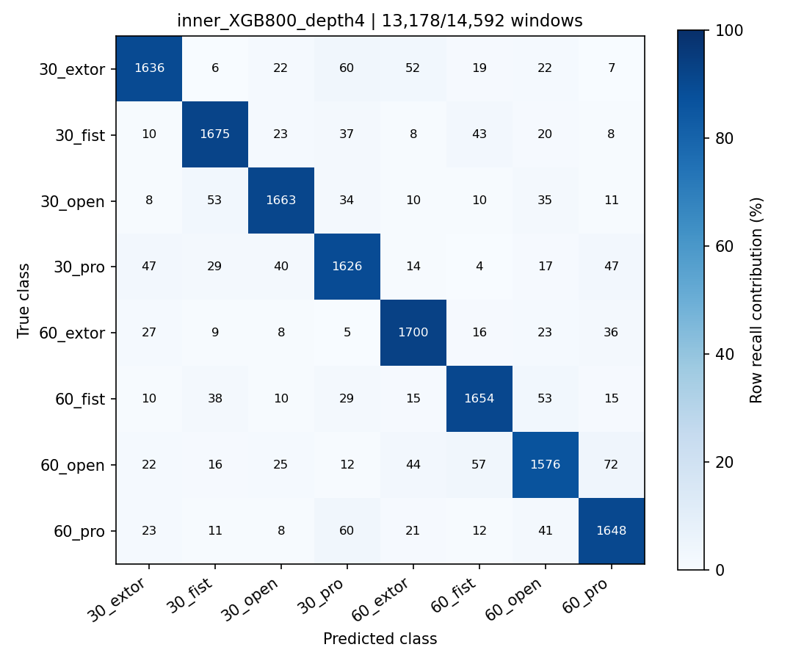

XGB800 / 깊이 4. [행렬 CSV](results/submission_review/confusion_inner_XGB800_depth4.csv).

RF 두 설정은 `60_pro → 30_pro`, SVC는 `60_fist → 30_fist`의 각도 혼동이 가장 컸다. XGB 두 설정은 `60_open → 60_pro`의 동작 혼동이 가장 컸다. 모든 최신 후보에서 `60_open`의 Recall이 가장 낮았다. <strong>가설:</strong> 410특징을 사용해도 해당 조건의 분포가 다른 동작과 겹치며, 모델의 경계와 학습 목표가 다른 부분을 분리할 수 있다. RF의 64목표 변환에서 개선이 있었지만 64목표가 64기록과 일대일이므로 이 변화를 동작 일반화의 증거로 해석하지 않는다. XGB가 RF/SVC보다 높은 이유를 부스팅만의 효과로 확정하려면 목표·용량도 통제한 대조가 필요하다.

### 최종 v33: 바깥 개발 전체 29,184창

|모델|최고 Recall 클래스|최저 Recall 클래스|주요 방향별 오분류 (정답 → 예측)|
|---|---|---|---|
|단일 XGB 선택 절차 v33|`30_fist` 92.65%|`60_open` 88.49%|`60_open → 60_pro` 133창; `60_pro → 60_open` 115창; `30_open → 30_pro` 101창|

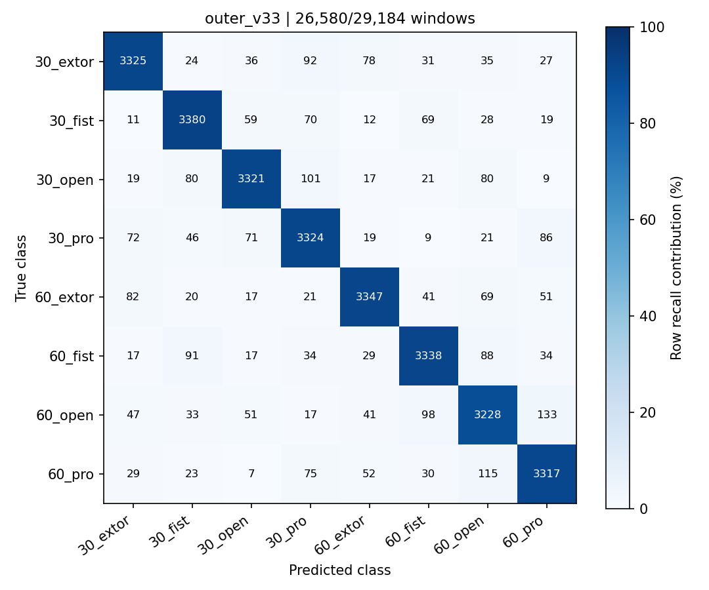

개발 1,536시행 × 19창, 클래스당 3,648창이며 대각선 합은 <strong>26,580</strong>이다. `60_open ↔ 60_pro`의 두 방향 오류가 133+115=248창으로 남았다. 이는 같은 각도에서 동작을 틀린 경우다. 내부 후보에서도 `60_open`이 취약했지만, 이 바깥 오류를 보고 새 설정을 선택하지 않았다. <strong>가능한 원인 가설</strong>은 두 동작의 짧은 근활성·주파수 패턴이 겹치는 것이다. 현재 자료로는 신호 특성, 고정 구간 정렬, 기록 특성 중 어떤 원인이 지배적인지 분리하지 못했다. [행렬 CSV](results/submission_review/confusion_outer_v33.csv).

<a id="submission-final"></a>

## 4. 최종 결과

<strong>현재 최종 결과는 200ms 한 창만 사용하는 단일 XGB 선택 절차 v33의 91.0773%다.</strong> 개발 29,184창 중 26,580창을 맞혔다. 기록과 피험자를 공유하는 시행 분리 결과이며, 원래 시험 자료도 이전 전체 CV에 노출된 이력이 있어 독립 외부 시험으로 표현하지 않는다.

|비교 범위|가장 높은 결과|가장 낮은 결과|해석|
|---|---|---|---|
|강의 25특징·전체 5-fold 창 정확도|RF 64.54±0.35%|SVM 48.56±0.45%|동일 강의 기준 조건|
|410특징·같은 내부 3분할 단일 후보 평균|XGB800 90.3098%|RF200 직접 8목표 82.2026%|위 후보 표의 범위 안에서만 비교|
|바깥 개발 단일 XGB 대조|v33 선택 절차 91.0773%|고정 XGB800 90.9608%|같은 29,184창에서 +34창; 비용도 증가|

v34의 현재창 시간별 대역 표현은 91.0739%로 기존보다 1창 적어 개선을 확인하지 못했다. 최종 v33은 `60_open`이 가장 취약했고, `60_open → 60_pro` 133창과 반대 방향 115창의 오류가 남았다. 기록 분리 대조에서는 높은 기록 공유 점수를 재현하지 못했다. 64학습목표와 64기록의 일대일 관계, 반복 개발 선택, 원필터·마커 정렬의 불확실성이 남아 있다. 논문 RF 96.72±0.58%와 입력·분할·표본 집계 조건을 맞췄다는 근거가 없어 논문 정확재현이나 논문급 일반화 달성을 선언하지 않는다.

이전 <strong>91.9819%는 서로 다른 모델의 출력 결합</strong>, <strong>96.6488%는 과거 창을 포함한 최대 600ms 조건</strong>이다. 두 값은 아래 이력에 보존하며 현재 단일 모델 주결과와 분리한다. 주어진 데이터 전체를 조사하고, 후속 실험은 고정된 개발 1,536시행·64기록·19창을 유지했다. 성공과 실패, 비용·복원 검증·설정 변경을 모두 기록했다.

사용자가 실제로 제시한 판단은 이두근과 삼두근의 반응 차이를 확인하자는 가설, 같은 입력 조건 유지, 단일 모델 사용, 크기·학습·추론 시간 고려다. 이에 대한 분석과 근거는 아래에 남겼다. <strong>개인적인 감정이나 학습 소감은 확인받지 않았으므로 작성하지 않았다. 본인 소감이 필요하면 사용자 확인이 필요하다.</strong>

### 사용자가 제시한 가설과 관찰

사용자는 <strong>팔을 굽힐 때 이두근 반응이 커져도 삼두근은 다르게 반응할 수 있다</strong>는 가설을 제시했다. 강의는 4채널을 이두근, 5채널을 삼두근으로 설명하므로 두 채널의 각도별 변화를 따로 비교했다. 같은 피험자·동작에서 30회 시행 RMS의 중앙값을 구한 뒤 60°/30° 비율을 계산했다. 입력의 전압 단위가 불명확하므로 절대 전압으로 해석하지 않았다.

|동작 코드|이두근 RMS 비율 중앙값|60°에서 증가한 피험자|삼두근 RMS 비율 중앙값|60°에서 증가한 피험자|
|---|---:|---:|---:|---:|
|extor|1.716|7/8|1.105|6/8|
|fist|1.057|5/8|0.977|4/8|
|open|1.341|6/8|1.040|5/8|
|pro|1.091|4/8|1.084|6/8|


그림 1. 각 동작·채널에서 구한 8명 RMS 비율의 중앙값. 셀의 숫자는 60°/30° 비율이고 색은 그 중앙값의 log2값이다. 개인별 점·최솟값·최댓값을 표시하지 않는다. extor와 open에서 이두근의 중앙 비율이 삼두근보다 컸고, fist에서 삼두근의 중앙 비율은 1보다 작았다. 정적 각도 조건과 전극·기록 차이를 포함하므로 팔꿈치 굴곡의 인과 효과를 입증한 결과는 아니다. [전체 5채널 집계표](results/channel_angle_summary.csv)를 함께 제공한다.

### 검증 범위

- v28 시점의 코어·확장·분할·선택·투영·확률 결합·RMS·AR·동작/각도 분리·가우스 경계·시행 보정·호출 생략·과거 창 평균·XGB 후보·결합 비중·PCA·온도 변환·숲 결합 검사 66개를 통과했다. 그중 최초 기준의 합성 신호·수동 계산 단위검증은12개다. 이름, 채널 순서, 마커, 누락, 시간 간격, 창 경계, ZC 임계값, SSC, scaler, 집계와 지표를 검사했다.
- 200ms·300ms 실제 30창의 750특징을 별도 Python 스칼라 합으로 계산했다. 최대 절대차이는 3.55×10⁻¹⁵였다.
- 기준 18회·개발 40회·선택 모델 시험 1회, 총 59회 실행의 예측으로 혼동행렬과 지표를 재계산했다. 시행 ID·다수결·모델 규모·학습 부분의 scaler 평균과 분산도 일치했다. [검증 결과](results/verification.json)를 제공한다.
- 분석 구간 사이 최소 간격은 2999표본이며, 36480특징 벡터의 완전 중복은 0개다. 같은 시행의 겹친 창이 학습·평가를 가로지르지 않는다.
- 원본 전체를 별도 출력 위치에서 다시 처리했을 때 입력 해시, 특징 해시와 시행 ID 분할이 모두 일치했다.

v34까지의 최종 검사는 83개였다. 이번 문서 보완에서는 저장 예측 21파일·내부 지표 15행을 수동 행렬과 scikit-learn으로 대조했으며, v33의 전체 1,536시행 1회 평가와 26,580정답을 다시 확인했다. 새 학습이나 새 시험 추론은 수행하지 않았다. [검산 기록](results/submission_review/prediction_verification.json).

<a id="experiment-history"></a>

## 실험 경과와 상세 근거

이하의 결합·시간 확장 결과는 해당 실험 당시의 조건을 보존한 이력이다. 현재 제출 주결과는 위 v33 단일 모델 평가다.

## 이전 결합 실험의 기록

아래91.9819%와 과거 창 결과는 이전 요청에서 수행한 별도 조건이다. 현재 단독 분류기의 목표·결과로 사용하지 않는다. 기존 코드와 실패 결과는 재현을 위해 보존하며 새 출력 결합은 하지 않는다.

과거 v25는 XGB·LDA·SVM을 결합해 같은 200ms 입력에서91.9819±0.4986%였다. v21/v22의91.3857%보다 전29,184창에서174개를 더 맞혔다. 대표 결합 크기는138.51MB였고 전체 확률 경로 중앙값43.42ms, 라벨 호출 생략 경로 중앙값6.60ms였다. 두 지연값의 측정 표본 범위는 다르다. 이 수치를 단독 모델의 성능·비용으로 인용하지 않는다.

후속 v29·v30의 제한된 SVM 설정 비교와 v31 상관 보정은 최고 결합을 개선하지 못했다. v31은 내부 정답 −19/−13/−6개로 모두 탈락했고3개 확률모델·12개 base SVM 복원 검증을 마쳤다. 현재는 해당 결합 탐색을 종료하고 위 단독 모델 조건을 따른다.

별도 v23은 당시 v21의 현재·과거 최대 5창 확률을 평균해 **96.6488±0.3316%**였다. 입력 범위가 최대 600 ms로 늘어난 결과이므로 현재 단일 200 ms 결과를 대체하지 않는다. 알려진 시행 경계마다 초기화했고 첫 창을 포함한 19창을 모두 평가했다. 실제 무구간 연속 동작이나 새 기록 일반화 성능은 아니다.

작은 단일 모델의 비용 기준은 내부 선택으로 정한 **410특징 XGB400(narrow64)**다. 바깥 개발 정확도는 90.0151±0.4240%, 대표 모델은 36.75 MB, 학습 123.41초였다. 최신 XGB800만 따로 계산하면 90.9608±0.3258%, 55.42 MB, 학습 172.31초, CPU 특징+추론 중앙값 7.07 ms(p95 7.92 ms)다. 다만 XGB800은 세 모델 결합 점수로 선택했으므로 이 단독 점수는 보조 집계이며 별도 단일 모델 최적화의 결과가 아니다. 아래의 64목표·기록 의존성 때문에 어느 점수도 새 기록의 배포 성능으로 보증하지 않는다.

추가 AR 대조에서는 직접8클래스의 기록 공유 정확도를62.08→72.42%로 높였지만 기록 분리는8.86→8.66%였다. 기존90% 후보에 AR을 내부 선택으로 더한 바깥 점수는90.1350%로35창 높아졌고, 전체 내부 합계에서는 기존410특징이 더 높았다. 아래에 새23fit의 실패·수식·비용까지 기록했다. 이어 동작·각도를 독립 분류한 고정 대조는 같은60특징의 기록 분리 정확도를8.66→14.67%로 높였지만, 기록 공유는72.42→66.98%로 낮아졌다. 조건부 분류도 공유72.11%·분리9.53%에 그쳤다. 새48fit의 결과로 기존90% 후보를 교체하지 않았다.

**앞의 과거 결합 결과와 현재 단일 모델 결과 모두 새로운 기록의 동작 인식 성능으로 해석할 수는 없다.** 별도 고정 직접8클래스 대조에서 기본25특징은 기록 공유62.08%·기록 분리8.86%, 확장905특징은87.15%·6.76%였다. 클래스 누락·확률 열·분할·scaler·저장 모델 복원 오류는 이 대조에서 발견되지 않았다. 현재 개선은 같은 기록의 다른 시행을 분류하는 조건에서 확인됐으며, 새 기록에서 신뢰할 만한 동작 일반화는 확보하지 못했다. 원래 기준과 초기300ms의 시험68.20%, 각 실험의 실패·변경·비용을 아래에 보존했다. [인계 후 검증·판단 보고](docs/CONTINUATION_REPORT.md)에 확인된 사실과 미확인 범위를 구분했다.

강의가 인용한 논문은 RF 96.72±0.58%를 보고한다. 그러나 논문의 최종 표본 구성과 원필터, 분할 ID는 확보하지 못했다. 이 저장소는 **강의 설정을 제공 데이터에 적용한 재현**을 다루며, 논문 정확재현을 완료했다고 주장하지 않는다. [재현 명세](docs/PROTOCOL.md), [기준실험 보고](docs/BASELINE_REPORT.md), [강의 자료와 출처 범위](docs/LECTURE_REVIEW.md)에 조건과 출처를 기록했다.

창은 100ms씩 겹친다. 아래의 단독 창 또는 독립 창 점수는 이전 창의 예측을 쓰지 않고 현재 200ms 신호만 분류한 결과를 뜻한다. 겹친 창들이 통계적으로 서로 독립이라는 뜻은 아니다.

직접 계산한 평균±SD의 SD는 fold 정확도의 표준편차(ddof=0)이며 신뢰구간이 아니다. 현재 자료에는 완전히 미관측인 독립 시험이 남아 있지 않다. [시간 참조 범위](docs/TEMPORAL_SCOPE.md)에 사전 필터의 미확인 부분을, [평가 절차와 사용 이력](docs/EVALUATION_SCOPE.md)에 내부 선택·바깥 평가 및 남아 있는 편향을 정리했다.

## 개선 과정

기준 18회 학습과 독립 지표 검증을 마친 뒤, 미리 정한 8개 설정을 같은 개발 5-fold에서 평가했다. 개발 학습·검증은 hold-out의 학습 1,536시행 안에서만 이루어진다. 변경하지 않은 설정은 해당 기준모델과 같다. 아래 차이는 같은 개발 분할의 해당 모델 기준 대비이며 단위는 %p다.

|설정|바꾼 조건과 이유|개발 창 정확도 평균±SD|기준 대비|판단|
|---|---|---:|---:|---|
|SVM 기준|C=1, 25특징, 200ms|47.84±0.73%|—|비교 기준|
|RF 기준|100트리, 25특징, 200ms|63.87±0.90%|—|기준모델 중 최고|
|XGB 기준|400회, 깊이 6, 25특징, 200ms|62.22±0.38%|—|XGB 변경의 비교 기준|
|SVM C=10|오분류 벌점을 높여 규제 강도 영향 확인|56.13±0.53%|+8.30|상승했지만 RF보다 낮음|
|XGB 깊이 4|얕은 트리의 일반화 효과 확인; 400회 유지|55.23±0.22%|−6.99|이번 조건에서는 성능 하락|
|XGB + MNF/MDF|주파수 분포를 10특징으로 추가, 총 35개|64.14±0.59%|+1.92|XGB보다 상승; RF와 차이는 0.26%p|
|XGB 300ms 창|더 긴 구간의 특징 추정 효과 확인; 이동 100ms 유지|67.39±0.42%|+5.17|사전 선택 규칙에서 최고|
|XGB 전완만|상완 2채널을 제외해 채널 기여 진단, 15특징|44.08±0.59%|−18.14|선택 제외 진단; 상완 정보 제거 시 하락|


그림 4. 개발 5-fold 창 정확도와 SD. 300ms 설정은 시행당 18창이고 나머지는 19창이다. 전체 1,920시행으로 수행한 기준 CV와 학습 규모가 다르므로 앞의 기준 CV 평균과 직접 빼지 않는다. [개발 fold별 결과](results/development.csv)와 [선택 기록](results/selection.json)을 제공한다. SVM의 규제 완화나 긴 창이 도움이 될 가능성은 보였지만, 깊이를 줄이는 것이 항상 유리하지는 않았다. 전완만 사용한 결과는 상완 채널의 예측 기여를 시사하며 이두근과 삼두근 각각의 생리적 원인을 분리한 검증은 아니다.

개발 평균 정확도로 선택한 **XGB 300ms**만 고정 hold-out에 추가 평가했다. 학습은 1,536시행·27,648창, 시험은 384시행·6,912창이며 특징은 25개, XGB는 400회·깊이 6 그대로다.

|선택 모델의 고정 시험|창 정확도|Macro precision|Macro recall|Macro F1|
|---|---:|---:|---:|---:|
|XGB 300ms|68.20%|0.6835|0.6820|0.6824|

300ms 창에서는 마지막 시작 위치가 3.2초여서 기준의 3.3초 창이 없어지고 창끼리 겹치는 비율도 커진다. 고정 시험 68.20%는 **4714/6912창**을 맞힌 값이다. **동일한 첫 18개 시작 위치**로 기존 예측을 다시 집계하면 200ms XGB는 63.05%, RF는 64.27%, 300ms XGB는 68.20%다. 이는 평가 시작 위치만 맞춘 사후 집계다. 200ms 모델은 시행당 19창, 300ms 모델은 18창으로 학습했으므로 학습 표본까지 통제한 비교가 아니다. 창 길이에 따라 입력 정보와 평가 표본의 의미도 달라지며, 이 집계에서는 추가 학습이나 선택 변경이 없었다. [동일 시작 위치 집계](results/matched_start_diagnostic.csv)에 개발 fold와 시험 값을 모두 남겼다.

선택 모델의 학습 시간은 5.73초, 단일 창 호출은 30.54ms, 로컬 직렬화 크기는 11.31MB였다. 이 결과를 1차 개선 기록으로 보존한다. 이어지는 개선에서는 원필터·마커·동작 코드의 미확인 부분을 명시하면서, 개발 자료의 오류와 특징을 진단해 검증할 수 있는 원인부터 실험한다.

### 개발 자료의 병목 진단과 2차 개선

기존 개발 1,536시행의 OOF 예측 29,184창을 분석했다. 고정 시험 384시행은 이 진단과 새 선택에서 제외했다. 원본에서 계산한 시간별 RMS와 기본 특징의 RMS는 일치했고, 파일명에서 읽은 각도·동작과 시행별 레이블도 일치했다. 전압 단위와 마커의 생리적 의미는 여전히 확인되지 않았다.

|관찰|해석과 확인할 실험|
|---|---|
|ZC=0 비율: 삼두근 60.31%, 이두근 48.50%. 전체 창의 13.28%는 5채널 모두 0.|0.01 임계값이 저진폭 파형의 부호 정보를 제거할 가능성. 원래 25특징을 보존한 대조군과 ZC만 바꾼 조건 비교.|
|XGB 위치별 정확도: 1.7초 72.85%, 2.4초 53.84%, 3.3초 65.23%.|어려운 창이 단순히 뒤쪽 휴식에 몰리지 않음. 200ms 안의 시간 변화·대역 분포·채널 관계를 추가해 전이에서 손실된 정보를 확인.|
|전완 RMS의 조용한 구간 대비 비율이 1–3인 창은 약 55%, 10 이상은 77.26%, 1 미만은 64.18%.|저진폭 자체만으로 난도를 설명할 수 없음. 어려운 창도 전부 평가에 유지. 조용한 기준 구간은 mark+0.2–1.0초이며 실제 휴식이라는 판정은 아님.|
|StandardScaler는 학습 전체의 특징별 선형 변환이며 창별 진폭 정규화가 아님.|절대 진폭을 지웠다는 가설은 해당하지 않음. SVM에서는 비선형 분포 변환만 바꿔 거리 배치의 영향 확인.|


200ms·100ms 이동·19창·5채널·고정 2초를 유지한 후보 10개를 [결과 전 계획](experiments/diagnostic_v2/PLAN.md)에 고정했다. 개발 자료 안에 outer 3-fold와 inner 3-fold를 만들고, 각 outer의 학습 자료 안에서 후보를 선택한 뒤 분리된 outer 평가 시행에서 기준 XGB와 비교한다. 이 자료는 과거 실험과 진단에 이미 사용됐으므로 중첩 평가도 완전히 독립적인 일반화 증거는 아니다. 이번 선택 과정의 학습·검증 재사용을 줄이는 장치다. 현재 실행 결과와 다음 판단은 [2차 개선 기록](experiments/diagnostic_v2/LOG.md)에 이어서 남긴다.


그림. 각 후보의 내부 평가 9회 평균과 SD(ddof=0). 원래 특징의 XGB는 58.44%, ZC 교체는 58.32%, 시간 특징 추가는 58.36%였다. 채널 관계 추가는 65.57%, 대역 특징 추가는 73.70%, 결합 특징 400회는 77.17%, 800회는 79.02%였다. 이 비교의 학습 규모는 fold당 682 또는 683시행이며, 최초 전체 5-fold와 다르다. 원래 ZC를 무임계값으로 교체하는 것만으로는 개선되지 않았고, 정보 복구의 주된 이득은 채널 관계와 주파수 분포에서 나왔다. 결합 뒤의 800회 추가 이득은 약 1.85%p였다. [후보별 집계](results/diagnostic_v2/inner_summary.csv)를 제공한다.

세 outer 모두 내부 정확도로 결합 특징 XGB 800회를 선택했다. 각 outer에서는 1,024시행을 학습하고 별도 512시행의 9,728창을 평가했다. 세 평가를 합치면 개발 1,536시행의 29,184창을 중복 없이 한 번씩 평가한다.

|중첩 평가 조건|입력 범위|정답 창 / 전체 창|창 정확도|Macro F1|
|---|---|---:|---:|---:|
|강의 XGB 대조군, 25특징·400회|현재 200ms|17,981 / 29,184|61.61±0.48%|0.6161|
|결합 특징 XGB, 240특징·800회|현재 200ms|24,062 / 29,184|82.45±0.44%|0.8245|
|같은 개선 모델 + 고정 과거 5창 집계|현재와 과거, 최대 600ms|26,409 / 29,184|90.49%|별도 문맥 조건|

단독 창의 각도 정확도는 90.98%, 동작 정확도는 87.19%였다. 세 outer의 창 정확도는 81.88%, 82.95%, 82.52%로 모두 대조군보다 높았다. 주점수는 두 번째 행의 200ms 단독 창 결과다. [바깥 평가 원수치](results/diagnostic_v2/outer.csv)와 [전체 집계](results/diagnostic_v2/outer_pooled.csv)를 제공한다.

과거 문맥 조건은 현재 창과 직전 네 창의 최빈 예측을 쓰고, 알려진 시행 경계에서 초기화한다. 동률이면 현재 예측을 우선하고 그렇지 않으면 최소 클래스 ID를 택한다. 첫 네 창을 포함한 모든 평가 창을 유지하며 미래 창과 정답은 사용하지 않는다. 2,837창을 정정하고 490창을 악화시켰다. 미래 대기는 없지만 실제 동작 전환에 대한 반응 지연이 생길 수 있다. 시행 안의 레이블이 일정한 이 자료로 연속 전환 지연을 검증하지는 못했다. [고정 문맥 계획](experiments/diagnostic_v2/CAUSAL_CONTEXT_PLAN.md)과 [fold별 결과](results/diagnostic_v2/causal_context.csv)를 함께 읽어야 한다.

96회 실행의 저장 예측과 지표를 정수 혼동행렬에서 다시 계산했고, 모든 scaler를 해당 학습 창에서 재계산해 일치함을 확인했다. 학습·평가 시행 교집합과 기존 시험 384시행의 교집합은 모두 0이다. [검증 결과](results/diagnostic_v2/verification.json)를 제공한다. 이 성과를 독립 외부 시험이나 논문 정확재현이라고 표현하지 않는다. 다음에는 [창 길이·ZC·60Hz 성분의 원인 분리](experiments/mechanisms_v3/PLAN.md)와 [복구한 특징의 모델 용량·SVM 대조](experiments/capacity_v4/PLAN.md)를 이어간다.

### 원인 분리: ZC, 창 길이, 60Hz 성분

기존 개발 5-fold를 사용해 여섯 조건을 사전 고정하고 30회 학습했다. 모두 XGB 400회이며, scaler는 해당 학습 창으로만 계산했다. 이 단계는 앞의 중첩 평가와 학습 규모가 다른 원인 분석이다. 반복 개발에 사용한 분할이므로 새 독립 성능으로 표현하지 않는다.

|검증한 변화|변경 전 → 후의 창 정확도|차이|상승한 fold|
|---|---:|---:|---:|
|기존 25특징에 무임계 ZC 5개만 추가, 200ms·19창|62.22 → 62.61%|+0.39%p|4/5|
|학습·평가 모두 18시작 위치로 맞춘 200 → 300ms, 25특징|62.33 → 67.39%|+5.05%p|5/5|
|200ms·18창에 대역 특징 추가, 25 → 120특징|62.33 → 77.53%|+15.20%p|5/5|
|300ms·18창에 같은 대역 특징 추가, 25 → 120특징|67.39 → 82.21%|+14.83%p|5/5|
|대역 특징을 쓴 동일 18위치의 200 → 300ms|77.53 → 82.21%|+4.68%p|5/5|
|200ms·19창의 대역 특징 입력에서 60Hz 투영 성분 제거|77.92 → 76.46%|−1.46%p|0/5|

학습 위치까지 맞춘 후에도 300ms의 이득이 남았다. 따라서 초기 사후 집계의 학습 표본 수 차이만으로 설명되는 상승은 아니었다. 다만 창 길이가 늘면 정보량과 겹침 비율도 함께 늘어나며, 18창 조건은 원래 19창 주평가와 구분한다. 대역 특징의 이득은 두 창 길이 모두에서 나타났다. 원래 ZC를 보존한 추가는 작은 이득이 있었지만 주요 격차를 설명하지 못했다.

60Hz 대조는 각 200ms 안에서 사인·코사인 성분만 추정해 빼고 특징을 다시 계산했다. 창 밖이나 미래 신호를 사용하지 않았다. 모든 fold에서 약간 떨어졌지만 주파수 특징의 큰 상승이 사라지지는 않았다. 이 결과만으로 남은 성분을 모두 생리 신호라 하거나 60Hz 성분을 모두 잡음이라 판정하지 않는다. 기준 전처리도 변경하지 않았다. [짝지은 원수치](results/mechanisms_v3/paired_comparisons.csv)와 [30회 지표·6개 모델 복원 검증](results/mechanisms_v3/verification.json)을 제공한다.


### 학습 목표를 세분화한 비교

개발 특징의 중심을 비교하면 같은 클래스의 사람 간 거리가 한 사람 내 클래스 간 거리보다 컸다. 사람·기록 조건에 따라 같은 클래스의 신호 분포가 여러 갈래로 나뉠 가능성을 검토했다. 학습에서만 사람×8클래스를 64목표로 구분하고, 예측 때 얻은 64확률을 원래 8클래스별로 합산했다. **평가 사람 코드나 기록 ID는 예측 입력에 넣지 않았다.** [사전 계획](experiments/latent_subclass_v5/PLAN.md)에 두 모델과 새 개발 3-fold를 고정했다.

|같은 240특징·200ms·19창 조건|정답 창 / 전체 창|창 정확도 평균±SD|Macro F1|총 트리 수|
|---|---:|---:|---:|---:|
|직접 8클래스 목표, XGB 400회|23,473 / 29,184|80.43±0.30%|0.8043|3,200|
|학습 목표 64개, 출력 8클래스, XGB 400회|24,914 / 29,184|85.37±0.39%|0.8537|25,600|

세 fold에서 +5.02, +5.21, +4.58%p 상승했다. 각도 정확도는 92.57%, 동작 정확도는 88.86%였다. [전체 집계](results/latent_subclass_v5/pooled.csv)와 [6회 지표·모델 복원 검증](results/latent_subclass_v5/verification.json)을 제공한다. 이 비교는 앞의 중첩 평가와 분할·선택 과정이 다르므로 82.45→85.37%를 그대로 짝지은 개선 폭으로 쓰지 않는다. 직접 대조군과의 차이는 80.43→85.37%다.


그림. 모든 19창을 유지한 세 개발 fold의 결과와 창 시작 위치별 집계. 동일한 240개 신호 특징을 쓰지만 목표 세분화로 전체 트리 수도 늘었다. 이 효과를 분리하기 위해 [같은 트리 수와 대역별 채널 관계 대조](experiments/cross_spectrum_v6/PLAN.md)를 이어간다. 과거 5창 문맥을 더한 값은 93.29%이며, 최대 600ms 이력과 시행 경계를 쓰는 별도 결과다. 단독 200ms 주점수는 85.37%다. 자료는 반복 개발에 사용됐고 같은 사람·기록의 다른 시행을 평가하므로 외부 일반화 결과로 해석하지 않는다.


### 용량 증가와 시간 특징 제외

별도 중첩 평가에서 후보 다섯 개를 내부 45회와 바깥 6회로 비교했다. 세 바깥 분할 모두 1,600회 XGB가 선택됐고, 같은 29,184개 창에서 800회 **82.02%**(23,936개 정답)에서 1,600회 **82.96%**(24,211개 정답)로 0.94%p 올랐다. 모델 크기는 대표 fold에서 21.65→35.88MB였다. 학습 정확도는 모든 후보가 100%였으며, 검증 이득은 학습 정확도만으로 설명되지 않았다. [51회 검증](results/capacity_v4/verification.json)과 [바깥 집계](results/capacity_v4/outer_pooled.csv)를 제공한다.

내부 평균은 240개 특징·800회 79.79%,155개 특징·800회 79.73%,240개 특징·1,600회 80.45%였다. 추가 시간 특징 85개를 제외해도 거의 같았으므로 155개 특징은 비용 대안으로 비교한다. SVM C100은 표준화 72.83%, 분위수 변환 73.56%로 이번 설정에서 낮았다. 새 특징을 넣었을 때도 SVM이 자동으로 높은 성능을 내지는 않았다. [실험 기록](experiments/capacity_v4/LOG.md)에 해석과 후속 판단을 남겼다.

### 같은 트리 수와 대역별 채널 관계

240개 특징은 각 채널의 대역 파워와 전체 채널 상관을 포함하지만, 특정 대역에서 두 채널의 위상이 어떻게 맞물리는지는 나타내지 않았다. 각 200ms 창의 복소 교차 스펙트럼을 8대역·10개 채널 쌍으로 정규화해 실수·허수 160개 특징을 추가했다. 합성파와 독립적인 CSD 계산으로 검증했으며 생리적 coherence 추정과 같은 의미로 부르지 않는다. [사전 계획과 수식](experiments/cross_spectrum_v6/PLAN.md)을 제공한다.

|동일 25,600개 트리·동일 200ms·19개 창의 고정 3-fold|정답 창 / 전체 창|창 정확도 평균±SD|Macro F1|
|---|---:|---:|---:|
|직접 8클래스,240개 특징,3,200회|24,462 / 29,184|83.82±0.87%|0.8381|
|학습 목표 64개,240개 특징,400회|24,977 / 29,184|85.58±0.52%|0.8559|
|학습 목표 64개,400개 특징,400회|25,796 / 29,184|88.39±0.24%|0.8839|

같은 총 트리 수에서도 목표 세분화의 이득이 남았고, 대역별 관계 추가는 세 fold 모두 올랐다. 최종 행의 각도 정확도 94.34%, 동작 정확도 91.14%보다 두 조건을 동시에 맞히는 8클래스 점수가 낮다. **주점수는 독립 200ms 창의 88.39%**다. 과거 5개 창을 더한 94.84%는 최대 600ms 문맥과 알려진 시행 경계를 쓰는 별도 결과다. [전체 집계](results/cross_spectrum_v6/pooled.csv)와 [9회 지표·9개 모델 복원](results/cross_spectrum_v6/verification.json)을 확인할 수 있다.


그림. 왼쪽은 모든 19개 창을 유지한 위치별 평균, 오른쪽은 같은 분할에서의 평균 저장 크기와 정확도다. 더 많은 입력 특징이 항상 더 큰 학습 모델을 만들지는 않았다. 첫 분할에서 세 모델은 각각 53.68/41.72/38.71MB였다. 트리 수는 같아도 노드 수가 달랐다. 추론 지연과 메모리는 [고정 비용 측정 계획](experiments/cost_benchmark/PLAN.md)에 따라 별도 측정하며, 학습이 경합한 시간으로 독점 GPU 속도를 주장하지 않는다.

첫 교차 모델은 학습 gain의 큰 부분을 250–350Hz 관계에 배분했지만, 이 대역의 평균 파워는 전체의 약 0.4–0.7%였다. 이 성분이 생리 신호인지 기록·전극·공통 성분인지 아직 분리되지 않았다. [용량과 해당 관계 제거의 후속 계획](experiments/cross_capacity_v7/PLAN.md)을 고정해 검증을 이어간다. 현재 결과는 같은 사람·기록의 다른 시행을 분류한 개발 결과이며, 새 사람·기록의 외부 일반화나 원논문 정확재현을 뜻하지 않는다.


## 용량 증가와 고주파 관계의 비용

새로 고정한 개발 3분할에서 교차 특징의 부스팅 횟수와 특정 대역 관계를 분리했다. 각 분할의 학습은 1,024시행, 평가는 512시행이다. 앞선 6차와 seed가 다르므로 88.39%와 아래 수치의 차이를 같은 시험에서의 개선으로 해석하지 않는다. 이번 비교의 모든 조건은 같은 분할과 200ms·19창을 사용했다.

| 조건 | 창 정답 수 / 29,184 | 정확도 | 평균 저장 크기 | 평균 관측 학습 시간 |
|---|---:|---:|---:|---:|
| 교차 관계, 400회 | 25,657 | 87.91% | 38.66 MB | 131.68초 |
| 교차 관계, 800회 | 25,817 | 88.46% | 60.11 MB | 209.61초 |
| 250–350 Hz 관계 20개 제거, 400회 | 24,772 | 84.88% | 41.06 MB | 128.92초 |

트리를 25,600→51,200개로 늘린 이득은 **0.55%p**였다. 평균 저장 크기는 약 56%, 관측 학습 시간은 약 59% 늘었다. 사전 기준인 +0.5%p를 넘겨 800회를 선택했지만 작은 성능 차이에 큰 비용이 든다. 위 시간은 당시 실행한 `model.fit`의 실측이며 하드웨어를 독점한 성능 보증은 아니다. [9회 전체 결과](results/cross_capacity_v7/scores.csv), [복원 검증](results/cross_capacity_v7/verification.json), [판단 기록](experiments/cross_capacity_v7/LOG.md)을 남겼다.


그림. 고주파 관계만 제외하면 모든 분할에서 점수가 낮아져 평균 3.03%p 하락했다. 원신호를 필터링한 결과가 아니며 기존 대역 파워 특징은 보존했다. 관계 특징에 대한 의존은 확인했지만 성분의 생리적 기원은 미확인이다. 최대 600ms의 과거 5창을 쓰는 94.76%는 단독 200ms 점수와 분리한다. 다음에는 [세부 주파수 파워 보존 계획](experiments/fine_spectrum_v8/PLAN.md)에 따라 같은 입력 길이에서 넓은 대역 내부의 정보를 검사한다.

## 세부 스펙트럼을 보존한 개선

대역 합계 안에 가려진 주파수 분포를 확인하기 위해 기존 400특징에 채널별 5Hz 간격 파워 505개를 추가했다. 같은 200ms 신호의 periodic Hann periodogram이며 zero padding이나 신호 길이 변경은 없다. 파워에는 log10을 적용하고 원신호 단위 제곱의 수치 바닥값 1e-12를 사용했다. [사전 계획](experiments/fine_spectrum_v8/PLAN.md)에 후보·분할·채택 기준을 결과 전에 고정했다.

| 같은 v7 개발 분할 | 정답 창 / 29,184 | 정확도 평균±SD | 평균 저장 크기 | 평균 관측 학습 시간 |
|---|---:|---:|---:|---:|
| 400특징, 400회 | 25,657 | 87.91±0.28% | 38.66 MB | 131.68초 |
| 400특징, 800회 | 25,817 | 88.46±0.34% | 60.11 MB | 209.61초 |
| 905특징, 400회 | 26,201 | **89.78±0.35%** | **36.17 MB** | 234.51초 |

세부 파워를 넣으면 같은 25,600트리 대조보다 세 분할 모두 높아져 평균 1.86%p 올랐다. macro F1은 0.89778, 각도 정확도는 95.54%, 동작 정확도는 91.95%였다. 최대 600ms의 과거 문맥을 쓰는 95.38%는 별도 보조 결과다. 특징은 늘었지만 저장 모델은 작아졌고, 학습 시간은 늘었다. 대표 첫 분할 모델의 크기는 36.34MB, CPU 전체 처리 중앙값/p95는 6.10/7.49ms였다. [3회 모델·scaler·예측 복원 검증](results/fine_spectrum_v8/verification.json)과 [실험 기록](experiments/fine_spectrum_v8/LOG.md)을 제공한다.


그림. 19개 위치를 모두 평가했다. 정확도 상승은 특정 위치를 제외한 결과가 아니다. 같은 모델 수로 주파수 분포를 자세히 표현한 이득이며, 이미 사용한 개발 분할의 비교다. 새로운 외부 시험이나 논문과 동등한 평가를 뜻하지 않는다.

개발 시행별로는 589개가 개선되고 297개가 낮아졌으며 650개는 같았다. 시행을 묶어 다시 뽑은 기술적 bootstrap의 평균 차이 구간은 +1.50~2.23%p였지만, 반복 개발로 선택된 모델에 조건부인 값으로 외부 일반화 신뢰구간은 아니다. 학습 gain의 29.5%가 추가 파워 특징에 배분됐고, 300Hz와 420Hz가 각각 전체의 17.8%, 3.0%를 차지했다. 두 성분은 60Hz의 배수이나 생리 신호·전원·기록 조건의 기원을 아직 구분하지 못했다. [집계 진단](results/fine_spectrum_v8/diagnosis.json)과 [학습 gain](results/fine_spectrum_v8/training_gain.csv)을 남기고 이 의존을 후속 대조에서 검사한다.

초기 기준 구간도 별도로 검사했다. 원본을 다시 읽고 해당 시행을 학습에서 제외한 저장 OOF 모델을 그대로 적용했을 때 mark+0.0–0.2초의 200ms 창은 **1,389/1,536개, 90.43%**를 맞혔다. 원래 마지막 창 mark+3.3–3.5초는 93.49%였다. 이는 입력 시점을 바꾼 진단으로 주평가 점수를 대체하지 않는다. 학습·평가 시행 교집합은 0이지만 기록 64개는 공유됐다. 초기 구간이 완전한 휴식이라고 확인한 것도 아니다. 현재 특징은 CSV의 해당 200표본만 쓰지만, 제공 CSV의 사전 필터가 비인과적이었는지는 검증하지 못했다. 300Hz·420Hz 로그 파워의 큰 기록 간 차이가 초기와 후기 모두 남았다. 같은 피험자·조건에 기록이 하나이므로 동작·자세·사람·기록 효과를 구분할 수 없으며, 높은 개발 점수를 근육 수축 인식이나 새 기록 일반화로만 해석하기 어렵다. [계획과 범위](experiments/reference_phase_probe/PLAN.md), [진단 결과](experiments/reference_phase_probe/LOG.md)를 함께 남겼다.

## 초기창의 기록 공유 진단

초기창에 남은 정보가 다른 기록에도 유지되는지, 같은 초기 200ms에서 학습·평가하는 작은 대조를 추가했다. 두 조건 모두 905특징·직접 8클래스 XGB400을 사용했다. 모든 개발 시행은 프로토콜별로 한 번씩 평가했고 원래 시험은 제외했다.

| 초기창 학습·평가 조건 | 정답 / 1,536시행 | 전체 합산 정확도 | 4-fold 평균±SD |
|---|---:|---:|---:|
| 시행 분리, 64기록 공유 | 1,249 | 81.3151% | 81.3151±2.7149% |
| 기록 분리, 48기록 학습·16기록 평가 | 40 | 2.6042% | 2.6029±1.2156% |

기록 분리에서는 클래스별로 기록 6개를 학습하고 2개를 평가했다. 클래스별 학습 139–148시행, 평가 44–53시행으로 모든 클래스가 존재했고, 8개 모델의 확률 열과 레이블 순서도 일치했다. 학습에는 8명이 모두 있어 새 사람을 제외한 검증은 아니다. [클래스 지원 수](results/record_reference_control/class_support.csv)와 [매핑 검사](results/record_reference_control/label_support_verification.json)를 확인할 수 있다. 학습 시행 수는 1,139–1,164개로 시행 분리의 1,152개와 조금 다르다. 기록 분리의 fold 크기가 달라 합산 정확도와 fold 평균을 구분했다. 이 초기창 대조에서 높은 점수는 기록을 바꾸면 유지되지 않았다. 사람×조건별 기록이 하나이므로 기록 효과와 사람·조건의 결합 효과는 분리하지 못한다.


그림. 점은 각 fold, 막대는 fold 평균, 오차막대는 fold 표준편차다. 신뢰구간이 아니다. 초기 90.43%와는 학습 구간·모델·표본 수가 달라 두 점수의 차이를 기록 분리 효과로 해석하지 않는다. 활동 구간의 19창 주평가도 이 대조로 대체하지 않는다. 초기창이 실제 휴식인지는 여전히 미확인이다. [사전 계획](experiments/record_reference_control/PLAN.md), [전체 결과와 해석](experiments/record_reference_control/LOG.md), [8개 모델 복원 및 분할 검증](results/record_reference_control/verification.json)을 남겼다.

인계 후 별도 코드로 8개 모델을 CPU에서 복원하고, 클래스 지원 수·확률 열·정수 혼동행렬·학습 scaler를 다시 확인했다. 기록 분리 **40/1,536=2.6042%**가 재현됐고 레이블/클래스 누락/확률 열 순서 오류는 발견되지 않았다. 초기창905특징의 재계산과 창 밖 표본 변형 검사도 통과했다. 제공 CSV의 사전 필터 인과성과 생리적 휴식 여부는 이 검사에 포함되지 않는다. [독립 검증 범위와 근거](docs/HANDOFF_VERIFICATION.md)를 남겼다.

## 활동 구간에서도 남는 기록 의존성

초기창의2.60%만으로 활동 구간을 판단하지 않기 위해, 고정1.5–3.5초의19창 전체에서 직접8클래스 XGB400을 시행 분리와 기록 분리로 각각4회 학습했다. 이어905특징의 결과를 본 뒤, 강의의 기본25특징만 복원한 동일 분할 대조8회를 추가했다. 후자는 사후 진단이며 새 독립 확증 실험으로 표시하지 않는다. 모델·창·분할·레이블은 같고 특징 표현만 다르다.

| 같은 직접8클래스 XGB400 | 기록 공유: 정답 / 29,184창 | 전체 정확도 | 기록 분리: 정답 / 29,184창 | 전체 정확도 |
|---|---:|---:|---:|---:|
| 강의 기본25특징 | 18,116 | 62.0751% | 2,585 | 8.8576% |
| 확장905특징 | 25,435 | 87.1539% | 1,973 | 6.7606% |


그림. 막대는 전체 정답 수를 합친 정확도, 점은4개 fold다. 모든200ms 창과5채널을 유지했다. 기록 분리의 fold 크기는 서로 달라 전체 정확도와 fold 평균을 구분한다. [동일 분할 집계](results/active_record_control/matched_feature_summary.csv)에 둘 다 기록했다.

기록 분리는 클래스마다6기록 학습·2기록 평가이며, 모든 학습·평가 부분에8클래스가 남는다. 클래스별 학습139–148시행·평가44–53시행, 전체 평가 지원 수는 클래스마다3,648창이다. 학습에는8명이 모두 포함돼 새 사람 전체를 제외한 검증은 아니다. 16개 모델을 CPU에서 복원한 예측, train-only scaler, 분할 재구성과 확률 열이 일치했다. 기존384시험은 제외했다. [905특징 검증](results/active_record_control/verification.json), [25특징 검증](results/active_record_baseline/verification.json), [사후 기준 대조 계획](experiments/active_record_control/BASELINE_PLAN.md)을 제공한다.

기록 간 전이 실패는 주파수 특징 확장에만 생긴 문제가 아니었다. 확장은 기록 공유에서24.91%p 높았지만 기록 분리에서는2.10%p 낮았다. 사람×조건별 기록이 하나이므로 기록 특성·개인별 조건 반응·획득 조건을 분리할 수 없다. 이 대조만으로 신호를 잡음으로 단정하거나 원래 강의 문제를 새 기록 분류 문제로 바꾸지 않는다. 또한 이 직접8개 목표·3,200트리의 진단 점수를64개 목표·25,600트리 모델의 정확한 기록 분리 성능으로 대체하지 않는다.

64개 학습 목표는 이 자료에서 사람×조건의64개 기록과 일대일로 대응한다. 예측에 사람·파일 ID를 입력하지는 않지만, 기록마다 안정적으로 남는 신호 특징을 이용할 가능성은 남는다. 현재의 높은 기록 공유 점수를 일반적인 근육 수축 인식이나 외부 일반화로 확대할 근거는 부족하다.

### 공통 진폭을 제거해도 기록 전이는 해결되지 않았다

같은 클래스의 기록별 RMS 중앙값이 약2.00–7.53배 다른 관측을 근거로 한 가지 고정 대조8회를 추가했다. 현재200ms×5채널에서 DC를 빼지 않고 `g=sqrt(mean(x*x))`로 계산해5채널 전체를 같은g로 나눴다. 양수이면 작은g도 그대로 사용하며 epsilon은 없다.0이면 영신호다. 실제 분모는0.00111666–0.556939로0인 창은 없었다. ZC0.01은 정규화된 무차원 파형의 임계값으로 의미가 달라지고 SSC는 무임계값을 유지한다. 계산·분할·seed·XGB 설정은 학습 전 `c41f96e`에 고정했다.

| 같은25특징·XGB400·19창 | 원파형 | 공통 RMS 정규화 | 차이 |
|---|---:|---:|---:|
| 기록 공유 | 62.0751% | 56.2911% | −5.7840%p |
| 기록 분리 | 8.8576% | 9.8650% | +1.0077%p |


그림. 막대는 전체29,184창의 합산 정확도,오차막대는4fold SD로 신뢰구간이 아니다.12.5% 선은 균등 무작위 기대값이다.19겹친 창을 독립 표본으로 가정한 검정은 하지 않았다. 이 특정 공통 배율 제거는 전이 실패를 해소하지 못했다. 채널별 상대 크기·주파수 차이는 남으므로 진폭 가설 전체를 기각하지 않는다. 모든8모델 복원·분할·scaler·클래스 열 검증을 통과했고 기존시험384시행은 사용하지 않았다. [고정 계획](experiments/gain_invariance_v14/PLAN.md), [결과·해석](experiments/gain_invariance_v14/LOG.md), [검증](results/gain_invariance_v14/verification.json)을 남겼다.


그림. 각 행은3,648창이고 칸은해당 정답 클래스의비율(%)이다. 모든8클래스가 출력됐으며 전체 예측에서 가장 큰 클래스 비중은 기본25의14.25%,905의16.01%,정규화25의14.69%다. 한 클래스만 출력하는 붕괴는 없었다. 기본25의 `30_fist→60_fist`는1,425창, `30_open→60_open`은1,175창이고 `30_extor→30_pro`도1,024창이다. 새로운 기록에서 여러 방향의 체계적 혼동이 남으며 단순 각도 반전만으로 설명되지 않는다.12.5%는 학습된 모델 정확도의 하한이 아니다. [클래스별 재현율·예측 수](results/gain_invariance_v14/record_class_errors.csv), [fold별 쏠림](results/gain_invariance_v14/record_fold_prediction_counts.csv)을 공개 집계로 남겼으며, 이 결과로 레이블을 재배열하지 않았다.

대표 CPU 비용도 별도로 측정했다. 기록 공유 fold0의 원파형→정규화는11.01→11.26MB,전체 중앙값0.571→0.602ms였고,기록 분리 fold0은10.92→11.33MB,0.540→0.751ms였다. 학습은 약5.4–5.6초였다. 같은256개 입력·6스레드·20회 예열·200회 측정이며 신호 취득200ms는 제외했다. [비용4조건](results/gain_invariance_v14/cost_summary.csv), [캐시·저장 예측·원시 시간 검증](results/gain_invariance_v14/report_verification.json)을 제공한다.

## 두 주파수와 학습 목표의 대조

v8의 상승이 넓은 스펙트럼 정보에 의존하는지, 특정 주파수에 집중되는지 분리했다. 같은 3개 fold·200ms·19창·총 25,600트리를 유지했다. 특징 열 제거는 원신호 필터링과 다른 변경이다.

| 같은 분할의 조건 | 정답 / 29,184창 | 평균±fold SD | 평균 저장 크기 | 평균 관측 학습 시간 |
|---|---:|---:|---:|---:|
| 전체 905특징, 64개 목표 | 26,201 | 89.7786±0.3530% | 36.17 MB | 234.51초 |
| 기존 400특징+300/420Hz의 10특징 | 26,257 | **89.9705±0.2374%** | 36.83 MB | 122.29초 |
| 905특징에서 두 주파수의 10열 제외 | 25,650 | 87.8906±0.3053% | 37.66 MB | 247.32초 |
| 전체 905특징, 직접 8클래스 | 25,632 | 87.8289±0.1532% | 46.19 MB | 290.38초 |

좁은 표현은 v8보다 56창, 평균 0.1919%p 높았다. fold별 차이는 +0.2981/−0.0103/+0.2878%p로 작고 세 fold 모두 개선된 것은 아니다. 학습 시간은 약 48% 줄었지만 저장 크기는 약 0.65MB 늘었으며, 이 후보의 별도 바깥 대표 모델 CPU 비용은 아래 최신 표에서 측정했다. 두 주파수 열을 빼면 세 fold 모두 점수가 낮아졌다. 인접 bin과 기존 대역·교차 정보는 남으므로 신호 기원은 이 대조만으로 확정할 수 없다. 직접 8클래스도 같은 트리 수에서 낮았지만 학습 목표와 boosting 단계의 차이를 함께 포함한다.


그림. 모든 평가 위치를 유지했다. 오른쪽은 같은 분할의 평균 저장 크기이며, 정확도와 크기만의 관측 비교다. [사전 계획](experiments/spectral_controls_v9/PLAN.md), [완료 기록](experiments/spectral_controls_v9/LOG.md), [9개 모델 복원 검증](results/spectral_controls_v9/verification.json), [같은 fold 차이](results/spectral_controls_v9/paired_differences.csv)를 제공한다. 최종 후보는 별도로 등록한 내부 선택 규칙으로 정하고 바깥 평가를 수행한다. 반복 사용한 개발 자료이므로 외부 독립 성능으로 해석하지 않는다.

## 후보 선택을 분리한 후속 평가

넓은 표현,300/420Hz만 명시적으로 추가한 좁은 표현,두 주파수 열 제외,직접8클래스의4후보를 미리 고정했다. 개발1,536시행을 바깥 학습1,024·평가512로3회 나누고, 각 학습 부분을 다시 내부 학습768·선택256으로 나눴다. 내부 정답 창 수로 후보를 고른 뒤 바깥 학습 전체에서 재학습했다. 바깥 점수는 이 선택에 쓰지 않았다. 총12회 내부 학습과6회 바깥 학습,18회가 모두 완료됐다.

세 fold 모두410특징의 좁은 표현을 선택했다. 내부 정답 합계는 전체 표현13,028창,좁은 표현13,083창,두 주파수의10열 제외12,740창,직접8클래스12,605창이었다. 고정 전체 표현을 같은 바깥 분할에서 다시 학습해 선택 절차와 비교했다.

| 같은 바깥3-fold | 정답 / 29,184창 | 평균±fold SD | 평균 저장 크기 | 평균 관측 학습 시간 |
|---|---:|---:|---:|---:|
| 고정 전체905특징 | 26,273 | 90.0254±0.4323% | 36.19 MB | 246.82초 |
| 내부 선택410특징 | 26,270 | 90.0151±0.4240% | 36.83 MB | 126.54초 |

선택 모델은3창 적게 맞혀 정확도 향상을 확인하지 못했다. 학습 시간은 약49% 짧았고 저장 크기는 약0.64MB 컸다. 앞의89.9705%와는 바깥 분할이 달라 그 차이를 개선량으로 계산하지 않는다. 각도·동작을 합친 현재 창8클래스 점수이며 과거창 투표나 시행 다수결을 쓰지 않았다.


그림. 왼쪽은 같은3개 바깥 fold,오른쪽은 모든19시작 위치의 합산 정확도다. 전체 표현과 선택 모델의 위치별 차이가 작다. [18개 모델 복원·분할·scaler 검증](results/nested_selection_v10/verification.json), [선택 기록](results/nested_selection_v10/selection.json), [정수 집계](results/nested_selection_v10/outer_pooled.csv)를 제공한다. 별도 산술로 내부 확률의8클래스 합산과 동점 규칙을 다시 확인했고 클래스별 평가 지원 수는 모두3,648창이었다.

중첩 구조는 이번4후보 선택 안의 분리다. 특징 설계와 이전 실험은 같은 개발 자료를 보았고 학습·평가에 같은 기록이 남는다. 따라서 이90%를 새 기록·새 사람·미관측 외부시험 성능이나 논문 정확재현으로 표현하지 않는다.

## 성분 의존과 추가 개선의 검증

### 두 성분 제거는 개선에 실패했다

특징 열을 지우는 것과 달리, 각200ms 신호에서300Hz·420Hz의 sin/cos 네 성분을 최소제곱 투영으로 제거한 뒤905특징을 다시 계산했다. 원본 캐시는 보존하고 전체1,920시행을 변환했다. 같은 개발3-fold와 XGB64·400회에서 **89.7786±0.3530% → 78.9405±0.2160%**로10.8381%p 하락했다. 평균 저장 크기는36.17→43.61MB, 관측 학습 시간은234.51→284.88초였다.


그림. 같은 fold끼리 연결했다. 입력 구간·창 수·모델 규모를 유지했으며 모든 fold에서 하락했다. 두 성분이 예측에 기여했지만 그 기원이 생리 신호·전원·기록 조건 중 무엇인지는 확정하지 못한다. 다른 주파수 정보는 남는다. [계획과 완료 기록](experiments/line_projection_v11/LOG.md), [3개 모델 검증](results/line_projection_v11/verification.json)을 남기고 이 제거 조건은 개선안으로 채택하지 않았다.

### 두 표현의 확률 결합은 작게 개선됐다

전체 표현과 좁은 표현의 오류가 일부 달라, 현재 창의8클래스 확률을 결합했다. 좁은 표현의 비중a를0/.25/.5/.75/1 중 내부 예측으로 고정했으며 세 fold 모두a=.75를 선택했다. 바깥 모델이 이미 있어 추가 fit은0회였다. 원본 모델·확률 해시를 보존하고18개 참조 파일과6개 모델의 복원 검증을 마쳤다.

| 동일한 바깥3-fold | 정답 / 29,184창 | 평균±fold SD | 평균 저장 크기 |
|---|---:|---:|---:|
| 전체 표현 하나 | 26,273 | 90.0254±0.4323% | 36.19MB |
| 좁은 표현 하나 | 26,270 | 90.0151±0.4240% | 36.83MB |
| 사전 고정50:50 대조 | 26,364 | 90.3372±0.3820% | 73.02MB |
| 내부 선택25:75 | 26,313 | **90.1624±0.4303%** | 73.02MB |

선택 결합은 전체 표현보다40창(+0.1370%p) 높았다. 결합만 맞힌385창과 기준만 맞힌345창이 있었고, 시행별로는256개가 개선·231개가 악화·1,049개가 같았다. log loss는.30594→.29674, Brier sum은.14907→.14507이었다. 고정50:50의 바깥 점수가 더 높았지만, 이 결과로 선택 가중치를 바꾸거나90.3372%를 내부 선택 결과라고 보고하지 않았다.


그림. 색 점은 평균, 선은fold SD, 회색 점은 각 fold다. 신뢰구간이 아니다. v10·v13의 선택 모델과 고정 narrow64는 동일한 모델·예측을 재사용하므로 독립 반복검증3개가 아니다. [가중치 선택](results/probability_blend_v12/selection.json), [원수치](results/probability_blend_v12/summary.csv), [검증](results/probability_blend_v12/verification.json)을 제공한다.


그림. 쉬운 위치만 골라 점수를 높이지 않았다. 과거·미래 창이나 시행 다수결을 추가하지 않은 현재 창 결합이다. 작은 개선을 외부 일반화의 확증으로 해석하지 않는다.

### RF·ExtraTrees 확장은 채택되지 않았다

학습 정확도100%와 평가 약90%의 차이가 남아, 같은905특징에서 무작위 숲의 평균 효과를 확인했다. 내부 학습768·선택256시행의 고정3분할에서 RF100과 ExtraTrees400을 각각3회 학습했다. 내부 정확도는 RF **74.75±0.56%**, ExtraTrees **83.94±0.76%**로 좁은 XGB **89.66±0.84%**보다 낮았다. 평균 크기는 각각69.12/369.62MB로 XGB의33.62MB보다 컸다.


그림. 내부 선택 점수와 실제 저장 크기다. 숲은 직접8개 목표, XGB는64개 목표를 합산하며 트리 구조도 달라 동일 용량의 순수 알고리즘 대조가 아니다. 세 fold 모두 기존 narrow64를 선택해 바깥 새 학습은0회였고 점수도v10과 같은90.0151%다. 이 고정 숲 후보들의 이점은 확인하지 못했다. [완료 기록](experiments/forest_transfer_v13/LOG.md), [6개 모델·54개 참조 파일 검증](results/forest_transfer_v13/verification.json)을 남겼다.

## AR 계수와 잔차를 추가한 고정 대조

기본 특징이 현재 창의 시간 상관구조를 충분히 표현하지 못하는지 확인하려고 채널별6차 AR 계수30개와 잔차 RMS5개를 추가했다. [Pan 등의 연구 초록](https://pubmed.ncbi.nlm.nih.gov/26737970/)은 AR 계수에 잔차가 주는 추가 정보를 조사했다. 전문의 추정법·평가 조건은 미확보이므로, 이번 최소제곱 AR와 잔차 RMS는 [사전 명세](experiments/ar_residual_v15/PLAN.md)에 정의한 별도 대조다. 해당 연구를 그대로 재현했다고 주장하지 않는다.

각200ms 창의 채널별 평균을 뺀 뒤, 앞6표본으로 현재 표본을 예측하는 최소제곱 계수를 구했다. 잔차 RMS는 예측하지 못한 성분의 크기다. 미래 창이나 시행 전체를 참조하지 않고 기본25특징의 ZC .01·SSC 수식을 유지했다. 전체1,920시행의19창을 계산했고, 새 학습·선택·평가는 기존 개발1,536시행에 한정했다. 주평가지표는 창 정확도다. 모델은 동일 XGB400이며 시료 수·채널·라운드를 줄이지 않았다.

|동일 직접8클래스 XGB400|특징 수|기록 공유 창 정확도|기록 분리 창 정확도|
|---|---:|---:|---:|
|기본 TD25|25|62.0751%|8.8576%|
|TD25+AR 계수|55|68.8391%|8.6212%|
|TD25+AR 계수+잔차 RMS|60|72.4232%|8.6554%|

각 열은 같은4fold의29,184창을 합산했다. **계수와 잔차 추가는 기록 공유에서+10.3481%p(3,020창)를 얻었지만, 기록 분리에서는−0.2022%p(59창 감소)**였다. 잔차를 계수에 추가한 이득은 공유 조건에서+3.5842%p다. 이미 원래 RMS가 포함돼 있어도 잔차가 같은 기록의 패턴을 구분하는 데 도움이 됐지만, 기록 전이를 해결했다는 근거는 없다. 원인 해석에는 제공 필터와 실제 마커 정렬의 미확인 부분이 남는다.

기존90% 후보에도 계수/잔차를 추가해 별도로 검증했다. 기존v10의 내부768학습/256검증3분할에서 정답 합계는410특징13,083창,AR440특징13,079창,AR445특징13,078창이었다. 내부 합계에서는 기존 모델이 가장 높았다. 각 분할 내부 정답 수로 고정한 선택은410/410/445였고, 선택된445만 바깥1,024학습/512평가로 새로 학습했다. 바깥 전체 정확도는 **90.0151→90.1350%**로35창(+0.1199%p) 늘었다. 시행별 정답 창 수는110시행 증가·78시행 감소·1,348시행 동일했다. 세 분할 중 한 분할에서 생긴 작은 차이이며 반복 개발 선택 이력도 있어 일반적인 개선이나 통계적 확증으로 해석하지 않는다. 단일 기준 설정은 내부 합계와 비용을 고려해 기존410특징을 유지한다.


왼쪽은 직접8클래스의동일4fold 비교, 오른쪽은64기록과 일대일 대응하는64목표의동일3개 바깥 개발 분할 비교다. 두 패널은 학습 목표와 분할이 달라 서로 정확도를 직접 비교하지 않는다.19창은 겹치며 독립 반복 표본이 아니다.

|대표 모델 / 비용 측정 범위|크기(MB)|실제 학습(s)|CPU 특징+추론 중앙값/p95(ms)|
|---|---:|---:|---:|
|직접8클래스55특징,공유 fold0|11.608|7.519|0.900/1.735|
|직접8클래스60특징,공유 fold0|11.563|7.716|0.914/1.560|
|기존64목표410특징,바깥 fold2|37.002|130.890|4.868/5.274|
|추가64목표445특징,같은 바깥 fold2|36.467|129.785|5.043/6.037|

비용은 CPU6thread,동일256개 개발 창에서20회 준비 호출 후200회 batch1로 측정했다. 신호200ms 취득과 모델 로딩은 제외했다. 학습은 각각 원래 GPU 실행 시간이며 작은 차이를 속도 개선으로 해석하지 않는다.445특징은 이 대표 측정에서 CPU 지연이 증가했다. 모델 크기는 직렬화 파일 크기다.

신규23fit(내부6,바깥1,직접8클래스16)를 모두 복원해 분할·학습 전용scaler·확률 열·수동 지표를 검증했다. 모든 학습 목표와8개 출력 클래스가 존재한다. 내부 평가의 기록 수는64/63/63으로, 학습 목표 누락과는 다르다. 초기 검증조건 오인과 비용 import 충돌은 [실행 기록](experiments/ar_residual_v15/LOG.md)에 남겼다. 저장된2개 완료 모델을 보존하며 재개했고, 기존 결과 내용이 달라지지 않았음을 확인했다. 전체 테스트45개가 통과했다.누적 관측fit358개·저장모델138개이며 개수 자체를 정확성의 근거로 삼지 않는다.

50ms×4의log-RMS 변화는 기존40ms×5특징과 겹치고 기존 시간 특징 추가의 이득이 없어 생략했다. 내부 오류의 최대 클래스쌍은 분할마다 바뀌고 전체 오류의8.99–13.70%에 그쳐 쌍별 LDA/SVM 보정도 생략했다. 같은 동작의 각도 혼동을 근거로 아래 v16에서 두 축의 분리 학습을 고정 비교했다. 새로운 기록 일반화와 논문 비교를 판단하려면 독립 반복 세션, 필터·마커의 실제 처리 정보와 논문 전문이 필요하다.

[집계표](results/ar_residual_v15/comparison.csv), [바깥 비교](results/ar_residual_v15/outer_comparison.csv), [복원 검증](results/ar_residual_v15/verification.json), [비용6조건](results/ar_residual_v15/cost_summary.csv), [출처 범위](experiments/ar_residual_v15/SOURCES.md)에 재검산 근거가 있다.


## 동작·각도 분리 대조: v16

앞의60특징 직접8분류에서 각도만 틀린 오류는 기록 공유2,100/8,048개(26.09%), 기록 분리8,801/26,658개(33.01%)였다. 두 축의 경계를 따로 학습하면 이 오류를 줄일 수 있는지 확인했다. 기존 구현에 동일 대조가 없음을 검색한 뒤 [학습 전 계획](experiments/factorized_targets_v16/PLAN.md)을 `a534397`에 고정했다.

입력은 TD25+AR계수30+잔차RMS5의60특징, 현재200ms·100ms 이동·19창·전체5채널이다. 기존 개발1,536시행을 같은4fold 기록 공유와4fold 기록 분리로 각각 한 번 평가했다. 384개 역사적 시험은 제외했다. 새 필터·채널 선택·기록 ID 입력 또는 목표는 추가하지 않았다. 두 방법 모두 XGB400·깊이6·학습률.05·subsample.9·colsample.8·seed42를 유지했다.

독립 방법은 동작4종과 각도2종을 각각 학습하고 `P(g|x)P(a|x)`로8개 확률을 만든다. 조건부 방법은 동일한 동작 모델과, 학습 자료를 동작별로 나눠 학습한4개 각도 모델의 `P(g|x)P(a|g,x)`를 곱한다. 평가에서는 실제 동작을 주지 않고4개 각도 모델을 모두 호출한다. 최종8확률의 최댓값으로 출력하며, hard gate 등 다른 결합 규칙을 평가 후 선택하지 않았다. [열 순서·확률 결합 코드](experiments/factorized_targets_v16/model_family.py)와 [합성 검증](experiments/factorized_targets_v16/test_factorization.py)을 제공한다.

|평가 조건|방법|8클래스 창 정확도±fold SD|동작 정확도|각도 정확도|
|---|---|---:|---:|---:|
|기록 공유|직접8 기준|72.4232±0.9826%|79.6190%|85.2351%|
|기록 공유|독립 분류|66.9785±1.1673%|78.3614%|83.6075%|
|기록 공유|조건부 분류|72.1080±1.5362%|79.1118%|85.3790%|
|기록 분리|직접8 기준|8.6554±2.2916%|38.8124%|46.1657%|
|기록 분리|독립 분류|14.6690±1.4243%|39.4326%|48.1702%|
|기록 분리|조건부 분류|9.5292±2.6543%|39.8163%|45.9841%|

동작·각도 열은 최종8클래스 예측에서 각각을 읽은 정확도다. 확률을 먼저 주변화한 뒤 각 축을 별도 argmax한 보조 정확도는 [전체 집계](results/factorized_targets_v16/pooled.csv)에 구분했다. 두 계산은 조건부 모델에서 같지 않을 수 있다. 모든 행은29,184개 같은 개발 창을 평가했다. ±는4개 fold 점수의 SD이며 창의 독립성을 가정한 신뢰구간이 아니다.

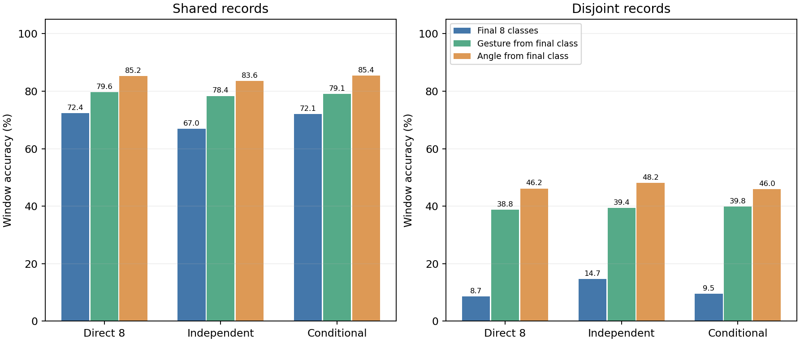

독립 분류의 기록 분리 이득은1,755창(+6.0136%p)이지만 각도 정확도의 상승은2.0045%p, 동작은0.6202%p다. 각도만 틀린 오류가1,574개, 동작만 틀린 오류가1,170개 줄고 두 축을 모두 틀린 오류는989개 늘었다. 따라서8분류 이득 전체를 각도 인식 개선이라고 설명할 수 없다. 두 축 오류가 같은 창에 더 모이는 변화도 포함된다. 기록 공유에서는1,589창을 덜 맞혔다. 조건부 방법은 공유에서92창 감소, 분리에서255창 증가로 일반화 문제를 해결하지 못했다. 기록 분리14.67%는 균등 무작위의 기술적 기준12.5%보다 높지만, 독립 외부 시험이나 통계적으로 보장된 성과를 뜻하지 않는다.

|기록 공유 fold0의 비용|직접8|독립 분류|조건부 분류|
|---|---:|---:|---:|
|활성 모델 / 총 트리|1 / 3,200|2 / 2,000|5 / 3,200|
|직렬화 크기(MB)|11.5635|7.5568|10.7809|
|구성 모델 학습 시간 합(초)|7.7157|5.0312|7.1199|
|CPU 특징+추론 중앙값 / p95(ms)|1.0684 / 1.5510|1.3669 / 2.1857|2.5713 / 3.1528|

400라운드는 같지만4분류는1,600트리, 이진 분류는400트리여서 독립 방식의 총트리는 더 적다. 모델 두 개의 호출·scaler·결합 비용 때문에 크기가 줄어도 지연은 늘었다. 조건부 학습은 동작별 부분집합을 쓰므로 시간 감소를 동일한 전체 학습량의 속도 개선으로 해석하지 않는다. 각 조건의 같은256개 개발 창에서 CPU6스레드·20회 예열·200회 batch1을 측정했으며200ms 신호 취득과 모델 로딩은 제외했다. [기록 분리까지 포함한6조건 비용](results/factorized_targets_v16/cost_summary.csv)을 남겼다. 이전90%의64목표 모델과는 목표·분할이 다르므로 이 표를 그 모델의 개선량으로 연결하지 않는다.

새 구성 모델48개를 모두 CPU에서 복원했다. 분할 재생성, 전체 클래스 지원, 각 구성 모델의 학습 자료만 사용한 scaler, 조건부 학습 부분집합의 합집합,400라운드·트리 수, 확률 열·곱·지표를 확인했다. 기존 직접8모델8개는 재학습하지 않았다. 새48fit와16개 결합 평가를 혼동하지 않는다. [복원 검증](results/factorized_targets_v16/verification.json), [차이와 실행 수](results/factorized_targets_v16/summary.json), [실행 기록](experiments/factorized_targets_v16/LOG.md)에 근거가 있다.

두 방법의 설정을 미리 고정하고 평가 후 어느 하나를 새 기본 모델로 선택하지 않았다. 60특징의 선택과 여러 개발 비교에 따른 이력은 남으며 새 외부 시험은 아니다. 단순 출력 분리만으로 기록 공유 점수와 기록 전이를 함께 개선한다는 가설은 이번 조건에서 지지되지 않았다. 독립 방식의 각도48.17%가 남은 병목이지만, 이것만으로 채널 재배치나 새로운 파형 변환의 효과를 예측할 수는 없다. 학습 규모를 더 늘리는 대신 반복 세션과 획득 정보로 기록 차이를 분리하는 검증이 필요하다.


## 결정 경계 대조: v17 축소 QDA

확장 전 SVM만 비교했던 것은 아니다. v4의240특징·RBF C100은 내부에서 표준화72.83%,분위수73.56%로 XGB80.45%보다 낮았다. 같은 실험을 반복하지 않고, 현재410특징에서 클래스별 공분산을 사용하는 곡선 경계 한 가지를 검사했다. [학습 전 명세](experiments/shrink_qda_v17/PLAN.md)를 `5886af2`에 고정했다. 기존768학습/256선택의 내부3분할과64학습 목표를 유지했으며,64목표가 기록과 일대일이라는 한계도 같다. 창이나 시행을 축소하지 않았다.

각 클래스의 공분산을 학습 자료에서만 Ledoit–Wolf 방식으로 축소하고 가우스 사후확률을 계산했다. 축소 강도는 검증 점수로 탐색하지 않았다. 입력·StandardScaler·410특징·200ms·19창을 고정해 XGB와 결정 경계만 비교했다. CPU6스레드를 사용했고 반복 최적화의 학습 횟수를 임의로 줄인 모델은 아니다. [추정·확률 코드](experiments/shrink_qda_v17/gaussian_boundary.py)에 정확한 식이 있다.

|같은 내부 평가|XGB410·64목표|축소 QDA410·64목표|
|---|---:|---:|
|분할0 창 정확도|88.7952%|47.6562%|
|분할1 창 정확도|90.7895%|48.0263%|
|분할2 창 정확도|89.3914%|51.6859%|
|14,592개 내부 평가 관측의 합계|89.6587%|49.1228%|
|대표 내부fold0 크기(MB)|33.4092|86.2901|
|실제 fit 시간(초)|101.5897(GPU)|0.2126(CPU)|
|CPU 특징+추론 중앙값 / p95(ms)|3.8381 / 4.0340|6.0141 / 6.3892|

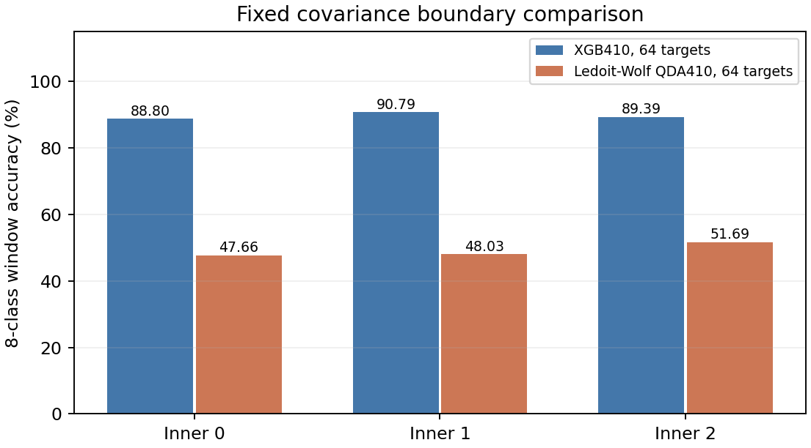

내부3분할은 전체 개발 OOF가 아니며 관측들이 중복될 수 있다. 사전 규칙상 내부에서 이긴 분할만 바깥 학습을 추가하지만, QDA가 모두 낮아 새 바깥fit는0회였다. 바깥 선택 결과90.0151%는 기존 XGB 결과를 그대로 재사용한 값으로 QDA의 성능이 아니다. [선택 기록](results/shrink_qda_v17/selection.json), [정수 오류 교집합](results/shrink_qda_v17/inner_overlap.csv), [비용](results/shrink_qda_v17/cost_summary.csv)에 근거가 있다.

QDA는 XGB가 틀린387개 내부 관측을 맞혔지만, XGB가 맞힌6,302개를 놓쳤다. 이 교집합으로 사후 결합 가중치를 찾지 않았다. 저장 모델의 학습 정확도는99.9041/100/100%였고 검증은47.66–51.69%였다. 따라서 학습 실패나 부족한 반복 횟수보다는 이번 클래스별 공분산 모형의 강한 과적합과 양립한다. 정규분포 가정 자체가 참인지, 입력 분포의 어느 성질이 원인인지는 확정하지 못한다. [학습 집계](results/shrink_qda_v17/training_diagnostic.csv)를 추가했으며 이 진단으로 이미 고정한 선택을 바꾸지 않았다.

신규3모델의 학습 scaler,192개 클래스별 공분산,확률과 지표를 재계산했고 SciPy 정규밀도와도 대조했다. 학습자료에서만 통계량을 계산했고 기존384시험은 제외했다. [복원 검증](results/shrink_qda_v17/verification.json)과 [실행 기록](experiments/shrink_qda_v17/LOG.md)을 보존했다. 이 실패가 모든 SVM·QDA 설정의 불가능성을 뜻하지는 않는다.


## 공분산 공유 대조: v18 축소 LDA

QDA의 학습99.90–100%와 검증49.12%의 차이를 보고, 클래스마다 다른 공분산을 추정하는 복잡도가 과한지 확인했다. [별도 사전 계획](experiments/shared_lda_v18/PLAN.md)을 `287501d`에 고정하고 LedoitWolf 공분산을 클래스 사전확률로 가중해 공유하는 LDA 한 가지를 추가했다. 입력410특징·64목표·전체 해당 개발창·내부분할·train 전용 scaler는 유지했다. 검증 점수로 축소 계수를 탐색하지 않았다.

|같은 내부 평가와 비용|XGB410|공분산 공유 LDA410|
|---|---:|---:|
|3개 내부 관측 합계 창 정확도|89.6587%|79.5025%|
|분할0 / 1 / 2 창 정확도|88.7952 / 90.7895 / 89.3914%|79.2763 / 80.1192 / 79.1118%|
|학습 정확도(별도 진단)|이번에 재측정하지 않음|86.9312 / 86.5063 / 86.3967%|
|대표 내부fold0 크기(MB)|33.4092|3.1257|
|실제 fit 시간(초)|101.5897(GPU)|0.2083(CPU)|
|CPU 특징+추론 중앙값 / p95(ms)|3.8201 / 3.9300|2.0771 / 2.5893|

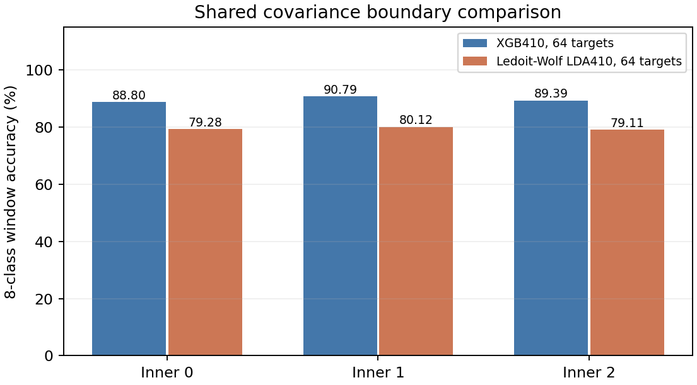

LDA는 QDA보다 검증 성능이30.3797%p 높고 학습·검증 차이가 줄었다. 공분산 공유가 이번 과적합을 줄이는 방향이었다는 관측이지만, XGB보다10.1563%p 낮았다. 모든 내부fold에서 XGB가 선택돼 추가 바깥fit는0회이며, 기존 바깥90.0151%를 LDA 성과로 적지 않는다. 크기는 작고 CPU 처리는 빨라졌으나 정확도와의 교환 관계다. 입력의 통계적 가정이나 새 기록 일반화를 입증한 결과는 아니다.

LDA는 XGB가 틀린 내부 관측635개를 맞혔고 XGB가 맞힌2,117개를 놓쳤다. 이 오류 교집합은 약한 보완 가능성을 제시하지만 단독 LDA의 우월성을 뜻하지 않는다.3개 저장 모델,192개 클래스별 공분산과3개 공유 공분산,scaler,별도 정규밀도 확률·지표를 재계산했다. [전체 집계](results/shared_lda_v18/summary.json), [검증](results/shared_lda_v18/verification.json), [비용](results/shared_lda_v18/cost_summary.csv), [실행 기록](experiments/shared_lda_v18/LOG.md)에 근거가 있다. 반복 사용한 내부 자료이며 미관측 외부 시험은 아니다.


## 작은 LDA 결합: v19

단독 LDA는 XGB보다 낮았지만 XGB가 틀린 내부 관측635개를 맞혔고 모델이3.13MB로 작았다. 같은410특징을 한 번만 계산하면서 일부 오류를 보완할 수 있는지 확인하려고 [사전 계획](experiments/lda_blend_v19/PLAN.md)을 `d3788a8`에 고정했다. `q=(1−α)p_XGB+αp_LDA`의 LDA 비중을0·5·10·20%로 제한하고 각 내부 분할의 정답 창 수로만 선택했다. 동률은 작은 비중을 유지한다. 확률 보정·새 특징·시계열 변환은 추가하지 않았다.

|고정 LDA 비중|0%|5%|10%|20%|
|---|---:|---:|---:|---:|
|내부14,592개 평가 관측의 정답 수|13,083|13,110|13,135|13,162|

내부3분할 모두20%를 선택한 뒤 선택 파일을 먼저 저장했다. 해당 바깥 학습1,024시행에서 LDA만3회 새로 학습하고 기존 XGB를 재사용했다. 바깥512시행×19창에서 가중치는 고정했다. 내부3분할은 전체 OOF가 아니며 과거에도 선택에 사용된 자료다. 같은 개발1,536시행 전체를 바깥 평가에서 정확히 한 번 사용했고 기존384시험은 제외했다.

|바깥 개발 평가|단일 XGB410|내부 선택 XGB/LDA|
|---|---:|---:|
|8클래스 창 정확도±fold SD|90.0151±0.4240%|90.5942±0.3574%|
|29,184창 중 정답|26,270|26,439|
|동작 정확도|92.3040%|92.7700%|
|각도 정확도|95.6140%|95.9464%|
|macro F1|0.900173|0.905971|
|분할별 추가 정답 창|—|+64 / +57 / +48|

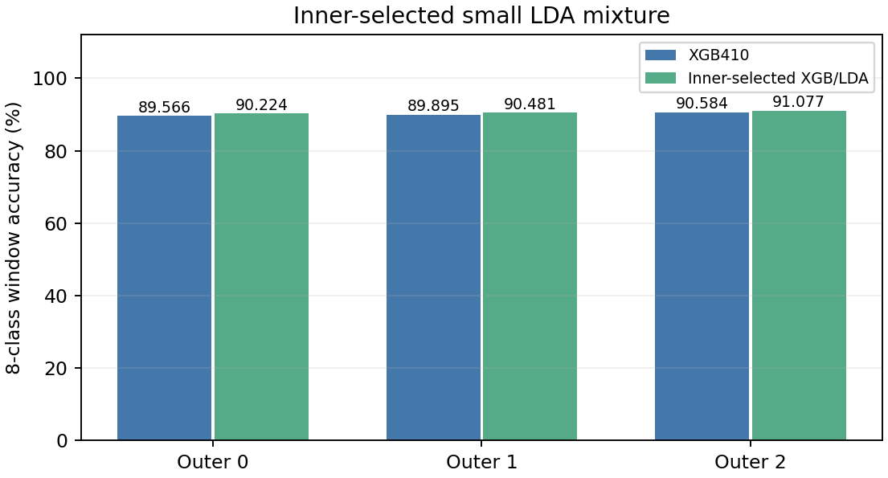

기존 오답390창을 고쳤고 기존 정답221창을 놓쳐 순증169창이었다. 시행별로는282개에서 맞힌 창 수가 늘고158개에서 줄었으며1,096개는 같았다. 이는 시행 다수결 점수나 독립 표본을 가정한 유의성 검정이 아니다. 주지표는 계속 현재200ms의8클래스 창 정확도다. 최대 후보20%가 선택됐지만 바깥 결과를 보고 비중 범위를 늘리지 않았다. [고정 선택](results/lda_blend_v19/selection.json), [바깥 집계](results/lda_blend_v19/pooled.csv), [짝지은 변화](results/lda_blend_v19/paired_changes.csv)에 근거가 있다.

|같은 바깥 fold0 비용|단일 XGB|XGB80%+LDA20%|
|---|---:|---:|
|활성 모델 수|1|2|
|전체 직렬화 크기(MB)|36.7511|39.8768|
|구성 모델 실제 fit 시간 합(초)|123.4104|123.6601|
|CPU 특징+추론 중앙값 / p95(ms)|3.9750 / 4.0877|4.2916 / 4.4326|

특징 계산은 공유하고 scaler와 추론은 각 모델의 학습된 것을 사용했다. XGB의 기존 GPU 학습 시간과 새 LDA의 CPU 학습 시간을 합한 값이며, 이번에XGB를 다시 학습한 것은 아니다. CPU6스레드·동일256개 개발창·20회 예열·200회 batch1이며 신호취득200ms·모델로딩은 제외했다. [비용 원수치](results/lda_blend_v19/cost_summary.csv)를 제공한다. 앞의 두XGB 결합90.1624%와 비교하면 추가 모델은 작지만, 여러 시도 뒤의 바깥 수치를 보고 전체 실험 중 최적 모델을 새로 선택했다는 주장으로 바꾸지 않는다.

새3개 모델의 학습 scaler·192개 클래스별 공분산·3개 공유 공분산·별도 정규밀도 확률을 복원했다. 내부 가중치 선택,64→8확률 합산,가중치 고정,전체 바깥 창 지표도 다시 계산했다. [검증](results/lda_blend_v19/verification.json)과 [실행 기록](experiments/lda_blend_v19/LOG.md)에 범위가 있다. 전체 단위검사52개를 통과했으며 누적 관측fit415개·저장모델195개다. 개수 자체로 정확성을 입증하지 않는다.

이번 결합은 기록 공유 개발 조건에서의 작은 개선이다. 두 모델 모두64개 기록과 일대일인64목표를 학습했고410특징의 주파수 의존도 유지한다. 반복 내부 선택과 과거 바깥 평가 노출에 따른 낙관적 편향이 남는다. 기록 분리14.67%의 직접8목표 대조와 이90.59%를 하나의 개선량으로 연결할 수 없다. 새 기록의 동작 일반화와 논문 수준이라는 목표는 아직 검증하지 못했다. 추가 가중치·변환을 계속 탐색하기보다 독립 반복 세션,실제 획득·필터·마커 정보와 논문 전문을 확보해야 그 목표를 판단할 수 있다.


## 410특징 RBF SVM: v20

과거 SVM 실행을 코드와 실제 결과표로 다시 확인했다. v4의 SVM은 **240특징·직접8목표**이며 StandardScaler72.83%, 분위수 변환73.56%였다. 이 결과로410특징 SVM을 이미 검증했다고 말할 수 없다. 이번에는 [사전 계획](experiments/svm410_v20/PLAN.md)을 학습 전 커밋 `7945b5f`에 고정하고, 현재410특징·64목표의 RBF SVM(C=100, gamma=scale) 한 설정을 실행했다. 기존과 입력·목표·분할·보정이 다르므로 과거 점수와의 차이를 특징 수만의 효과로 해석하지 않는다.

현재 고정 XGB/LDA의 내부14,592관측 중 오류1,430개는 동작만803개, 각도만335개, 둘 다292개였다. 최대 방향성 클래스쌍도77개(오류의5.38%)에 그쳐 특정 쌍 보정기를 고르지 않았다. 첫 창은83.46%로 뒤쪽93–95%보다 낮지만, 학습 RMS 사분위 중 가장 낮은 활성도 구간은94.22%였다. 휴식이나 낮은 진폭만으로 오류를 설명할 수 없어19창과 고정 분석구간을 모두 유지했다. RMS 구간 경계도 각 내부 학습 부분에서만 구했다.

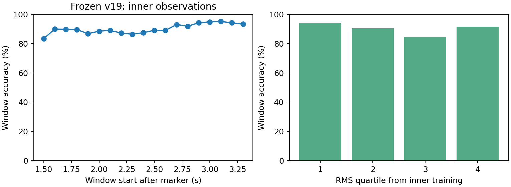

같은 내부 학습768시행·평가256시행을 사용했다. 보정용3fold는 학습 시행 단위로 나누고, 해당 시행의19창을 함께 이동했다. 각 보정 학습 부분의 scaler·SVM으로 얻은 학습 OOF 점수에 sigmoid를 맞춘 뒤 전체768시행으로 최종 SVM을 다시 학습했다. 모델당 base SVM4회, 총12회이며 별도로64개 sigmoid 계수를 추정한다. 최종 활성 모델은 SVM1개와 보정기다. 모든 학습 창을 유지했고 반복 상한은 두지 않았다. 주예측은 보정된64확률을 사람 축으로 합한8확률의 argmax다.

|같은 내부 비교와 fold0 비용|고정 XGB80%+LDA20%|RBF SVM410|
|---|---:|---:|
|정답 / 내부 관측|13,162 / 14,592|12,584 / 14,592|
|창 정확도|90.2001%|86.2390%|
|분할0 / 1 / 2 정확도|89.1653 / 91.4063 / 90.0288%|86.2459 / 86.3487 / 86.1225%|
|대표 저장 크기(MB)|36.5349|60.9387|
|대표 학습 시간(s)|101.7981|100.4718|
|CPU 특징+추론 중앙값 / p95(ms)|3.9915 / 4.1964|32.6436 / 33.3945|

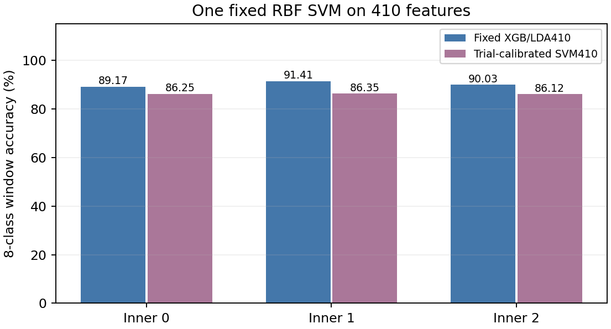

세 내부 분할 모두 기존 결합을 유지하도록 선택됐다. **바깥 SVM 학습은0회**이며 바깥90.5942%는 기존 결합을 재사용한 값이다. 이를 SVM 성능으로 부르지 않는다. 내부 세 평가 부분의 합은 전체 OOF가 아니며 같은 시행이 중복 관측될 수 있다. 보정 전64목표 argmax를8클래스로 바꾼 진단도 저장했지만 주지표나 선택 규칙을 사후 변경하지 않았다.

SVM의 대표 최종 support vector는14,101개로 학습14,592창의 대부분이다. 모든12회가 `fit_status_=0`으로 끝났고 세 확률모델의 fit 합계는297.91초였다. base SVM fit 합155.07초와 구분하며, 전자는 보정 OOF 추론·계수 추정과 감사 저장도 포함한다. 표의 기존 결합 학습 시간은 과거 GPU XGB와 CPU LDA 시간 합이고 SVM은 CPU libsvm 단일 스레드 경로다. 비용은 동일256개 개발창,20회 예열,200회 batch1에서 측정했으며 특징·각 scaler·실제 보정 확률·8클래스 합산을 포함한다. 취득200ms와 모델 로딩은 제외했다.

SVM은 기존 결합이 틀린655관측을 맞혔지만 기존 정답1,233개를 놓쳤다. 따라서 단독 교체는 기각했다. 작은 확률 결합의 근거는 남아 있으나, 항상 두 방식을 실행하면 내부fold0 모델 크기만 약97.47MB이고 전체 CPU시간도 약35ms로 예상된다. 이는 실측 결합 비용이 아니며 추가 검증 전 예상치다. 작은 비중만 내부에서 고정 비교할 수 있지만, 더 높은 점수를 비용과 무관한 개선으로 취급하지 않는다.

[집계](results/svm410_v20/summary.json), [12개 base 모델과 확률 검증](results/svm410_v20/verification.json), [수렴·support vector](results/svm410_v20/base_fit_audit.csv), [비용](results/svm410_v20/cost_summary.csv), [실행 기록](experiments/svm410_v20/LOG.md)에 근거를 남겼다. 학습 전용 scaler, 보정 시행 교집합0,64클래스 지원,학습 OOF 전체 포함,192개 sigmoid 보정기의 계수와 최종 확률·지표를 재계산했다. 현재200ms·19창·5채널과 개발 분할을 유지하고 역사적384시험은 다시 평가하지 않았다.64목표의 기록 의존성, 반복 개발 노출, 논문 전문·원필터·마커 정보의 부족은 그대로다.


## 상보 오류를 이용한 작은 SVM 결합: v21

v20의 단독 SVM은 낮고 느렸지만 기존 결합이 틀린655개 내부 관측을 맞혔다. [세 후보의 근거·비용 비교](experiments/svm_blend_v21/HYPOTHESES.md)에서 학습 전용 특징 변환, 규제한 ExtraTrees, 작은 확률 결합을 비교했다. 현재 직접 확인된 보완 오류와 기존 예측 재사용이 가능한 마지막 방법을 우선했다. 다른 두 후보를 실행했다고 주장하지 않는다. 비교 문서의 보완 작성 시점과 사전 계획의 고정 시점을 구분했다.

[사전 계획](experiments/svm_blend_v21/PLAN.md)은 `86d914a`에서 고정했다. 기존 확률 `q0=0.8*p_XGB+0.2*p_LDA`에 SVM을 `q=(1-beta)*q0+beta*p_SVM`으로 더하고 beta는0·5·10·20%로만 제한했다. 내부 세 분할의 정답 합은 각각13,162·13,189·13,216·13,260개였다. 각 분할 모두20%를 선택해 `b52c51d`에 저장한 뒤 바깥 SVM3개를 학습했다. 최종 비중은 **XGB64%·LDA16%·SVM20%**다. 바깥 점수로 비중이나 모델을 다시 고르지 않았다.

|동일 바깥 개발 평가|기존 XGB80%+LDA20%|내부 선택 SVM 결합|
|---|---:|---:|
|정답 / 창|26,439 / 29,184|26,670 / 29,184|
|창 정확도 평균±SD|90.5942±0.3574%|**91.3857±0.3502%**|
|각도 정확도|95.9464%|96.3679%|
|동작 정확도|92.7700%|93.3559%|
|Macro F1|0.90597|0.91389|

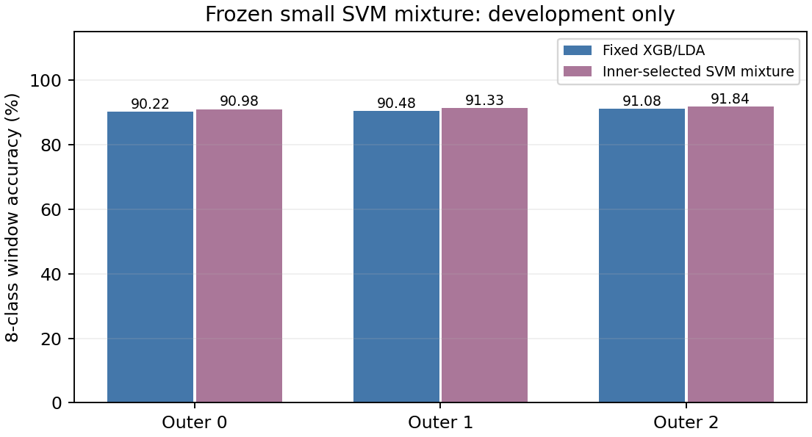

세 분할에서74·83·74창이 증가해 순증231창(+0.7915%p)이었다. 기존 오답365창을 고쳤고 정답134창을 놓쳤다. 시행별 맞힌 창 수는285시행에서 늘고95시행에서 줄었으며1,156시행은 같았다. 이는 시행 다수결 점수나 독립 창을 가정한 유의성 검정이 아니다. [선택](results/svm_blend_v21/selection.json), [전체 집계](results/svm_blend_v21/pooled.csv), [짝지은 변화](results/svm_blend_v21/paired_changes.csv)를 제공한다.

|같은 바깥 fold0의 비용|기존 결합|SVM 결합|
|---|---:|---:|
|직렬화 크기(MB)|39.8768|119.8385|
|구성 모델의 관측 학습 시간 합(s)|123.6601|282.4544|
|CPU 특징+추론 중앙값(ms)|4.1965|38.7054|
|CPU 특징+추론 p95(ms)|4.3082|40.2353|

CPU6 라이브러리 스레드와 단일 스레드 libsvm을 사용했다. 같은256개 개발창,20회 예열,200회 batch1에서 특징 계산을 공유하고 각 scaler·확률·합산을 포함했다. 취득200ms·모델 로딩은 제외했다. 학습 시간은 기존 GPU XGB·CPU LDA와 새 CPU SVM 보정 fit 시간의 합이다. 기존 두 모델은 이번에 다시 학습하지 않았다. SVM의 학습 OOF 점수 추론·sigmoid 추정·감사 저장이 포함되므로 base SVM fit 시간과 구분한다. 크기는 파일 바이트이며 실제 RAM 최대치가 아니다.

전체 바깥 학습1,024시행·19,456창을 각 최종 SVM에 사용했고, 보정 내부3개 학습을 합쳐 새 base SVM은12회였다. 11:57:52 UTC에 모두 완료했다. [12개 base 모델 감사](results/svm_blend_v21/base_fit_audit.csv), [독립 확률·선택·지표 검증](results/svm_blend_v21/verification.json), [비용](results/svm_blend_v21/cost_summary.csv), [실행 기록](experiments/svm_blend_v21/LOG.md)을 남겼다. 첫 실행의 표준 라이브러리 이름 충돌은 결과 계산 전에 수정했으며 학습 실패나 후보 재선택이 아니다. 비용 참조행의 SVM 활성 설명 두 항목도 원본을 보존하고 정정했으며 시간·크기·성능 값은 바꾸지 않았다.

이 결합은 같은 기록을 공유하는 개발 평가의 정확도를 높였다. 반복 CV와 이전 바깥 평가 노출은 남고,64목표가64기록과 일대일인 구조나 기록 분리 실패를 해결하지 않았다. 현재 단일 기준 XGB나 작은 XGB/LDA를 비용과 무관하게 대체하는 배포 모델로 선언하지 않는다. 새 기록의 일반화와 논문 정확재현 목표는 여전히 미달이다.


## 라벨을 보존하는 호출 생략: v22

v21의 정확도는 높아졌지만 항상 SVM을 실행하면 CPU비용이 컸다. 새 모델이나 임계값 탐색 대신, 결합식의 성질로 불필요한 계산을 생략했다. 기존 XGB/LDA 확률의 1·2위 차이를 `delta`라 하면 SVM 비중 `beta`인 결합의 두 클래스 차이는 최소 `(1-beta)*delta-beta`다. **beta=0.2에서 delta>0.25이면 최종 1위는 SVM 결과와 무관하게 유지된다.** [사전 명세](experiments/svm_gate_v22/PLAN.md)를 `fabc71e`에 고정했고 구현은 수치 여유를 둬0.25+1e-8보다 클 때만 생략한다. 경계·동률은 그대로 계산한다.

전체 내부 14,592관측과 바깥 29,184창에서 원래 결합과 라벨이 모두 일치했다. 실제 CPU에서도 바깥 29,184창 전체의 조건부 SVM 실행과 동일 라벨을 확인했다. SVM 호출은 2,362창(8.09%), 생략은 26,822창(91.91%)이었다. 새 학습과 임계값 선택은 0회이며 모델 해시는 그대로다. **이 경로는 라벨 전용이다. 전체 결합 확률·신뢰도·log loss가 필요하면 SVM을 생략할 수 없다.** [저장 예측 대조](results/svm_gate_v22/verification.json), [전체 바깥 CPU실행 대조](results/svm_gate_v22/runtime_verification.json)를 제공한다.

처음에는 기존과 같은256개 개발 입력 중 200개를 측정했다. 전체 결합의 중앙값/평균/p95는38.02/38.16/39.10ms, 호출 생략은4.41/5.28/4.68ms였다. 하지만 이 입력에는 대표 모델의 학습 시행도 들어갈 수 있고, 측정 200창의 호출은 5개(2.5%)뿐이었다. **이 p95를 바깥 평가의 일반적인 지연으로 쓰지 않는다.** 기존 결과를 보존하고 [추가 범위](experiments/svm_gate_v22/EVALUATION_COST_PLAN.md)를 `ea51bb9`에 먼저 고정했다.

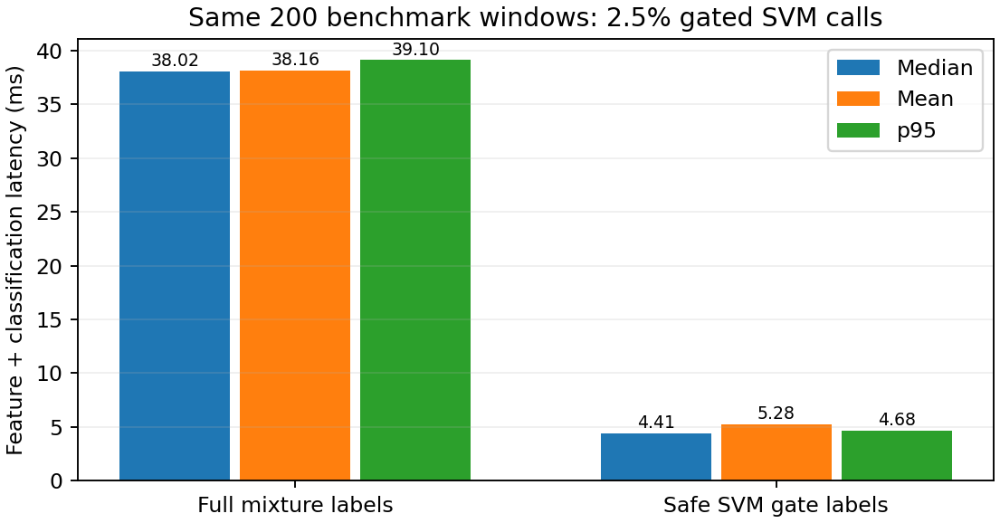

그림. 두 경로의 입력·예열·호출 횟수는 같다. 다만 게이트 호출률이 전체 평가보다 낮아 이 표본의 지연 분포가 더 낙관적이다. [원수치](results/svm_gate_v22/cost_summary.csv)를 함께 남겼다.

첫 바깥 fold의 **512평가시행×19창=9,728창 전체**를 하나도 제외하지 않고 CPU에서 1회씩 실행했다. 20창으로 예열하고 특징·각 scaler·실제 분기·라벨 결정을 포함했다. 취득200ms·CSV읽기·모델로딩은 제외했다.

|전체 바깥 fold0의 라벨 전용 실행|값|
|---|---:|
|SVM호출 / 전체창|792 / 9,728(8.14%)|
|중앙값|4.5202ms|
|평균|7.3150ms|
|p95 / p99|38.1143 / 39.7040ms|
|관측 최대|51.7179ms|
|원래 결합과 다른 라벨|0|
|저장 모델 크기|119.8385MB,변화 없음|

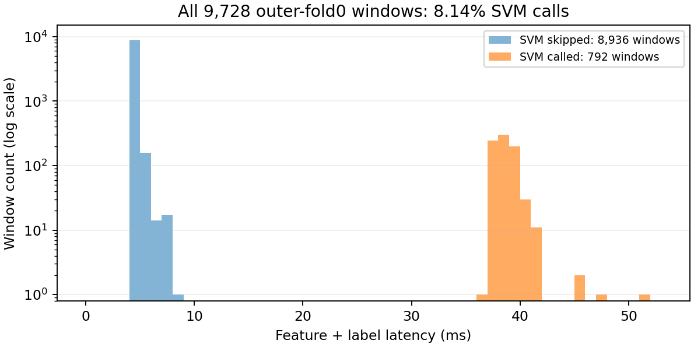

그림. 세로축은 로그 창 수다. SVM을 생략한 8,936창은 약 4.5ms, 실행한 792창은 약 38.6ms의 평균을 보였다. 평균과 중앙값이 줄어도 느린 경로가 남아 p95는 38.11ms다. 다른 두 바깥 모델의 전체 시간을 측정했다고 주장하지 않으며, 이 관측 최대도 실시간 최악 지연의 보증은 아니다. [전체측정](results/svm_gate_v22/evaluation_cost.json), [원시시간재계산](results/svm_gate_v22/evaluation_timing_verification.json), [집계](results/svm_gate_v22/summary.json), [실행기록](experiments/svm_gate_v22/LOG.md)을제공한다.

따라서 현재 분류 라벨만 필요할 때는 동일한 91.3857%의 계산 비용을 줄이는 경로가 확인됐다. 저장 크기·학습 비용·반복 개발 노출·기록 의존성은 해결하지 않는다. 모델 크기를 우선하면 기존 39.88MB의 90.5942% 결합이나 36.75MB의 90.0151% 단일 기준과 교환 관계를 판단해야 한다. 현재 근거만으로 추가 모델 탐색을 무조건 늘리지 않는다. 남겨둔 특징 변환·규제 숲 가설은 별도 명세와 동일 평가가 필요한 미검증 후보다.


## 과거 확률을 이용한 별도 시간 조건: v23

짧게 나타나는 창 오류를 과거 증거로 줄일 수 있는지 확인했다. 기존 코드를 다시 읽어 초기 대조뿐 아니라 v5–v11에서도 과거5창의 **하드 라벨 다수결**을 사용했음을 확인했다. 이번에는 아직 실행하지 않은 현재 v21의 확률 평균만 비교했다. [사전 명세](experiments/causal_probability_v23/PLAN.md)를 `d401a02`, 실행 코드를 `8b37adc`에 결과 전에 고정했다. 새 모델 학습은0회다.

각 창의 고정 XGB/LDA/SVM 비중은64/16/20이다. 시행의 창 번호를 j라고 하면 현재와 과거 `q[max(0,j-k+1):j+1]`을 평균한다. 후보는 k=1/3/5뿐이며 내부 세 분할에서 모두5를 선택했다. 내부 관측14,592개의 정답 수는 각각13,260/13,906/14,069개였다. [선택 파일](results/causal_probability_v23/selection.json)을 12:29:29 UTC에 저장하고 해시를 고정한 뒤 바깥에는 k5를 그대로 적용했다. 기존1,536개발시행·29,184창을 모두 유지하고 원래384시험은 새로 평가하지 않았다. 내부 관측을 전체 OOF라고 부르지 않는다.

|기록 공유 바깥 개발 평가|현재창 k1|내부 선택 k5|
|---|---:|---:|
|현재 입력창 / 최대 사용 신호 범위|200ms / 200ms|200ms / 600ms|
|정답 / 전체창|26,670 / 29,184|28,206 / 29,184|
|창 정확도, fold 평균±SD|91.3857±0.3502%|96.6488±0.3316%|
|macro F1|0.913890|0.966491|
|각도 정확도|96.3679%|98.2353%|
|동작 정확도|93.3559%|98.0366%|

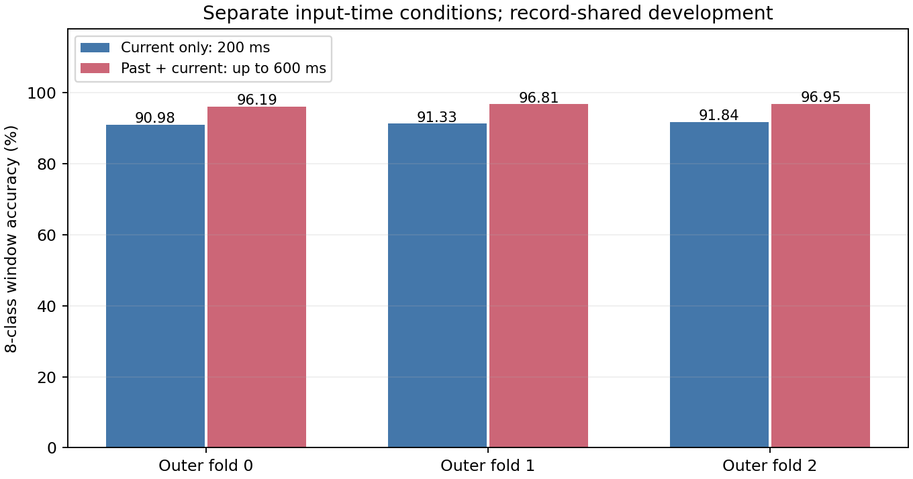

그림. 200ms 주결과와 최대600ms 이력을 사용하는 별도 조건이다. 같은19창의8클래스 정확도를 계산했지만 입력 정보량이 다르므로 같은200ms 조건의 개선이나 논문 정확재현으로 제시하지 않는다. [전체 지표](results/causal_probability_v23/pooled.csv), [분할별 지표](results/causal_probability_v23/outer.csv)를 제공한다.

첫 창은 현재 확률만 사용하고 이후 보유한 창 수로 나눈다. 각 시행 경계에서 버퍼를 비우며, 경계는 기존 시행 ID로 주어진다. 정답으로 경계를 추론하지 않는다. stride100ms에서 k1/3/5의 최대 신호 범위는200/400/600ms다. k5는 첫 다섯 출력에서200/300/400/500/600ms를 사용한다. 첫 출력은 mark+1.7초의 입력 취득 뒤부터 나오고, 완성된 다섯 창 이력은+2.1초부터 쓰므로 **미래 창을 기다리는 추가 시간은0ms**다. 이는 계산 시간이0이라는 뜻이 아니며, 과거 증거에 따른 동작 전환 응답 지연은 측정하지 못했다.

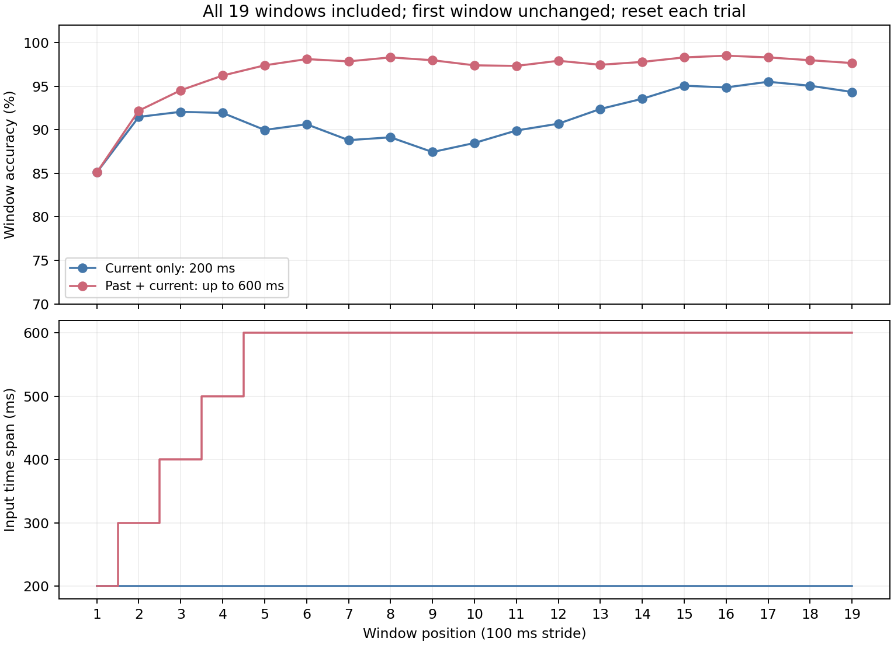

그림. 첫 창 정확도85.0911%와 모든 첫 창 라벨은 그대로다. 이후 창에서 이득이 나타나지만 초기창을 제외하거나 전 구간을 한 표본으로 바꾸지 않았다. 알려진 경계에서 초기화하는 정적 시행 실험이므로, 경계가 없는 실제 연속 동작에서 검증됐다는 뜻은 아니다. [위치별 집계](results/causal_probability_v23/position_summary.csv)에 각 출력의 실제 신호 범위를 보존했다.

오답1,792창을 수정하고 정답256창을 잃어 순증1,536창이었다. 시행별 정답 수가 늘어난 경우818개, 줄어든 경우41개, 같은 경우677개였다. 각도만 틀린 창은575→405, 동작만 틀린 창은1,454→463, 둘 다 틀린 창은485→110개였다. 다만 한 창만 틀린 오류 구간이1,222→176개로 줄어든 반면, **5창 이상 이어진 오류 구간은39→55개**, 그 구간의 오답 창은253→345개로 늘었다. 과거의 잘못된 증거가 일부 오류를 오래 유지할 수 있음을 함께 기록한다. 실제 동작 전환을 측정한 수치로 해석하지 않는다.

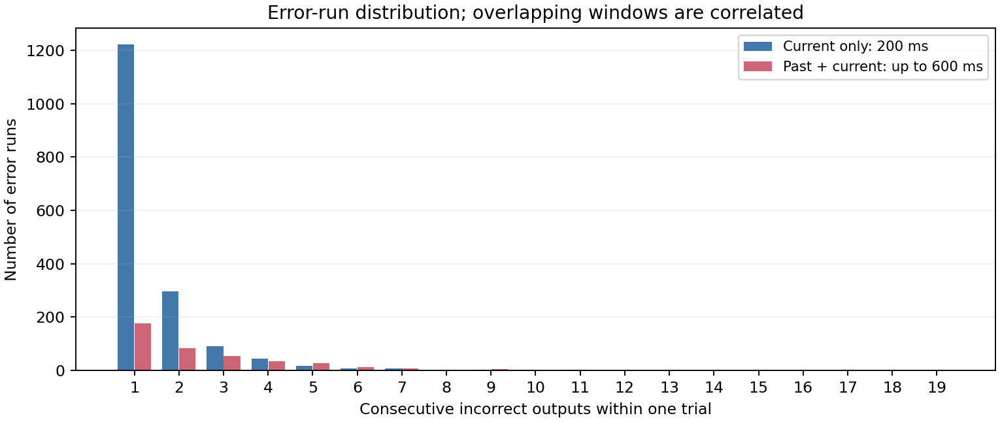

그림. 오류 구간은 시행 경계를 넘지 않고 센다. 19개의 겹친 창을 독립 표본처럼 유의성 검정하지 않았다. [전후 수정·손실](results/causal_probability_v23/paired_changes.csv), [오류 축](results/causal_probability_v23/error_axis_summary.csv), [연속 오류](results/causal_probability_v23/error_run_summary.csv), [이전 혼동행렬](results/causal_probability_v23/confusion_current.csv), [이후 혼동행렬](results/causal_probability_v23/confusion_selected.csv)을 남겼다.

매창의 전체 결합 확률이 필요하므로 **v22의 라벨 전용 SVM 호출 생략을 사용하지 않는다.** 첫 바깥 fold의 첫20평가시행×19창=380창을 각 조건에서 시간순으로 한 번씩 실행했다. 한 시행19창으로 예열하고, 특징 추출·세 모델 확률·평균·라벨·경계 초기화를 포함했다. CSV읽기·모델로딩·취득200ms는 제외했다. 평균 연산만의 비용은 같은 fold의9,728창 전체에서 따로 측정했다.

|CPU6라이브러리스레드, SVM 단일스레드|k1|k5|
|---|---:|---:|
|전체 경로 중앙값 / 평균 / p95|37.9751 / 38.0484 / 38.7233ms|37.7348 / 37.8038 / 38.4574ms|
|평균·라벨 연산만 중앙값|0.010895ms|0.011078ms|
|확률 이력 payload, float64|64바이트|320바이트|
|버퍼·인스턴스·속성사전 관측 합계|528바이트|768바이트|
|저장 모델 크기|119.8385MB|119.8385MB|
|원래 구성 모델 학습시간 합|282.4544초|282.4544초|

전체 경로의 작은 시간 차이를 k5의 속도 향상으로 해석하지 않는다. 순차1회 측정의 변동이며 두 조건 모두 세 모델을 항상 호출한다. 상태 객체 합계는 공유 문자열 키·정수 객체·임시 배열·할당기 여유를 제외한 관측값으로 전체 프로세스 메모리가 아니다. 정수 객체는 이 환경에서 하나당28바이트이며 공유될 수 있다. k3 payload는192바이트지만 선택되지 않아 전체 경로 비용은 추가 측정하지 않았다. 원시 시간을 재계산하고 복원한380개 현재 확률·과거 창 평균 라벨,9,728개 평균 라벨과 모델 해시를 확인했다. [비용](results/causal_probability_v23/costs.json), [비용 재계산](results/causal_probability_v23/timing_verification.json)을 제공한다.

독립 스칼라 합으로 내부·바깥102,144확률 행을 재계산하고 분할·시간 순서·미래 입력 변경 불변성·첫 창·초기화를 검사했다. 처음 검증기의 고정밀 연산이 원래 float32 결합과 최대1.28×10⁻⁷ 차이를 내어 중단됐으며, 원래 dtype와 연산 순서를 재현해 평균을 엄격히 대조했다. 별도 float64 계산에서도 모든 내부 후보의 라벨과 선택은 같았다. 원본15개 입력 파일과 세 모델은 보존됐다. [검증](results/causal_probability_v23/verification.json), [집계](results/causal_probability_v23/summary.json), [실행 기록](experiments/causal_probability_v23/LOG.md)을 제공한다.

현재64목표와64기록의 일대일 관계, 주파수 성분 의존, 사전 필터 인과성 미확인, 반복 CV 노출은 그대로다. 96.6488%는 신호 범위를 늘린 기록 공유 개발 결과다. 새 기록에서의 일반화나 강의 인용 논문과 같은 조건의96%를 달성한 것으로 쓰지 않는다. 실제 연속 사용 검증에는 독립 반복 세션과 동작 전환의 정확한 시각, 경계 검출 규칙을 먼저 확보해야 한다.


## 같은 200 ms 입력에서 XGB 규제·용량 대조: v24

기존 내부 오류 1,332개 중 946개는 정답이 상위 두 확률 안에 있었지만, 가장 큰 방향별 클래스 혼동은 72개(오류의 5.4%)에 그쳤다. 특정 클래스 쌍 보정부터 시도할 근거는 약했다. 기존 XGB의 학습 재대입 정답률은 100%였고 평가와 차이가 있어 규제 또는 얕은 트리의 학습 횟수 증가를 우선했다. 이는 원인 확정이 아니라 대조 실험의 근거다. 특징 변환, 규제 숲, seed 평균은 검토했으나 이번에는 함께 실행하지 않았다. [내부 오류 진단](results/regularized_boosting_v24/internal_diagnostic.json), [우선순위·사전 명세](experiments/regularized_boosting_v24/PLAN.md)를 제공한다.

입력은 기존 410특징·64학습 목표이며, XGB/LDA/SVM의 비중 64/16/20을 먼저 유지했다. 후보는 기존 XGB400(depth 6, min_child_weight 1, lambda 1), 규제를 늘린 XGB400(depth 6, 5, 5), 얕은 XGB800(depth 4, 1, 1)이다. 학습률 0.05, subsample 0.9, colsample 0.8, seed 42와 TITAN Xp의 CUDA hist는 같고 조기 종료는 쓰지 않았다. min_child_weight는 표본 수가 아닌 Hessian 합의 하한이다. 규제 두 항 또는 깊이·반복 수를 함께 바꾼 대조이므로 한 항만의 인과 효과로 해석하지 않는다. 설정의 의미는 [XGBoost 3.0 공식 문서](https://xgboost.readthedocs.io/en/release_3.0.0/parameter.html)를 확인했다.

내부 학습 768시행·평가 256시행의 같은 세 분할에서 후보를 고르고, 모델 크기가 기존 XGB의 두 배를 넘으면 제외하도록 미리 정했다. 내부 정답 수 동률이면 기존 후보, 이어 작은 모델을 우선했다. 선택 파일을 저장하고 해시를 고정한 뒤 바깥 학습 1,024시행·평가 512시행에 적용했다. 학습 창을 줄이지 않았고, subsample 0.9는 기존과 같은 트리별 표본 선택이다.

|내부 고정 비중 비교|정답 / 14,592관측|창 정확도|선택|
|---|---:|---:|---|
|기존 XGB400 결합|13,260|90.8717%|비교 기준|
|규제 XGB400 결합|13,219|90.5907%|세 분할 모두 탈락|
|얕은 XGB800 결합|13,313|91.2349%|세 분할 모두 선택|

내부 합계는 전체 OOF가 아니다. 같은 시행이 서로 다른 내부 평가에 다시 등장할 수 있다. 바깥 개발 1,536시행·29,184창은 정확히 한 번씩 평가했고 기존 시험 384시행은 다시 평가하지 않았다.

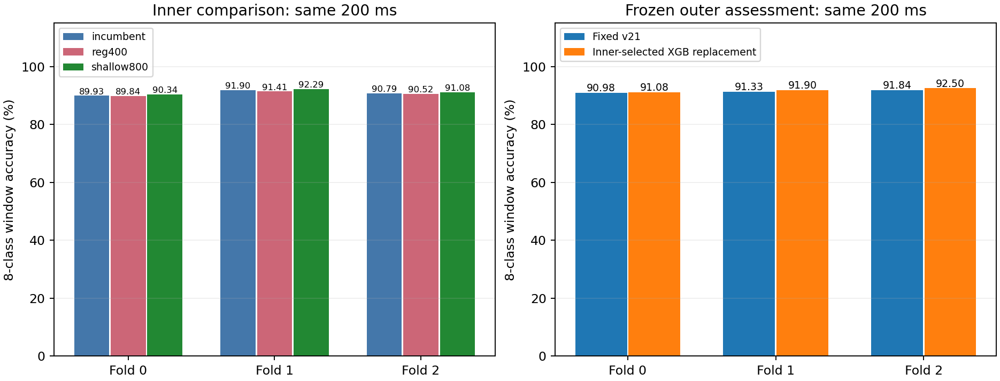

바깥 정확도는 **91.3857→91.8243±0.5816%**, 정답은 26,670→26,798개였다. 원래 오답 387개를 맞추고 정답 259개를 잃어 순증 128개였다. 시행별 정답 수는 267시행에서 증가, 169시행에서 감소, 1,100시행에서 같았다. 시행 집계는 보조 결과이며 주지표는 계속 창 정확도다.

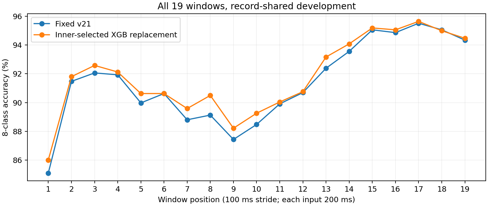

완료 학습은 내부 6회와 바깥 3회, **총 9회**이며 관측 학습 시간 합은 **1,201.02초**, scaler fit 합은 0.71초다. 최초 분리 실행은 100/400라운드 뒤 프로세스가 사라졌고 원인·종료 코드는 확보하지 못했다. 완성 모델이나 점수가 없음을 확인한 뒤 동일 명세로 재개했다. 마지막 부분 로그는 25.59초이며 이 불완전 실행의 비용은 완료 학습 합에 포함되지 않는다. 따라서 총 탐색 계산량을 1,201.02초로 단정하지 않는다. [중단 기록](results/regularized_boosting_v24/interruption.json)을 보존했다.

9개 모델 모두 CPU 복원, 원래 시행 분할, 64클래스 지원 수, 학습 전용 scaler, 입력 해시, 라운드 수, CUDA 설정, 확률 열의 64→8 대응, 수동 지표 재계산을 통과했다. 현재 창 행의 순서를 바꿔도 결과가 같았다. 기존 모델·예측의 해시도 보존됐다. [검증](results/regularized_boosting_v24/verification.json), [집계](results/regularized_boosting_v24/summary.json), [실행 기록](experiments/regularized_boosting_v24/LOG.md)에 근거를 남겼다.

## 같은 창에서 결합 비중을 고른 후속 비교: v25

v21의 SVM 비중 후보 0/5/10/20%에서는 내부 정답 수가 상한 20%까지 증가했다. 이에 v24의 첫 새 바깥 점수가 나오기 전에 **0/10/20/30/40/50%**의 작은 범위를 등록했다. v24에서 내부 선택한 XGB는 바꾸지 않고, 남은 XGB:LDA 비율 4:1도 유지했다. 식은 `q=(1−beta)×(0.8×q_XGB+0.2×q_LDA)+beta×q_SVM`이다. 내부 정답 수가 같으면 작은 beta를 택한다. 새 모델 학습은 0회다. [사전 명세](experiments/mixture_weights_v25/PLAN.md), [등록 시점](results/mixture_weights_v25/preregistration_timing.json), [선택 파일](results/mixture_weights_v25/selection.json)을 제공한다.

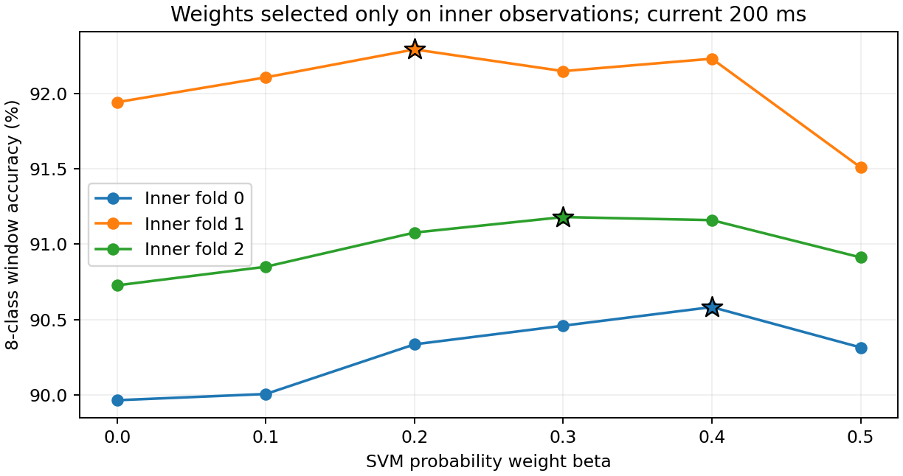

SVM 비중은 분할별 **40/20/30%**로 선택됐다. 최종 XGB/LDA/SVM 비중은 각각 48/12/40, 64/16/20, 56/14/30이다. 모든 분할에 공통 40%를 적용한 결과가 아니다. XGB 선택과 비중 선택에 같은 내부 자료를 순차 사용했으므로 선택 복잡성이 늘었으며, 기존 개발 자료의 반복 노출도 남는다. 바깥 점수를 보고 비중을 수정하지는 않았다.

|같은 200 ms·19창의 바깥 개발 평가|정답 / 29,184창|정확도 평균±SD|직전 대비 정답 순증|
|---|---:|---:|---:|
|v21/v22 고정 결합|26,670|91.3857±0.3502%|—|
|v24 XGB 교체, 기존 비중 유지|26,798|91.8243±0.5816%|128|
|v25 내부 비중 선택|**26,844**|**91.9819±0.4986%**|46|

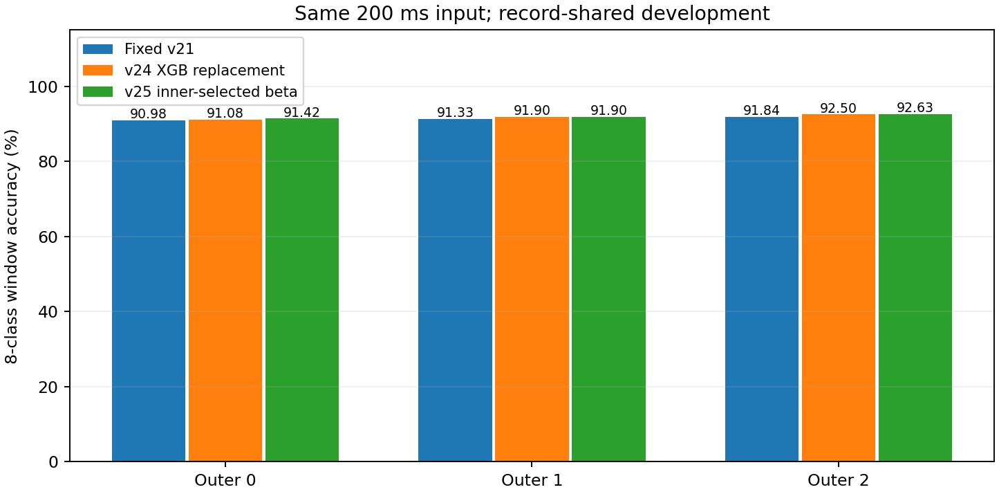

v25는 v24의 오답 168개를 수정하고 정답 122개를 잃었다. 시행별 정답 수는 129개 증가, 87개 감소, 1,320개 동일했다. 최종 macro F1은 0.919854, 각도 정확도는 96.6317%, 동작 정확도는 93.9282%다. 19개의 겹친 창을 독립 표본처럼 취급한 신뢰구간이나 유의성 주장은 하지 않는다. 전체 61개 테스트, 내부 18개 비중 후보의 독립 재계산, 바깥 58,368개 확률 행(기준·선택 각각 29,184)의 재계산, 분할·모델·소스 해시 검증을 통과했다. [검증](results/mixture_weights_v25/verification.json), [집계](results/mixture_weights_v25/summary.json), [실행 기록](experiments/mixture_weights_v25/LOG.md)을 제공한다.

비용은 다음처럼 구분한다. 크기는 직렬화 파일 합의 십진 MB이며 전체 실행 메모리는 아니다. 특징 추출·모델·결합 계산을 포함하고 CSV 읽기, 모델 로딩, 200 ms 신호 취득은 제외했다. CPU 라이브러리 스레드는 6개, SVM은 단일 스레드다. 현재 특징 경로는 905특징을 계산한 뒤 410열을 고르며 그 비용도 포함한다.

|대표 바깥 분할 0의 경로|모델 MB|구성 모델 학습 합(초)|측정 창 수|중앙값 ms|평균 ms|p95 ms|
|---|---:|---:|---:|---:|---:|---:|
|v21 전체 확률, v24에서 같은 입력으로 재측정|119.84|282.45|380|41.71|43.51|57.16|
|v24 전체 확률, SVM 20%|138.51|331.35|380|43.11|45.46|66.46|
|v25 전체 확률, SVM 40%|138.51|331.35|380|43.42|45.77|63.97|
|v25 라벨 전용 호출 생략|138.51|331.35|9,728|6.60|17.35|49.19|

학습 합은 해당 구성 모델을 원래 학습한 실행들의 관측 시간 합이다. v25가 331.35초의 새 학습을 수행했다는 뜻은 아니다. 라벨 전용 경로는 상위 두 기준 확률 차이가 `beta/(1−beta)+1e−8`보다 크면 SVM을 생략한다. 임계값은 수학적 argmax 보존 조건이며 평가 정답으로 튜닝하지 않았다. 바깥 전 29,184창에서 저장 예측과 실제 CPU 조건부 실행 라벨이 같았다. SVM은 분할별 2,477/710/1,157회 호출됐다. 대표 분할 호출률은 25.46%로 기존 v22의 8.14%보다 높다. 이번 개선은 큰 XGB와 더 잦은 SVM 호출의 비용을 함께 요구한다.

호출 생략은 **라벨만 보존**한다. 전체 확률이 필요하면 세 모델을 모두 계산해야 한다. 380창과 9,728창의 시간을 같은 표본의 속도 비율로 나누지 않으며, 1회 순차 측정의 p95를 실시간 지연 보증으로 해석하지 않는다. [전체 확률 비용](results/mixture_weights_v25/costs.json), [라벨 전용 비용·동등성](results/mixture_weights_v25/label_cost.json), [비용 사전 명세](experiments/mixture_weights_v25/LABEL_COST_PLAN.md)를 분리했다. 원시 시간을 다시 집계해 표와 일치함을 확인했다.

기록 공유와 64목표의 기록 식별 가능성은 그대로다. 현재 200 ms 조건의 개선은 확인했지만, 새 기록의 동작 일반화를 해결하거나 논문을 정확히 재현한 결과는 아니다. 별도 v23의 최대 600 ms 입력·96.6488%는 수정하지 않았다. 원래 384시험도 재평가하지 않았으며, 이번 결과에 맞춰 시험 집합이나 유리한 창을 선택하지 않았다.

## 주성분 추가와 LDA 확률 완화의 후속 실패: v26·v27

v25에서 멈추지 않고 같은 현재 200 ms 입력을 유지한 두 가설을 추가로 검증했다. 최신 내부 오류 1,262개 중 정답이 상위 두 확률 안에 있는 경우는 875개, 구성 모델 중 하나는 맞힌 경우는 682개였다. 가장 큰 방향별 클래스 혼동은 72개로 특정 쌍에 집중되지 않았다. 바깥 오류를 겨냥해 후보를 고르지 않았다.

**v26은 학습 주성분을 추가하는 한 설정이다.** 내부 학습 자료의 표준화된 410열에서 절대 상관 0.9 초과 열 쌍이 367–393개였고, 상위 64주성분이 설명하는 학습 분산은 약 65.7%였다. 원래 410열을 유지한 채 학습 부분에서만 fit한 PCA 64열을 붙여 474특징을 만들었다. scaler·PCA는 실제 모델 학습 부분에만 맞췄다. XGB800의 depth 4와 v25의 비중 40/20/30%를 유지했다. PCA만 사용해 저분산 정보를 버리는 방법이나 과거 창을 추가한 방법이 아니다. [사전 명세](experiments/pca_augmentation_v26/PLAN.md), [내부 진단](results/pca_augmentation_v26/internal_diagnostic.json)을 제공한다.

|내부 분할|기존 v25 정답 / 4,864창|PCA 추가 정답|차이|
|---|---:|---:|---:|
|0|4,406|4,389|−17|
|1|4,489|4,474|−15|
|2|4,435|4,429|−6|

내부 합계는 13,330→13,292개로 38개 줄었다. 세 분할 모두 기존 모델을 유지하도록 선택됐고 **새 바깥 학습은 0회**다. 바깥 91.9819%가 유지된 것은 v25를 재사용한 결과이며 PCA 후보의 바깥 정확도가 아니다. 새 내부 학습 3회 합은 **447.84초**, scaler/PCA 준비 합은 0.89초였다. 세 모델의 학습 64목표 재대입 정답률은 모두 100%였지만 내부 평가 개선은 없었다. 3개 모델의 CPU 복원, 학습 전용 PCA의 평균·고유값·축, 원래 410열 보존, 배치·순서 불변성, 분할·확률·지표 검증을 통과했다.

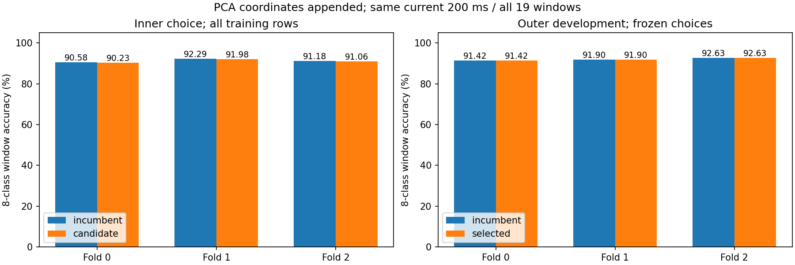

대표 내부 fold0의 저장 크기는 XGB 단독 52.07 MB, 전체 결합 116.13 MB였다. 같은 380평가창의 전체 결합 중앙값은 기존 **40.89 ms**, PCA 추가 **40.68 ms**이고, PCA 추가 평균 44.10 ms·p95 64.91 ms였다. 이 모델은 768시행 학습 모델이므로 v25 바깥 1,024시행 학습 모델의 138.51 MB와 직접적인 압축 효과로 비교하지 않는다. 첫 비용 측정에 v27 독립 검증의 CPU 실행이 겹쳐 그 기록은 보존하되 최종 표에서는 제외했다. 사전에 이유를 남기고 한 번만 분리 재측정했으며 더 빠른 값을 골라 쓰지 않았다. [분리 측정](results/pca_augmentation_v26/costs_isolated.json), [측정 품질 기록](results/pca_augmentation_v26/cost_quality.json), [검증·집계](results/pca_augmentation_v26/summary.json)를 구분했다.

**v27은 LDA의 과도한 확신을 완화하는 작은 대조다.** 내부 LDA 정확도는 79.11–80.12%인데 평균 최고 확률은 92.56–92.80%였고 오답에서도 약 81%였다. XGB/SVM 모델과 v25 비중을 고정하고, LDA의 64→8 합산 확률에만 온도 T=1/1.5/2를 적용했다. 각 확률의 1/T제곱을 합으로 나누며 0은 1e−15로 제한한다. T=1은 원래 확률을 그대로 쓴다. LDA 단독의 argmax는 보존하지만 결합 판단은 달라질 수 있다. 새 모델 학습은 0회다. [원리 출처](https://proceedings.mlr.press/v70/guo17a/guo17a.pdf)는 신경망 logit과 NLL 최적화를 다루며, 이번 전통 ML·합산 확률·정확도 선택 대조와 같은 실험으로 주장하지 않는다.

내부에서 선택한 T는 1.5/1/2로 정답이 13,330→13,334개(+4) 늘었다. 그러나 바깥에서는 **26,838/29,184 = 91.9613±0.5138%**로 기존보다 6개 낮았다. 원래 오답 24개 수정과 정답 30개 손실을 함께 기록했다. LDA 단독 NLL은 T=2에서 약 1.01→0.65로 낮아졌지만 결합 NLL은 내부 세 분할 모두 악화됐다. 확률 완화가 결합 정확도를 높인다는 가설은 이번 고정 범위에서 지지되지 않았다. 내부·바깥을 보고 새 온도나 비중을 다시 선택하지 않았다.

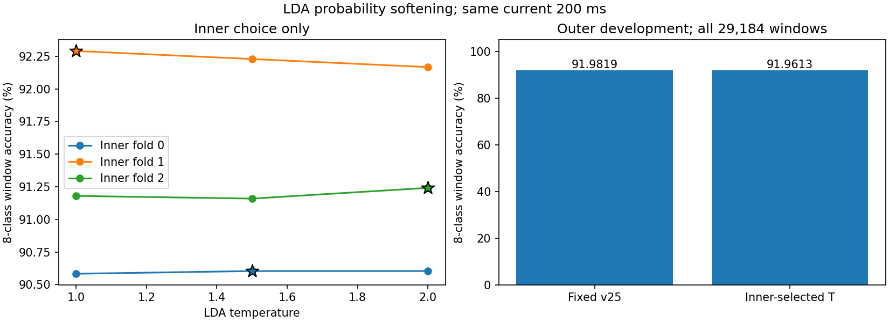

v27의 모델 크기는 138.51 MB, 원래 구성 모델 학습 합은 331.35초로 같고 온도 상수만 추가된다. 대표 바깥 fold0의 전체 확률 380창은 중앙값 **44.47 ms**, 평균 48.40 ms, p95 79.14 ms였다. 같은 실행의 T1 중앙값은 43.28 ms였다. 측정 변동을 포함하므로 차이를 온도 연산만의 인과 비용으로 단정하지 않는다. 라벨 생략 경로는 이 후보에서 새로 측정하지 않았으며 v25의 6.60 ms를 옮겨 쓰지 않는다. [비용](results/lda_temperature_v27/costs.json), [집계](results/lda_temperature_v27/summary.json), [사전 명세](experiments/lda_temperature_v27/PLAN.md)를 제공한다.

독립 거듭제곱 수식, 내부 9후보·바깥 58,368확률 행, 전체 시행 분할·19창·기존 시험 교집합 0·모델 해시를 검증했다. 최초 검증의 NLL 허용오차 1e−12는 float32 합산 순서 차이(최대 5.56×10⁻¹⁰)보다 작았다. 이를 기록하고 NLL만 1e−8로 조정했으며 예측 라벨은 계속 정확히 일치해야 통과하도록 유지했다. 생산된 결과나 선택은 수정하지 않았다. [수치 검증 기록](results/lda_temperature_v27/verification_numeric_note.json)을 남겼다.

전체 검사는 **65개**를 통과했다. v24의 규제 실패, v26의 주성분 추가 실패, v27의 확률 완화 실패를 지우지 않고 기존 v25 모델과 91.9819% 결과를 보존한다. 이번 대조는 모델을 늘리거나 입력 시간을 확대하지 않고 가능한 근거를 검증한 것이다. 기록 공유·64목표의 기록 대응·반복 내부 선택·미관측 시험 부재는 해결되지 않았다.

v27 정리 시점에는 410특징·64목표의 규제 숲이 미검증이었다. 과거 RF/ExtraTrees 대조는 905특징·직접 8목표였으므로 이를 같은 실험으로 간주하지 않고, 아래 v28에서 저장 예산을 고정해 실제로 추가 비교했다. 특정 클래스 쌍이나 특정 창을 골라 개선할 근거는 없으며, 기록 일반화에는 독립 반복 세션과 원필터·동작 시작 정보가 여전히 필요하다.

## 410특징·64목표의 저장 예산을 둔 숲 대조: v28

과거 숲 대조의 목표는 직접 8클래스였으므로 64목표의 ExtraTrees가 이미 검증됐다고 간주하지 않았다. 내부 오류에서 상보적인 판단의 가능성이 남아 있어, **현재 410특징·64목표에서 작은 숲 한 설정**을 추가로 실행했다. v26 PCA나 v27 온도 변환은 넣지 않고 기존 v25를 그대로 기준으로 삼았다.

모델은 ExtraTrees 128트리, 최대 잎 384개, 최소 잎 4창, max_features 0.5, bootstrap=False, seed 42다. 기존 v25 확률 90%와 숲 확률 10%를 고정해 비교했다. 전체 개발 시행과 19창은 그대로이며, 각 트리에 학습 창을 전부 제공했다. CPU 학습 6작업을 썼고 이 구현에 GPU를 강제로 적용하지 않았다. 128트리와 잎 상한은 결과를 보고 줄인 값이 아니라 **저장 예산을 먼저 정한 신규 후보**다. 트리 배열의 계산상 상한은 약 56.55 MB, 실제 숲+scaler 파일은 **56.68 MB**였다. 메타데이터를 포함한 실제 추가 결합 파일이 기존 전체 결합의 1.5배를 넘으면 선택하지 않도록 미리 정했다. [사전 명세](experiments/forest64_v28/PLAN.md)에 수식과 공식 문서 출처를 남겼다.

|내부 분할|기존 v25 정답|숲 10% 추가 정답|차이 / 4,864창|
|---|---:|---:|---:|
|0|4,406|4,404|−2|
|1|4,489|4,480|−9|
|2|4,435|4,435|0|

세 분할 모두 크기 상한 안이었지만 정답이 엄격하게 증가한 분할이 없어 **기존 v25를 유지**했다. 내부 합계는 13,330→13,319개로 11개 줄었다. 숲 단독 내부 정확도는 **81.3734%**이며 현재 결합의 대체 성능이 아니다. 학습 재대입 64목표 정확도는 약 91.84–92.40%였다. 새 내부 3fit의 실제 학습 합은 **19.32초**, scaler 준비 합은 0.16초다. 새 바깥 학습은 0회이며, 바깥 91.9819%는 기존 v25를 재사용한 값이다.


대표 내부 fold0의 전체 결합 파일 합은 기존 **116.32→172.99 MB**다. 같은 380평가창에서 특징+전체 확률 CPU 중앙값은 **40.62→44.84 ms**, 새 결합 평균 46.46 ms·p95 58.69 ms였다. 숲 추론은 단일 스레드이며 학습 때의 6작업 예측과 확률 동등성을 확인했다. 이 비용은 768시행으로 학습한 내부 모델이며, v25의 바깥 모델 138.51 MB와 압축률로 직접 비교하지 않는다. 라벨 호출 생략은 쓰지 않았다. [비용](results/forest64_v28/costs.json), [집계](results/forest64_v28/summary.json)를 제공한다.

첫 학습은 모델·예측·CSV 저장을 마친 뒤 진행 로그의 NumPy 정수 직렬화에서 멈췄다. 프로세스 종료와 완성 파일을 확인하고 로그 값만 Python 정수로 바꿨다. 첫 체크포인트를 다시 학습하지 않고 해시를 보존한 채 남은 2회를 완료했다. 따라서 완료 fit는 3회이며 첫 회를 중복 계산하지 않는다. [중단·재사용 기록](results/forest64_v28/interruption.json)을 남겼다.

3개 숲을 복원해 모든 트리의 실제 학습 행 수, 전체 표본 인덱스, 128트리, 잎 상한·최소 표본, 64클래스, 학습 전용 scaler, 확률의 64→8 합산, CPU 단일/병렬 예측, 행 순서, 원래 분할과 선택 규칙을 검증했다. 모든 1,536개 개발 시행과 19창, 기존 시험 교집합 0을 확인했다. 전체 테스트는 **66개**다. [검증](results/forest64_v28/verification.json), [실행 기록](experiments/forest64_v28/LOG.md)에 근거를 남겼다.

이번 작은 숲을 더 큰 숲 전체의 한계로 일반화하지 않는다. 다만 같은 입력의 PCA 추가, LDA 확률 완화, 비용 제한 숲 중 현재 v25를 개선한 후보는 없었다. 더 큰 숲·다른 seed·더 촘촘한 비중 탐색은 미실행이며, 지금 그 범위를 넓혀 얻을 이득은 입증되지 않았다. 이번에 근거를 세운 소수 대조를 모두 보존하고 **200 ms 최고 결과 91.9819%와 그 비용을 유지**한다. 개발 자료를 반복 확인한 수치이므로 미관측 성능으로 바꾸어 쓰지 않으며, 기록 일반화를 답하려면 독립 반복 세션과 원필터·동작 시작 정보가 필요하다.

## 410특징 SVM의 규제와 커널 폭: v29·v30

현재 410특징·64목표 SVM에는 C100/gamma=scale 한 설정만 적용돼 있었다. 과거 240특징·직접 8분류 결과를 이 설정의 탐색으로 간주하지 않았다. v25 내부 오답 1,262개 중 875개는 정답이 상위 두 클래스에 있었고, SVM 단독은 그 오답 중 353개를 맞혔다. 이 보완성을 유지하면서 C 또는 RBF 계수만 바꾸는 제한 비교를 등록했다. XGB·LDA, 4:1 비율, fold별 SVM 비중 40/20/30%는 그대로다.

v29는 C10, gamma=1/820, gamma=2/410의 세 후보를 비교했다. 표준화 뒤 기존 gamma=scale은 수치상 1/410이었다. gamma를 1/2배·2배 바꿨으며 신호 입력 시간은 바꾸지 않았다. C10이 기존과 같은 결과를 보여, 새 바깥 점수 전에 별도 v30에 C1 하나를 등록했다. v30 등록은 04:20:47 UTC, v29 선택 고정은 04:21:55 UTC, 첫 새 바깥 결과는 04:25:11 UTC다. v29의 후보를 사후 교체하지 않았다.

|고정 SVM 설정|내부 fold0 정답|fold1 정답|fold2 정답|기준 대비 합계|
|---|---:|---:|---:|---:|
|C100 / scale (기존)|4406|4489|4435|+0|
|C10 / scale|4406|4489|4435|+0|
|C100 / gamma 절반|4408|4487|4438|+3|
|C100 / gamma 두 배|4394|4479|4423|-34|
|C1 / scale|4392|4483|4423|-32|

각 내부 분할은 256시행×19창=4,864창이며 전체 창을 유지했다. SVM 파일 크기는 기존의 1.25배 이하만 허용하고, 정답 수가 같으면 기존을 유지했다.

v29 내부 선택은 넓은 커널 / 기존 / 넓은 커널이며 바깥 정답은 **26,832/29,184창, 91.9408±0.4625%**다. v25보다 -12개다. 이 비교의 내부 이득과 바깥 결과를 모두 보존한다.

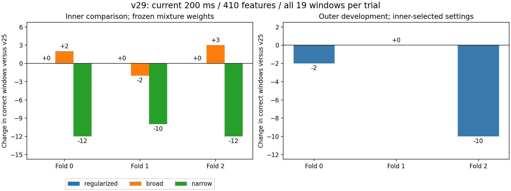

v30은 세 분할 모두 기존 유지다. 새 후보의 바깥 학습은 0회이며 **91.9819%는 v25를 그대로 재사용한 값**이다. C1 후보가 그 바깥 정확도를 얻었다고 해석하지 않는다.

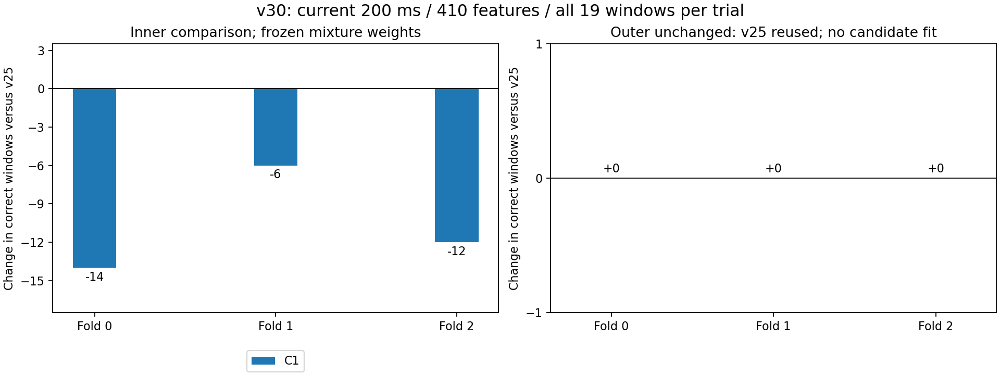

C100→10의 12개 base SVM 배열이 모두 같았는지 확인한 결과는 **모두 정확히 일치**다. 기존 최대 계수가 10보다 작아 C10이 실제 제약을 가하지 않았다. C1의 12개 base 모델 중 12개에서는 계수가 실제 상한 1에 도달했다. 따라서 C10의 무변화와 C1의 성능 결과를 같은 종류의 규제 실험으로 뭉뚱그리지 않는다.

|측정 대상|학습 범위|전체 모델 MB|구성 모델의 관측 학습 합(초)|특징+전체 확률 중앙값(ms)|평균(ms)|p95(ms)|
|---|---|---:|---:|---:|---:|---:|
|v29 incumbent|outer fold0|138.5073|331.35|42.6010|45.7650|69.4427|
|v29 broad|outer fold0|135.6532|309.64|42.1537|45.7604|74.6867|
|v30 incumbent|inner fold0|116.3176|233.12|41.9387|43.2501|53.1198|
|v30 C1|inner fold0|116.3734|233.92|44.2390|48.5086|69.4106|

각 비교 안에서 같은 첫 20평가 시행의 380창·19예열·CPU batch1을 사용했다. 특징 계산과 모든 모델의 확률 계산을 포함하며 신호 취득·CSV 읽기·모델 적재는 제외한다. 다른 학습·복원 검증과 겹치지 않게 순차 측정했다. 내부 모델은 768시행, 바깥 모델은 1,024시행으로 학습하므로 서로 압축률로 직접 비교하지 않는다. v25의 라벨 전용 호출 생략 시간 6.60 ms와도 다른 경로다. wrapper fit 시간에는 보정 OOF 예측과 sigmoid 학습이 포함되며 base fit 합과 더해 중복 계산하지 않는다.

새 확률모델은 총 **14개**, 64분류 base SVC fit는 **56개**다. 모든 모델의 4개 base 체크포인트, 실제 C/gamma, 클래스 지원, 수렴, 학습 전용 scaler, 시행 단위 보정 OOF, 64개 sigmoid 계수, 최종 확률·라벨·metric을 독립 복원했다. 선택·파일 크기 제한·분할 ID와 전 29,184창의 CPU 결합 라벨도 확인했다. 학습 시행의 19창은 보정 fold를 넘지 않는다. 원래 시험 384시행의 새 학습·평가·선택은 없다. 공유 캐시 파일에는 시험 행도 들어 있으므로 파일 수준에서 전혀 읽지 않았다고 주장하지 않는다.

검사한 범위는 C=1/10/100에서 gamma=scale, 그리고 C100에서 gamma=기준의 1/2배·2배다. C와 gamma의 모든 조합·연속 범위를 소진한 것은 아니다. 현재 결과는 넓은 커널의 미세한 내부 이득이 바깥에서 유지되지 않았고, 더 좁은 커널과 C1은 내부에서 유리하지 않았다는 범위로 해석한다. 후속 범위를 무작정 넓히는 것보다 새 표현이나 다른 학습기의 보완 오류에 대한 내부 근거를 먼저 요구한다.

현재 200 ms·100 ms 이동·전 19창·개발 1,536시행·64기록을 유지했고 과거/미래 창·시행 투표·기록 ID 추론 입력은 없다. 반복 개발 선택과 이전 바깥 점수 노출은 남아 있다. 64학습 목표와 64기록은 일대일이므로 기록 공유 성능을 새 기록의 동작 일반화로 제시하지 않는다. 논문 전문·정확한 원필터·독립 세션은 미확보이며, 논문 정확재현이나 독립 외부 시험 성공으로 주장하지 않는다. 기존 v23·v25 및 공개 묶음은 보존하고 외부 게시·업로드는 하지 않았다.

[v29 사전 명세](experiments/svm_tuning_v29/PLAN.md), [v30 사전 명세](experiments/svm_regularization_v30/PLAN.md), [v29 검증](results/svm_tuning_v29/verification.json), [v30 검증](results/svm_regularization_v30/verification.json), [v29 비용](results/svm_tuning_v29/costs.json), [v30 비용](results/svm_regularization_v30/costs.json)에 원시 집계와 검증 범위를 남겼다.

비용 측정의 첫 시도는 타이밍 전에 중단됐다. 동시 학습 검사에서 순차 실행용 부모 셸 명령문까지 감지한 것이 원인이며, 학습·복원 검증은 이미 종료돼 있었다. 최초 표식과 오류 로그를 보존하고, 같은 검사를 유지한 별도 비용 전용 프로세스에서 한 번만 다시 측정했다. 빠른 측정값을 골라 쓴 것이 아니다. [중단·재측정 기록](results/svm_tuning_v29/cost_quality.json)을 남겼다. 전체 테스트 69개와 새 거리 변환의 합성 테스트 3개가 각각 통과했다.

## 모델 크기와 실행 비용

v10–v13의8개 비용 조건은 모든 학습이 끝난 뒤, 같은256개 개발 창·CPU6스레드·20회 예열·200회 측정으로 실행했다. 같은 수식의 벡터화 특징, XGB CPU inplace_predict, 숲의 predict_proba를 사용했다. 각 모델의 특징·확률 열·저장 평가 예측과 모델 해시를 확인했고 원시 시간에서 중앙값과p95를 다시 계산했다. 신호 취득200ms와 모델 로드 시간은 제외했다.

| 대표 모델 | 학습 시행 | 모델+scaler 크기 | CPU 전체 중앙값 / p95 |
|---|---:|---:|---:|
| 전체 XGB, 내부fold0 | 768 | 32.88MB | 4.44 / 5.84ms |
| 좁은 XGB, 내부fold0 | 768 | 33.41MB | 4.40 / 5.19ms |
| 선택 결합, 내부fold0 | 768 | 66.29MB | 6.80 / 7.81ms |
| RF100, 내부fold0 | 768 | 68.16MB | 14.54 / 15.81ms |
| ExtraTrees400, 내부fold0 | 768 | 365.09MB | 46.11 / 47.77ms |
| 전체 XGB, 바깥fold0 | 1,024 | 36.07MB | 4.60 / 5.68ms |
| 좁은 XGB, 바깥fold0 | 1,024 | 36.75MB | 4.69 / 6.08ms |
| 선택 결합, 바깥fold0 | 1,024 | 72.82MB | 7.78 / 9.56ms |


그림. 막대는중앙값, 표시선 끝은p95, 숫자는중앙값이다. 위·아래의 학습 규모가 달라 각각 묶어 비교한다. 선택 결합은 특징을 한 번 계산해도 두 모델 추론이 필요하다. 바깥 대표 모델에서40창의 작은 정확도 이득에 대해 저장 크기는약2.02배, 계산 중앙값은약1.69배였다. 좁은 표현의 학습 시간은 줄었지만 이 구현의 추론 지연 우위는 확인하지 못했다. [측정 계획](experiments/continuation_cost/PLAN.md), [전체 수치](results/continuation_cost/summary.csv), [시간 재계산 검증](results/continuation_cost/verification.json)을 제공한다.

아래는 앞선 단계에서 측정한 비용 기록이며, 호출 API·학습 규모·측정 시점이 다른 표를 직접 뺄셈하지 않는다.

같은 PC에서 스레드 상한 6, 입력 풀 256개, 단일 창 warmup 20회와 측정 200회로 비교했다. 특징 추출·scaler·모델·전체 처리를 각각 쟀고, GPU 호출 앞뒤에는 동기화했다. batch 256은 warmup 5회와 측정 30회로 처리량을 따로 구했다. 다른 GPU 학습은 동시에 실행하지 않았다. 그래픽 데스크톱은 남아 있었다. [시간 원값 재계산 검증](results/cost_benchmark/verification.json), [전체 비용 표](results/cost_benchmark/accuracy_cost.csv), [측정 과정과 판단](experiments/cost_benchmark/LOG.md)을 제공한다.

| 같은 v7 분할의 조건 | 정확도 | 대표 크기 | CPU 전체 중앙값 / p95 | GPU 전체 중앙값 / p95 |
|---|---:|---:|---:|---:|
| 400회 | 87.91% | 38.84 MB | 5.93 / 6.98ms | 244.42 / 258.76ms |
| 800회 | 88.46% | 60.37 MB | 7.22 / 8.34ms | 407.05 / 438.04ms |
| 고주파 관계 제거 | 84.88% | 41.29 MB | 6.31 / 8.94ms | 258.45 / 275.13ms |
| 세부 파워 추가, 400회 | 89.78% | 36.34 MB | 6.10 / 7.49ms | 232.95 / 249.22ms |

정확도는 고정 3분할 집계, 비용은 첫 분할의 대표 모델을 측정한 값이다. 크기는 scaler를 포함한 실제 저장 바이트이며, 위의 분할 평균 크기와 구분한다. 모델 400/800회의 실제 구조는 각각 25,600/51,200트리, 646,510/783,950노드였다. RF100은 1,371,220노드·175.56MB였다. [상세 구조](results/cost_benchmark/model_structure.csv), [저장 모델 목록](results/cost_benchmark/all_saved_models.csv), [학습 시간과 측정 범위](results/cost_benchmark/observed_fit_times.csv)를 확인할 수 있다.


그림. 왼쪽 지연 축은 로그 눈금이다. 800회는 정확도가 조금 높지만 더 크고 느리다. 제거 조건은 400회보다 정확도·크기·지연 모두 불리했다. Pareto 여부는 같은 분할과 장치 안에서만 계산했으며 통계적 우열을 뜻하지 않는다. 현재 GPU 값은 매 호출의 DMatrix 생성·전송·CPU 확률 반환을 포함한다. GPU 하드웨어 자체의 한계로 단정하지 않고 [공식 inplace 경로 대조](experiments/cost_benchmark/INPLACE_PLAN.md)를 별도로 수행했다.

추가 호출 대조는 같은 저장 모델 4개·장치 8조합에서 수행했다. 이미 측정한 특징·문맥 시간을 반복하지 않고 단일 창 100회와 batch256 10회로 모델·전체만 비교했다. CPU/GPU 동기화, 복사 포함 범위, warmup 조건은 유지했다. 원래 200/30회 결과는 보존했다. fine400의 inplace 전체 중앙값은 CPU **5.97ms**, GPU **168.45ms**였다. batch256 전체 처리량은 CPU **3,212.85창/s**, GPU **1,017.32창/s**였다. API 개선 후에도 이 PC와 모델에서는 CPU가 빨랐다. 배치를 모으는 대기시간은 처리량에 포함하지 않는다. [호출 경로 표](results/cost_benchmark/api_comparison.csv)와 [원시 시간·출력 대조](results/cost_benchmark/inplace_verification.json)를 제공한다.

교차 특징의 Python 반복을 같은 수식의 행렬 계산으로 바꿨다. 전체 36,480창에서 float32 특징이 같았으며 v8의 모든 29,184개 개발 평가창에서 CPU/GPU 분류도 일치했다. 같은 입력을 번갈아 실행한 쌍 비교에서 v8의 CPU 특징 추출은 **3.19→1.89ms**, 전체 처리는 **6.37→4.88ms**, 전체 p95는 **8.90→6.51ms**였다. 모델이나 정확도를 바꾸지 않은 계산 개선이다. [특징·예측 동등성](results/cost_benchmark/fast_verification.json), [전체 CPU 예측 대조](results/fine_spectrum_v8/cpu_prediction_verification.json), [쌍 비교 시간 재계산](results/cost_benchmark/fast_timing_verification.json)을 확인할 수 있다.


그림. 막대는 중앙값, 위쪽 표시선은 p95다. 왼쪽은 동일 모델에서 번갈아 측정한 CPU 쌍 비교이며 오른쪽은 별도로 측정한 GPU 호출 경로 비교다. 두 그래프의 시간 축 범위는 다르다. 신호를 모으는 200ms와 이 계산 시간은 별개다.

더 작은 표현도 확인했다. 4차 내부 비교에서 155특징 대안은 79.73%, 240특징은 79.79%였고 CPU 전체 중앙값은 2.24/3.10ms였다. 크기는 19.56/19.46MB로, 특징을 줄여도 저장 크기는 줄지 않았다. 같은 자료의 바깥 평가 수치와 섞지 않는다. 6차 교차 모델은 CPU 특징 추출 2.83ms, 모델 2.60ms여서 같은 수식의 계산 최적화도 검증한다.

400/800회 CPU 측정 프로세스의 최대 RSS는 약 591/750MiB였다. Python·라이브러리·입력·모델을 합친 생애 peak이며 모델만의 메모리가 아니다. GPU 사용량은 warmup 뒤와 측정 뒤 166MiB가 관측됐고 순간 peak나 학습 peak는 측정하지 못했다. CPU 실행에서도 CUDA 모델 로드로 만든 context의 148MiB가 남았지만 booster의 예측 장치는 CPU였다.

첫 출력에는 200ms 신호가 필요하고, 과거 5창이 모두 쌓이면 600ms 정보를 사용한다. 첫 창부터 출력하므로 미래 대기는 없으며 알려진 시행 경계에서 reset한다. mark+1.7초의 첫 신호 종료, mark+2.1초의 완성된 문맥, 수 ms의 CPU 계산 시간은 서로 다른 항목이다. 실제 연속 동작 전환의 응답 지연은 이 정적 시행 자료로 측정하지 못했다.

## 과거 300ms 조건의 오류 분석


그림 6. 선택 모델은 4714/6912창을 맞췄다. 각 클래스는 864창이며, 남은 2198오류는 각도만 596개(27.1%), 동작만 934개(42.5%), 둘 다 668개(30.4%)였다. `30_pro→60_pro` 88창과 `60_pro→30_pro` 86창의 각도 혼동, `30_pro→30_extor` 71창의 동작 혼동이 남았다. [선택 모델 오류표](results/selected_errors.csv)와 [혼동행렬 수치](results/confusion_selected.csv)를 제공한다.


그림 7. 전체 5-fold의 평가 예측을 창 시작 시각별로 집계했다. 각 점은 1920창이다. SVM은 뒤쪽 창에서 성능이 낮아졌고, RF와 XGB도 위치에 따라 달라졌다. 신호 반응의 시간 변화와 연관될 가능성이 있으나, 이 그림만으로 낮은 성능의 원인을 휴식 구간이나 데이터 문제로 확정하지 않았다.

시행별 다수결은 보조지표로만 [원수치표](results/baseline.csv)의 `trial_vote_accuracy`에 남겼다. 창 점수와 평가 단위가 다르므로 주결과나 논문 점수를 대체하지 않는다.

## v31 상관 보정의 실패와 논문 대조로의 우선순위 변경

현재 410차원을 모두 유지한 채 StandardScaler 뒤에 학습 전용 Ledoit–Wolf 공분산의 역제곱근 변환을 넣었다. SVM C100·gamma=scale, 같은 시행 단위 내부 보정을 유지했다. 새로운 내부 3모델·12개 base SVM은 완료했으나 기존 결합 대비 정답이 −19/−13/−6개였다. 모든 fold가 기존 모델을 유지했으므로 새 바깥 모델은 0개이며, 결과표의91.9819%는 v25의 재사용이다. 원래 클래스 확률·학습 전용 변환·분할·체크포인트 복원 검증을 통과했다. 성능이 낮은 후보의 별도 긴 지연 측정은 사용자 우선순위에 따라 수행하지 않았다. [실행 결과](results/svm_metric_v31/inner.csv), [검증](results/svm_metric_v31/verification.json).

논문 공개 Fig.5와 강의 코드·본문을 다시 읽어 [비교표](docs/PAPER_IMPLEMENTATION_COMPARISON.md)를 작성했다. 단순한 트리 수 축소나 특징 수식 오류는 확인되지 않았다. 가장 중요한 미확인은 논문 그림의384개가 무엇을 한 표본으로 세었는지, 고정2초 구간의 시작점과 원필터가 무엇인지다. 공개 데이터 제공 정책을 데이터 불일치의 증거로 쓰지 않는다. 현재200ms 조건을 유지하는 v32 RF 대조를 별도로 사전 고정했고, 논문 수치에 맞추려고 평가단위를 바꾸지 않는다.

## v32: RF 용량 대조와 단독 모델 요청으로의 전환

이 계획은 단독 모델 요청 전에 결합 대조로 시작됐다. 이미 진행하던6fit를 안전하게 완료한 뒤 RF 단독 예측을 v33의 같은 내부 분할 비교에 재사용했다. 아래 결합 선택은 이전 계획의 실행 기록이며 현재의 후보 선정 기준으로 사용하지 않는다.

논문 비교표에서 강의 RF 100트리·25TD 기준선의 임의 축소는 확인되지 않았다. 별개로 현재 410개 특징에서 RF 자체를 충분한 잎 용량으로 비교한 기록이 없었다. v13은 905개 특징·직접 8목표였고 v28은 잎 제한 ExtraTrees였다. 따라서 RF 200트리·max_features=.5·깊이/잎 제한 없음 한 설정을 직접 8/64목표에서 비교했다. 같은 200ms·100ms 이동·19창·기존 시행 분할·전체 개발 1,536시행을 유지했다.

|목표|RF 단독 내부 평균±SD|기존 결합에 10% 추가한 정답 변화(3 fold)|모델 크기 범위|평균 학습시간|
|---|---:|---|---:|---:|
|direct8|82.2026±1.0008%|-1/+1/+8창|93.22–96.09 MB|127.54초|
|latent64|84.4161±0.8225%|-2/-3/+3창|504.10–518.98 MB|181.77초|

내부 후보 6개를 학습했고 선택은 `['incumbent', 'incumbent', 'incumbent']`였다. 내부 정답 최소 10개 증가·전체 크기 기존 3배 이내를 요구했다. 새 바깥 RF는 0개다. 바깥 결과의 기존 모델 재사용과 새 후보 평가를 구분한다.

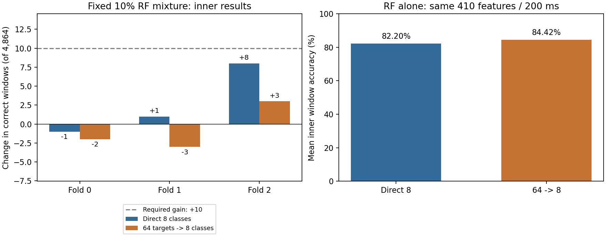

그림. 같은 내부 평가 4,864창의 정답 변화와 RF 단독 정확도다. 상관된 창을 독립 표본으로 가정한 신뢰구간은 계산하지 않았다. 64목표가 기록과 일대일이라는 한계가 유지되며, 이 RF 대조를 논문 96.72%의 재현으로 부르지 않는다.

6개 저장모델 복원, 각 200트리·전체 학습 창 제공·bootstrap 표본 수·학습 전용 scaler·확률 열·독립 선택 규칙·전 29,184바깥 창 집계를 확인했다. 기존 시험 384시행은 재평가하지 않았다. 초기 검사 수집은 파일명 중복으로 중단됐고 새 검사명만 고유하게 바꾼 뒤 75개 검사를 통과했다. 열세 내부 후보의 긴 지연 측정은 생략했다. [사전 계획](experiments/rf_capacity_v32/PLAN.md), [집계](results/rf_capacity_v32/summary.json), [검증](results/rf_capacity_v32/verification.json).

## v33: 결합 없는 단독 XGBoost의 고정 대조

같은 내부 분할에서 XGB800의 단독 정답이 XGB400보다 세 번 모두 높았다. 더 얕은 트리에 학습 단계를 늘리는 한 후보(깊이3·1,600회)를 GPU에서 검증했다. 사용자의 새 조건에 따라 한 번의 예측에는 XGB 한 모델만 쓰며 LDA·SVM·RF 출력이나 과거 창을 결합하지 않는다. 기존 200ms·100ms 이동·19창·개발 1,536시행·410특징·시행 분할을 유지했다.

|내부 fold|기존 단독 XGB800|새 단독 XGB1600|정답 변화|고정 선택|
|---|---:|---:|---:|---|
|0|89.4737%|89.5765%|+5 / 4,864창|깊이4·800|
|1|91.3240%|91.6324%|+15 / 4,864창|깊이3·1600|
|2|90.1316%|90.3166%|+9 / 4,864창|깊이4·800|

내부에서 정답 최소 10개 증가·기존 모델의 2배 이하 크기를 요구하고 선택을 먼저 고정했다. 바깥 개발 결과는 기존 단독 **90.9608%(26546/29,184)**에서 선택 절차 **91.0773±0.3460%(26580/29,184)**다. 순변화는+34창이다. 이 값은 과거91.9819% 앙상블과 다른 단독 모델 조건이며, 독립 외부 시험도 아니다.

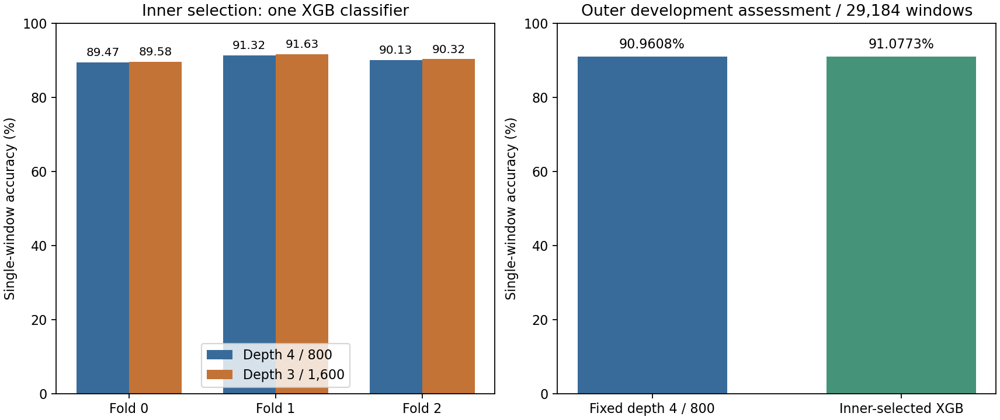

새 4fit와 저장 모델 4개를 복원했다. 모든 새 fit에서 CUDA·1,600회·102,400트리, 학습 전용 scaler, 같은 분할·클래스 지원·입력 해시·단일 모델 확률 해독·CPU 복원 라벨·수동 지표·기존 산출물 해시가 일치했다. 전체 77개 검사도 통과했다. 기존 시험 384시행은 평가하지 않았다.

새 후보의 학습 시간과 모델 크기는 [fit 기록](results/standalone_xgb_v33/fits.csv)에 있다. 정확도에 불리한 후보의 긴 비용 측정은 하지 않는다. 비용 측정을 완료한 경우 아래 표와 원시 집계에서 대표 fold·380창·현재창 특징 계산 포함 여부를 명시한다.

이전 바깥 평가 결과 노출과 반복 내부 선택은 남아 있다. 64목표와 64기록의 일대일 관계도 유지되므로 새 기록 일반화로 해석하지 않는다. 논문의384개 표본 정의·구간 시작점·실제 필터와 원자료 대응은 미확인이다. [사전 계획](experiments/standalone_xgb_v33/PLAN.md), [검증](results/standalone_xgb_v33/verification.json), [집계](results/standalone_xgb_v33/summary.json).

같은 바깥 fold1의 380창에서 측정한 단독 비용은 다음과 같다. 특징 계산은 현재 200ms에서905개를 계산한 뒤 410개를 선택하는 기존 경로를 포함한다. 예열 19창, CPU 라이브러리 6스레드이며 CSV·모델 로딩·신호 취득은 제외했다. 두 행은 각각 한 모델의 확률을 계산하며 모델 간 결합이나 호출 생략을 쓰지 않았다.

|단독 설정|저장 크기|관측 학습시간|특징+추론 중앙값|평균|p95|
|---|---:|---:|---:|---:|---:|
|깊이4·800회|55.44MB|176.15초|5.83ms|6.07ms|7.67ms|
|깊이3·1,600회|92.47MB|267.85초|7.32ms|7.54ms|9.28ms|

정확도 증가 0.1165%p에 비해 선택된 모델의 저장 크기와 학습시간 증가는 크다. 기존 800회 모델은 효율을 비교할 기준으로 보존한다. 이 점 추정의 작은 증가만으로 통계적 우월성이나 논문 수준 달성을 선언하지 않는다. [같은 창 비용](results/standalone_xgb_v33/cost_summary.csv), [원시 시간 재계산 검증](results/standalone_xgb_v33/cost_verification.json).

추가 미세 탐색을 자동으로 시작하지 않았다. 당시 다음 후보로 등록한 현재창 내부의 시간별 주파수 표현은 [다음 방법 검토](docs/NEXT_SINGLE_MODEL_METHOD.md)에 근거·반증 조건·예상 비용을 적었고, 아래 v34에서 실행했다. v34에서는 개선을 확인하지 못했다.

## v34: 현재창 내부의 시간별 대역 분포 — 개선 없음

기존 410/905 개 특징은 창 전체의 스펙트럼과 채널 관계, 짧은 구간의 광대역 RMS를 포함한다. AR 계수·잔차를 붙인 440/445 차원도 이미 v15 에서 시험했다. 이번에는 **현재 200ms만 네 50ms 블록으로 나누고, 각 블록·채널의 네 주파수 대역 상대 파워 80 개를 추가**했다. 전체 490 차원을 하나의 XGB에 입력했으며 모델 출력 결합은 없다. 블록 평균 제거→주기형 Hann→50 점 FFT→20–100/100–200/200–350/350–450Hz 상대 파워 순서다. 분해능은 20Hz이고, 미래·과거 창·시행 경계·기록 ID를 입력으로 사용하지 않는다. [정확한 수식과 사전 계획](experiments/local_spectrum_v34/PLAN.md), [특징 코드](experiments/local_spectrum_v34/features_tf34.py).

기존 905 개+AR 35 개와 직접 중복되는 열은 발견하지 못했다. 다만 기록·클래스·RMS를 통제한 시간 변화량과 오류의 상관은 −0.0263/+0.0021/−0.0131 로 작았다. 따라서 “큰 주파수 변화가 오류 원인”이라는 설명은 지지되지 않았다. 한 개의 변화량 요약만으로 전체 표현의 분류 효용을 판정할 수 없다는 제한 아래, 고정 후보 한 개를 시험한 이유와 진단 게이트 재검토를 [판단 기록](experiments/local_spectrum_v34/DIAGNOSTIC_DECISION.md)에 공개했다. 이 음성 진단을 양성 근거로 바꾸어 설명하지 않는다.

같은 내부 분할의 **단독** 비교는 다음과 같다. 각 셀의 분모는 4,864 창이며 세 내부 평가 부분을 완전 OOF로 부르지 않는다.

|내부 fold|기존 410 차원 XGB800|v33 에서 선택한 단독 모델|새 490 차원 XGB800|v33 대비|
|---|---:|---:|---:|---:|
|0|4,352|4,352|4,347|−5 창|
|1|4,442|4,457|4,433|−24 창|
|2|4,384|4,384|4,397|+13 창|
|평균 정확도|90.3098%|90.4126%|90.3029%|−0.1096%p|

새 표현의 전체 내부 평균은 고정 XGB800 보다도 1 창 낮았다. 사전에 정한 fold별 정답 최소 10 개 증가·기존 XGB800 의 1.5 배 이하 크기 기준으로 fold2 만 통과했다. **06:08:10 UTC에 `[false,false,true]` 선택을 고정한 뒤 바깥 학습 1 회만 수행**했다. 선택 해시는 `3ad523519393246d0dc0acdaad51daf71bc9bc889948e80edaff976c3fcb2858`이다.

바깥 개발 선택 절차는 **91.0773±0.3460% → 91.0739±0.3429%**였다. 정답은 **26,580→26,579/29,184 창**, −1 창(−0.00343%p)이다. 새 표현을 쓴 fold2 에서 오류 85 창을 고쳤지만 기존 정답 86 창을 잃었다. 해당 512 시행 중 57 개는 정답 수가 늘고 61 개는 줄었으며 394 개는 같았다. 나머지 두 fold는 기존 v33 모델이므로, 91.0739%를 490 차원 고정 설정의 전체 3-fold 점수라고 부르지 않는다. 바깥 결과를 보고 내부 선택을 되돌리지는 않았으며, **이 시도는 개선 실패로 보존하고 기존 v33 의 결과·모델을 유지**한다. 1 창 차이를 의미 있는 열세나 개선으로 과장하지 않는다.

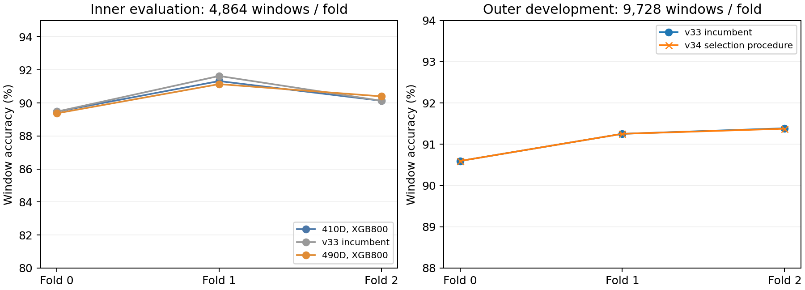

그림. 왼쪽은 같은 내부 분할의 정답률, 오른쪽은 전체 개발 시행을 한 번씩 평가한 바깥 결과다. 오른쪽의 첫 두 점은 같은 모델의 재사용이며 세 번째 점의 차이도 매우 작다. 입력은 200ms·100ms 이동·전 19 창, 개발 1,536 시행/64 기록, 같은 v10 분할을 유지했다. [집계](results/local_spectrum_v34/summary.json), [내부 비교](results/local_spectrum_v34/inner_comparison.csv), [바깥 변화](results/local_spectrum_v34/paired_changes.csv).

새 내부 3fit·바깥 1fit는 모두 사용자 TITAN Xp에서 800 회·깊이 4·64 목표·51,200 트리로 완료됐다. 새 4fit의 관측 학습 시간 합은 **661.23 초**, 모델 크기는 **52.07–55.59MB**다. 같은 바깥 fold2 의 기존→새 모델은 **55.75→55.59MB**, 원래 관측 학습 시간은 **175.59→199.54 초**였다. 학습 시간은 서로 다른 실행 시점의 관측값이며 통제된 동시 비교가 아니다. 개선이 없었으므로 새 모델의 추가 추론 지연 측정은 생략했고, 이전 모델의 지연을 새 모델 값으로 대입하지 않았다.

모델 4 개의 CPU 복원·64 목표 지원·학습 전용 scaler·실제 CUDA/800 회·분할 재구성·선택 규칙·입력/모델 해시·확률·라벨·수동 지표와 기존 파일 보존을 검증했다. 개발 전 29,184 창의 새 80 개 특징을 별도 SciPy periodogram으로 재계산한 최대 차이는 **5.56e−16**이었다. 기존 410 개 값도 그대로임을 확인했고 최종 **83 개 검사**를 통과했다. 기존 시험 384 시행은 새 특징 계산·학습·선택·평가에 사용하지 않았다. [복원 검증](results/local_spectrum_v34/verification.json), [독립 특징 검증](results/local_spectrum_v34/independent_features.json), [실행 기록](experiments/local_spectrum_v34/LOG.md).

이 결과는 해당 고정 표현의 이득을 확인하지 못했다는 뜻이다. 모든 시간별 주파수 표현이 무용하다는 증거는 아니다. 대역·블록 수를 사후에 바꾸는 연속 탐색은 이번 계획에 추가하지 않았다. 기록 공유·64 목표와 64 기록의 일대일 관계·반복 개발 선택 편향이 그대로 남고, 원자료의 사전 필터 인과성도 미확인이다. 새로운 외부 시험이나 논문 정확재현으로 해석하지 않는다. 공개 게시·업로드·ZIP 갱신은 하지 않았다.


## 전체 실험 이력 재실행 명령

<details>
<summary>기존 산출물을 보존하며 선행 단계부터 재현하는 명령</summary>

추가 진단과 개선은 같은 `SEMG_RUN_DIR`에서 아래 순서로 실행한다. 원래 `improve`와 `analyze`가 만든 특징·개발 예측·RMS 프로파일이 필요하다. 각 단계는 등록된 전체 입력을 쓰며 새 특징 생성과 학습은 기존 출력을 덮어쓰지 않는다.

```bash
bash run_extensions.sh test
bash run_extensions.sh features
bash run_extensions.sh diagnose
bash run_extensions.sh nested
bash run_extensions.sh mechanisms
bash run_extensions.sh capacity
bash run_extensions.sh subclass
bash run_extensions.sh cross
bash run_extensions.sh cross-capacity
bash run_extensions.sh fine-spectrum
bash run_extensions.sh spectral-controls
bash run_extensions.sh reference-phase
bash run_extensions.sh record-reference
bash run_extensions.sh fit-gap
bash run_extensions.sh nested-selection
bash run_extensions.sh line-projection
bash run_extensions.sh probability-blend
bash run_extensions.sh forest-transfer
bash run_extensions.sh verify
bash run_extensions.sh benchmark
```

활동 구간 기록 진단과 그 결과를 본 뒤 등록한 기본25특징 대조는 별도 결과 경로를 사용한다. 아래 순서를 유지한다.

```bash
"$SEMG_PYTHON" experiments/active_record_control/run.py
"$SEMG_PYTHON" experiments/active_record_control/verify.py
"$SEMG_PYTHON" experiments/active_record_control/run.py --baseline
"$SEMG_PYTHON" experiments/active_record_control/verify.py --baseline
"$SEMG_PYTHON" experiments/active_record_control/report.py
"$SEMG_PYTHON" experiments/continuation_cost/report.py
# 다른 학습이 끝난 상태에서 비용8조건을 각각 새 프로세스로 측정
for case in inner_fine64 inner_narrow64 inner_blend inner_RF100_fine inner_ET400_fine outer_fine64 outer_narrow64 outer_blend; do
  "$SEMG_PYTHON" experiments/continuation_cost/benchmark.py --case "$case"
done
"$SEMG_PYTHON" experiments/continuation_cost/verify_report.py
# 사후 등록한 공통 RMS 대조: 기존 결과와 별도 경로
"$SEMG_PYTHON" experiments/gain_invariance_v14/features.py
"$SEMG_PYTHON" experiments/active_record_control/run.py --gain
"$SEMG_PYTHON" experiments/active_record_control/verify.py --gain
for kind in raw25 normalized25; do
  for protocol in trial_shared record_disjoint; do
    "$SEMG_PYTHON" experiments/gain_invariance_v14/cost.py --kind "$kind" --protocol "$protocol"
  done
done
"$SEMG_PYTHON" experiments/gain_invariance_v14/report.py
"$SEMG_PYTHON" experiments/gain_invariance_v14/confusion_diagnostic.py
# 후속 AR 고정 대조: 새 경로, 최대25fit, 실제23fit
bash run_extensions.sh ar-residual
bash run_extensions.sh factorized-targets
bash run_extensions.sh shrink-qda
bash run_extensions.sh shared-lda
bash run_extensions.sh lda-blend
bash run_extensions.sh svm410
bash run_extensions.sh svm-blend
bash run_extensions.sh svm-gate
bash run_extensions.sh causal-probability
bash run_extensions.sh regularized-boosting
bash run_extensions.sh mixture-weights
bash run_extensions.sh pca-augmentation
bash run_extensions.sh lda-temperature
bash run_extensions.sh forest64
bash run_extensions.sh svm-tuning
bash run_extensions.sh svm-regularization
```

중단된 4–11차 학습은 해당 단계 뒤에 `--resume`을 붙인다. 완료 행과 필수 파일을 확인하고 기존 산출물의 해시를 보존하며, 점수 없는 불완전 산출물이 있으면 덮어쓰지 않고 중단한다. 실행 시간을 비교할 때에는 CPU 예측 시간, 동시 GPU 작업과 실제 모델 크기도 고려한다. 출력 경로 분리 후 새 경로에서 다시 만든 교차 특징의 SHA-256이 원래 배열 파일과 일치했다. [경로 검증](results/extension_path_verification.json)을 제공한다.

추가 API와 벡터화 검증은 기본 비용 측정이 완료된 뒤 다른 학습이 없을 때 실행한다. 공식 CuPy는 별도의 가상환경에 설치하며, 같은 출력 위치에 환경이 있으면 설치 스크립트가 보존을 위해 중단한다.

```bash
export PYTHONPATH="$PWD/src"
bash scripts/setup_inference_env.sh
"$SEMG_RUN_DIR/private/inference_env/bin/python" experiments/cost_benchmark/run_inplace.py
"$SEMG_RUN_DIR/private/inference_env/bin/python" experiments/cost_benchmark/report_inplace.py
"$SEMG_PYTHON" experiments/cost_benchmark/fast_probe.py
"$SEMG_PYTHON" experiments/cost_benchmark/verify_fast.py
"$SEMG_PYTHON" experiments/fine_spectrum_v8/verify_cpu.py
"$SEMG_PYTHON" experiments/cost_benchmark/report_paths.py
```

원본 데이터·강의·모델·개별 예측과 신호 그림은 Git에 포함하지 않았다. 공개 후보에는 새 코드·명세·집계표·집계그림만 있다. 로컬 Git은 새 루트 커밋에서 시작했다. 검증된 공개 파일만 별도 Git으로 구성해 [새 공개 저장소](https://github.com/KyunghoCha/semg-coursework-clean-reproduction)에 게시했으며 비공개 실험 이력은 push하지 않았다. [게시 이력](docs/PUBLICATION.md)에 공개 범위와 최초 ZIP 해시가 있다. [진행 기록](PROGRESS.md)과 [근거자료](docs/SOURCES.md)에 실행 순서와 미확인 범위를 남겼다.


</details>

## 공개 범위와 게시 이력

v34 공개 반영은 커밋 `8d7258135e5eba51f10632be98e67ae3c2315f18`에서 완료했다. 이번 보완은 새 학습 없이 제출용 코드 설명·네 지표·클래스별 혼동행렬을 정리한 것이다. 기존 v34 ZIP은 동결본으로 보존하며 현재 저장소의 후속 문서와 구분한다. 원신호·학습 모델·개별 예측·개인별 결과·강의 원문·인증정보·대화는 계속 제외한다. [공개 이력](docs/PUBLICATION.md), [포함 파일·해시](PUBLIC_MANIFEST.csv)를 참고한다.
