# sEMG 손동작·팔꿈치 각도 분류

5채널 표면근전도(sEMG)에서 손동작 4종과 팔꿈치 각도 2종을 구분하는 수업 프로젝트다. 강의 4개를 읽고 원본 CSV부터 새로 구현했다. 전체 1,920시행의 강의 기준실험에서 RF의 5-fold 창 정확도는 **64.54±0.35%**였다. 이후 같은 200ms·19창을 유지한 개발 평가에서, 내부 자료로 가중치를 선택한 두 XGB의 확률 결합은 **90.1624±0.4303%**였다. 같은 분할의 단일 모델보다 40창(+0.1370%p) 높았지만 대표 크기는36.07→72.82MB, CPU 처리 중앙값은4.60→7.78ms로 증가했다.

현재 후속 연구의 **단일 기준 후보는 내부 선택으로 정한410특징 XGB400(narrow64)**다. 바깥 개발 정확도는90.0151±0.4240%이며, 대표 모델은36.75MB,학습123.41초,CPU 특징+추론 중앙값4.69ms(p95 6.08ms)였다. 고정905특징 모델과 정확도 차이는3창이고 학습 시간은 약 절반이다. 추론이 더 빠르거나 외부 일반화가 우수하다는 뜻은 아니다. 아래의64목표·기록 의존성 때문에 배포 성능으로 보증하지 않는다.

추가 AR 대조에서는 직접8클래스의 기록 공유 정확도를62.08→72.42%로 높였지만 기록 분리는8.86→8.66%였다. 기존90% 후보에 AR을 내부 선택으로 더한 바깥 점수는90.1350%로35창 높아졌고, 전체 내부 합계에서는 기존410특징이 더 높았다. 아래에 새23fit의 실패·수식·비용까지 기록했다.

**이 약90%를 새로운 기록의 동작 인식 성능으로 해석할 수는 없다.** 별도 고정 직접8클래스 대조에서 기본25특징은 기록 공유62.08%·기록 분리8.86%, 확장905특징은87.15%·6.76%였다. 클래스 누락·확률 열·분할·scaler·저장 모델 복원 오류는 이 대조에서 발견되지 않았다. 현재 개선은 같은 기록의 다른 시행을 분류하는 조건에서 확인됐으며, 기록 간 일반화 개선은 확인하지 못했다. 원래 기준과 초기300ms의 시험68.20%, 각 실험의 실패·변경·비용을 아래에 보존했다. [인계 후 검증·판단 보고](docs/CONTINUATION_REPORT.md)에 확인된 사실과 미확인 범위를 구분했다.

강의가 인용한 논문은 RF 96.72±0.58%를 보고한다. 그러나 논문의 최종 표본 구성과 원필터, 분할 ID는 확보하지 못했다. 이 저장소는 **강의 설정을 제공 데이터에 적용한 재현**을 다루며, 논문 정확재현을 완료했다고 주장하지 않는다. [재현 명세](docs/PROTOCOL.md), [기준실험 보고](docs/BASELINE_REPORT.md), [강의 자료와 출처 범위](docs/LECTURE_REVIEW.md)에 조건과 출처를 기록했다.

창은 100ms씩 겹친다. 아래의 단독 창 또는 독립 창 점수는 이전 창의 예측을 쓰지 않고 현재 200ms 신호만 분류한 결과를 뜻한다. 겹친 창들이 통계적으로 서로 독립이라는 뜻은 아니다.

직접 계산한 평균±SD의 SD는 fold 정확도의 표준편차(ddof=0)이며 신뢰구간이 아니다. 현재 자료에는 완전히 미관측인 독립 시험이 남아 있지 않다. [시간 참조 범위](docs/TEMPORAL_SCOPE.md)에 사전 필터의 미확인 부분을, [평가 절차와 사용 이력](docs/EVALUATION_SCOPE.md)에 내부 선택·바깥 평가 및 남아 있는 편향을 정리했다.

## 문제와 데이터

입력은 전완 3채널과 상완 2채널의 시계열이며, 출력은 동작과 각도를 묶은 8클래스다. 예를 들어 `30_fist`는 30° 조건에서 주먹을 쥔 시행을 뜻한다. 단일 8클래스 모델은 두 축의 결합을 직접 학습한다. 두 축을 따로 예측하면 모델 역할은 분명해지지만 출력 결합 규칙이나 단계 간 오류 전달을 추가로 검토해야 한다. 각도 조건을 K개로 늘리면 클래스 수는 4K개가 되므로 조건별 반복 수와 학습 범위도 함께 확장해야 한다.

|원본에서 직접 확인한 항목|값|
|---|---:|
|피험자 수|8명|
|기록|64 CSV = 8명 × 4동작 × 2각도|
|신호 열 / 보조 열|bandpass 1–5 / time, onset, mark|
|시간 간격|1ms, 즉 1kHz|
|총 행 수|9,711,953|
|시행|기록당 30개, 총 1,920개|
|클래스당 시행|240개|
|결측·무한값|0개|
|기준 분석창|36,480개, 창당 25특징|

파일명 동작 코드는 `fist/open/pro/extor`다. 2차 진단에서 [제공자 문서의 고정 버전](https://github.com/TestUser-alt-dev/sEMG-Hand-Gesture-Elbow-Angle-Dataset/blob/cb64ded658b83ae97e6388dd373efad0e97bc47c/README.md)을 확인했고, 로컬 원본 64개의 Git blob 해시가 해당 버전의 64개 파일과 모두 일치했다. 문서는 `pro`를 회내, `extor`를 회외로 명시한다. 최초 명세에서는 이 대응을 가정으로 남겼으나 현재는 제공자의 설명으로 확인했다. 지표와 그림에는 원본 코드를 유지했다. 클래스 순서는 `30_extor, 30_fist, 30_open, 30_pro, 60_extor, 60_fist, 60_open, 60_pro`다. [입력 규모와 재현 해시 집계](results/data_summary.json)과 [제공자 버전 대조](results/diagnostic_v2/provider_verification.json)를 제공한다.

강의의 채널 순서는 다음과 같다(1주차 5쪽, 통합 20쪽). CSV의 1–5열을 이 순서에 대응한다.

|열|강의의 근육|부위|
|---|---|---|
|1|요측수근신근(ECR)|전완|
|2|총지신근(ED)|전완|
|3|천지굴근(FDS)|전완|
|4|상완이두근(Biceps)|상완|
|5|상완삼두근(Triceps)|상완|

## 사용자의 생각과 신호 관찰

사용자는 **팔을 굽힐 때 이두근 반응이 커져도 삼두근은 다르게 반응할 수 있다**는 가설을 제시했다. 강의는 4채널을 이두근, 5채널을 삼두근으로 설명하므로 두 채널의 각도별 변화를 따로 비교했다. 같은 피험자·동작에서 30회 시행 RMS의 중앙값을 구한 뒤 60°/30° 비율을 계산했다. 입력의 전압 단위가 불명확하므로 절대 전압으로 해석하지 않았다.

|동작 코드|이두근 RMS 비율 중앙값|60°에서 증가한 피험자|삼두근 RMS 비율 중앙값|60°에서 증가한 피험자|
|---|---:|---:|---:|---:|
|extor|1.716|7/8|1.105|6/8|
|fist|1.057|5/8|0.977|4/8|
|open|1.341|6/8|1.040|5/8|
|pro|1.091|4/8|1.084|6/8|

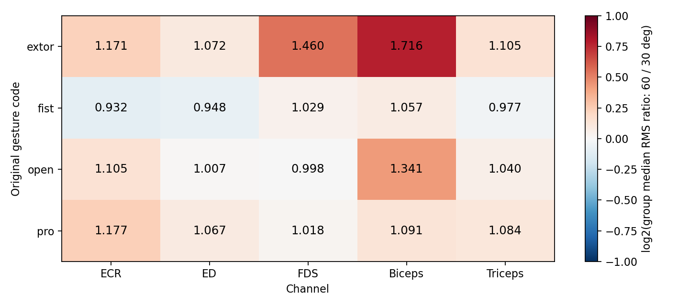

그림 1. 각 동작·채널에서 구한 8명 RMS 비율의 중앙값. 셀의 숫자는 60°/30° 비율이고 색은 그 중앙값의 log2값이다. 개인별 점·최솟값·최댓값을 표시하지 않는다. extor와 open에서 이두근의 중앙 비율이 삼두근보다 컸고, fist에서 삼두근의 중앙 비율은 1보다 작았다. 정적 각도 조건과 전극·기록 차이를 포함하므로 팔꿈치 굴곡의 인과 효과를 입증한 결과는 아니다. [전체 5채널 집계표](results/channel_angle_summary.csv)를 함께 제공한다.

## 신호를 학습 입력으로 바꾸는 방법

각 파일에는 `mark=1`이 30개 있고, 첫 `onset=1`과 첫 mark가 일치한다. 마커 간격은 4999–5001표본이다. 파일 전체를 한 시행으로 취급하면 29시행을 놓치므로 실제 마커 인덱스마다 시행 ID를 만들었다. **mark를 시행 시작으로 해석**하고, 1500표본 뒤에서 2000표본을 자른다. 이 구간은 강의 2주차 10쪽의 1.5–3.5초 실습 설정이다.

CSV 열 이름은 이미 bandpass 처리를 표기한다. 제공자 문서는 60Hz 노치와 20–450Hz 4차 Butterworth 처리를 명시하지만 실제 계수·노치 Q·위상 처리·실행 순서는 공개하지 않는다. 기준 실험에는 추가 필터를 적용하지 않았다. 강의의 60Hz 노치(Q=30)와 20–450Hz 4차 Butterworth 함수는 별도로 구현해 합성 신호로 검증했다. 따라서 이번 입력은 필터 이전 원신호에서 시작하는 강의 예제와 시작점이 다르다.

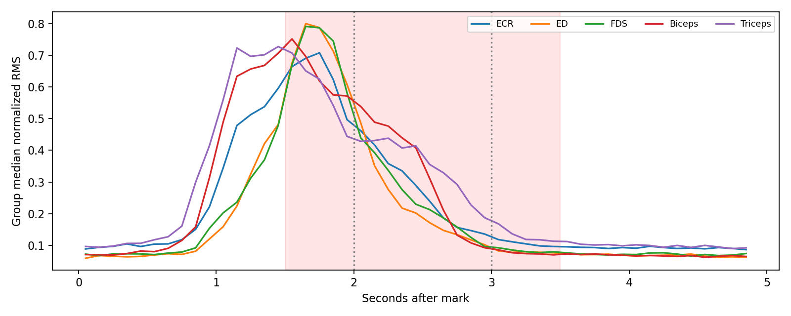

그림 2. 기록별 30시행의 100ms RMS 중앙값을 채널별 최대값으로 정규화한 후, 전체 64기록의 중앙값으로 모은 5개 곡선이다. 개인·기록별 프로파일은 포함하지 않는다. 붉은 영역은 분석 구간 1.5–3.5초, 점선은 강의 도식의 동작 구간 2–3초다. 전체 집계의 큰 반응은 대체로 1.5–1.8초 부근에 나타났다. 마커 가정과 강의 도식의 정렬은 미확인이다. 이 관찰을 근거로 시험 점수에 맞춰 구간을 이동하지 않았다. [곡선의 전체 집계값](results/marker_profile_summary.csv)을 제공한다.

2000표본을 200표본 창으로 100표본씩 이동하면 19창을 얻는다. 각 창에서 RMS, MAV, WL, ZC, SSC를 5채널에 계산한다. 벡터는 특징 우선 순서로 RMS1–5, MAV1–5, WL1–5, ZC1–5, SSC1–5를 연결한다. ZC는 서로 반대 부호인 인접 표본의 차이가 0.01 이상일 때만 세며, SSC는 기울기 부호 변화만 센다. [수식과 구현](docs/PROTOCOL.md#특징)을 함께 기록했다.

## 검증 설계

**분할 단위는 시행이고, 주평가 단위는 창이다.** 같은 시행의 19창은 항상 같은 집합에 놓인다.

|검증|학습 시행|평가 시행|목적|
|---|---:|---:|---|
|강의 hold-out|1,536|384|세 기준모델 비교|
|전체 층화 5-fold|1,536/fold|384/fold|강의 기준 평균·표준편차|
|개발 층화 5-fold|1,228 또는 1,229/fold|308 또는 307/fold|hold-out 학습 부분 안에서 후보 선택|

분할 seed는 42다. StandardScaler는 각 모델의 해당 학습 창으로만 fit한다. 실제 시행 ID 목록은 재실행 시 비공개 `private/split_manifest.csv`에 생성하며, 교집합 집계는 [split_checks.csv](results/split_checks.csv)에 있다. 각 분할 안의 학습·평가 시행 교집합은 0이며, 개발 5-fold는 hold-out 시험 384시행과 교집합이 0이다. Hold-out 양쪽 모두 64기록·8명·8클래스를 포함한다. 기록별 시험 시행 수는 1–10개로 균일하지 않다.

전체 5-fold와 hold-out은 같은 1920시행을 다르게 나눈 평가다. 고정 시험 384시행 전부가 전체 CV에서 각각 네 번 학습, 한 번 평가에 사용됐다. 각 fold의 학습에는 이 중 291–317시행이 들어간다. 따라서 고정 시험은 프로젝트 전체에서 완전히 미관측인 외부 시험자료가 아니다. 개발 후보 선택과 해당 모델의 학습에는 이 384시행을 넣지 않았다. 원천 데이터에는 이전 프로젝트 사용 이력도 있다. 현재 평가는 같은 피험자와 같은 기록의 다른 시행이 양쪽에 포함되는 성능이며, 새 피험자나 새 기록에 대한 성능은 측정하지 않았다.

## 강의 설정 기준실험

SVM은 RBF, C=1, gamma=scale, RF는 100트리, XGBoost는 400회·깊이 6·학습률 0.05·subsample 0.9·colsample 0.8이다. RF와 SVM은 CPU, XGBoost는 TITAN Xp CUDA에서 실행했다. 입력 규모나 트리 수를 줄이지 않았다. XGBoost의 400회는 8클래스에서 총 3200트리이며 저장 설정에서도 확인했다. [생성자 전체 설정](configs/model_parameters.json)과 [실제 XGB 설정](configs/effective_xgb.json)을 제공한다.

|모델|Hold-out 창 정확도|Macro precision|Macro recall|Macro F1|전체 5-fold 창 정확도 평균±SD|
|---|---:|---:|---:|---:|---:|
|SVM|49.62%|0.5048|0.4962|0.4974|48.56±0.45%|
|RF|64.38%|0.6451|0.6438|0.6441|64.54±0.35%|
|XGBoost|63.34%|0.6351|0.6334|0.6338|62.97±0.39%|

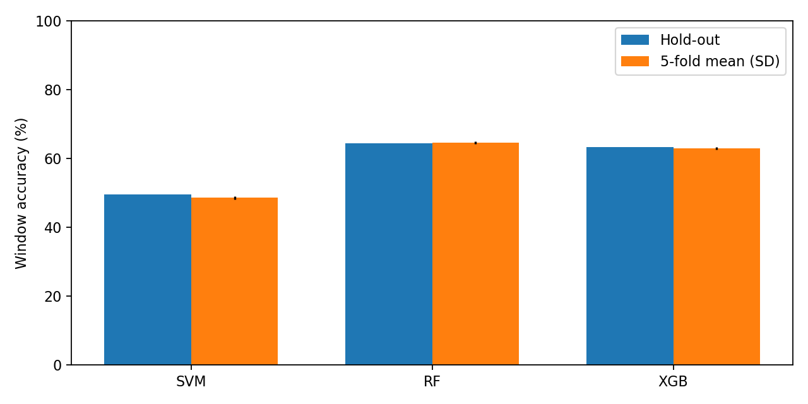

그림 3. 같은 분할과 25특징으로 비교한 기준 성능. 5-fold 오차막대는 5개 정확도의 모집단 표준편차(ddof=0)다. 모든 모델에서 384시험 시행 × 19창 = 7296창을 평가했다. [fold별 수치](results/baseline.csv)를 제공한다.

같은 5개 fold를 짝지은 t검정의 p값은 SVM–RF 1.80×10⁻⁷, SVM–XGB 7.50×10⁻⁷, RF–XGB 0.000979였다. 이번 분할에서는 차이를 검출했으나, 학습 집합이 겹치는 5개 fold의 탐색적 비교이므로 독립 반복실험의 확증으로 해석하지 않는다. 강의가 인용한 논문의 ‘차이 미검출’과 결론이 다르다.

|모델|학습 시간(s)|단일 창 추론(ms)|로컬 직렬화 크기(MB)|
|---|---:|---:|---:|
|SVM|29.31|1.35|8.26|
|RF|1.83|13.08|175.56|
|XGBoost|5.87|30.42|11.43|

학습 시간은 scaler와 모델의 fit 시간이다. 추론은 표준화된 한 창을 100회 호출한 평균으로, RF의 병렬 호출과 XGB의 DMatrix 생성·GPU 전송 비용을 포함한다. 신호 취득 2초와 특징 추출 지연은 제외했다. 작은 배치의 호출 비용이 커서 이 표를 GPU 처리량이나 실제 배포 지연으로 해석할 수 없다. [환경과 측정 범위](docs/ENVIRONMENT.md)를 참고한다.

## 개선 과정

기준 18회 학습과 독립 지표 검증을 마친 뒤, 미리 정한 8개 설정을 같은 개발 5-fold에서 평가했다. 개발 학습·검증은 hold-out의 학습 1,536시행 안에서만 이루어진다. 변경하지 않은 설정은 해당 기준모델과 같다. 아래 차이는 같은 개발 분할의 해당 모델 기준 대비이며 단위는 %p다.

|설정|바꾼 조건과 이유|개발 창 정확도 평균±SD|기준 대비|판단|
|---|---|---:|---:|---|
|SVM 기준|C=1, 25특징, 200ms|47.84±0.73%|—|비교 기준|
|RF 기준|100트리, 25특징, 200ms|63.87±0.90%|—|기준모델 중 최고|
|XGB 기준|400회, 깊이 6, 25특징, 200ms|62.22±0.38%|—|XGB 변경의 비교 기준|
|SVM C=10|오분류 벌점을 높여 규제 강도 영향 확인|56.13±0.53%|+8.30|상승했지만 RF보다 낮음|
|XGB 깊이 4|얕은 트리의 일반화 효과 확인; 400회 유지|55.23±0.22%|−6.99|이번 조건에서는 성능 하락|
|XGB + MNF/MDF|주파수 분포를 10특징으로 추가, 총 35개|64.14±0.59%|+1.92|XGB보다 상승; RF와 차이는 0.26%p|
|XGB 300ms 창|더 긴 구간의 특징 추정 효과 확인; 이동 100ms 유지|67.39±0.42%|+5.17|사전 선택 규칙에서 최고|
|XGB 전완만|상완 2채널을 제외해 채널 기여 진단, 15특징|44.08±0.59%|−18.14|선택 제외 진단; 상완 정보 제거 시 하락|

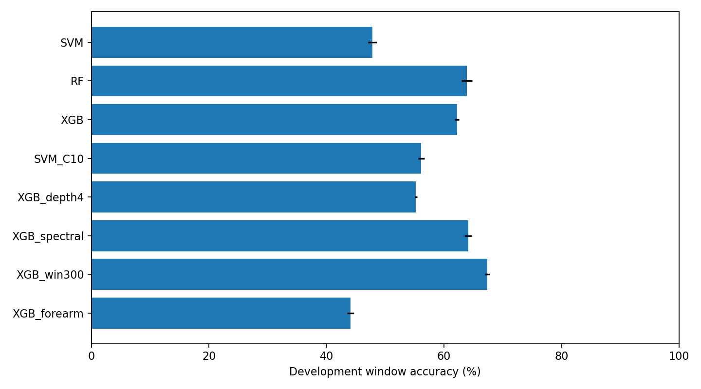

그림 4. 개발 5-fold 창 정확도와 SD. 300ms 설정은 시행당 18창이고 나머지는 19창이다. 전체 1,920시행으로 수행한 기준 CV와 학습 규모가 다르므로 앞의 기준 CV 평균과 직접 빼지 않는다. [개발 fold별 결과](results/development.csv)와 [선택 기록](results/selection.json)을 제공한다. SVM의 규제 완화나 긴 창이 도움이 될 가능성은 보였지만, 깊이를 줄이는 것이 항상 유리하지는 않았다. 전완만 사용한 결과는 상완 채널의 예측 기여를 시사하며 이두근과 삼두근 각각의 생리적 원인을 분리한 검증은 아니다.

개발 평균 정확도로 선택한 **XGB 300ms**만 고정 hold-out에 추가 평가했다. 학습은 1,536시행·27,648창, 시험은 384시행·6,912창이며 특징은 25개, XGB는 400회·깊이 6 그대로다.

|선택 모델의 고정 시험|창 정확도|Macro precision|Macro recall|Macro F1|
|---|---:|---:|---:|---:|
|XGB 300ms|68.20%|0.6835|0.6820|0.6824|

300ms 창에서는 마지막 시작 위치가 3.2초여서 기준의 3.3초 창이 없어지고 창끼리 겹치는 비율도 커진다. 고정 시험 68.20%는 **4714/6912창**을 맞힌 값이다. **동일한 첫 18개 시작 위치**로 기존 예측을 다시 집계하면 200ms XGB는 63.05%, RF는 64.27%, 300ms XGB는 68.20%다. 이는 평가 시작 위치만 맞춘 사후 집계다. 200ms 모델은 시행당 19창, 300ms 모델은 18창으로 학습했으므로 학습 표본까지 통제한 비교가 아니다. 창 길이에 따라 입력 정보와 평가 표본의 의미도 달라지며, 이 집계에서는 추가 학습이나 선택 변경이 없었다. [동일 시작 위치 집계](results/matched_start_diagnostic.csv)에 개발 fold와 시험 값을 모두 남겼다.

선택 모델의 학습 시간은 5.73초, 단일 창 호출은 30.54ms, 로컬 직렬화 크기는 11.31MB였다. 이 결과를 1차 개선 기록으로 보존한다. 이어지는 개선에서는 원필터·마커·동작 코드의 미확인 부분을 명시하면서, 개발 자료의 오류와 특징을 진단해 검증할 수 있는 원인부터 실험한다.

### 개발 자료의 병목 진단과 2차 개선

기존 개발 1,536시행의 OOF 예측 29,184창을 분석했다. 고정 시험 384시행은 이 진단과 새 선택에서 제외했다. 원본에서 계산한 시간별 RMS와 기본 특징의 RMS는 일치했고, 파일명에서 읽은 각도·동작과 시행별 레이블도 일치했다. 전압 단위와 마커의 생리적 의미는 여전히 확인되지 않았다.

|관찰|해석과 확인할 실험|
|---|---|
|ZC=0 비율: 삼두근 60.31%, 이두근 48.50%. 전체 창의 13.28%는 5채널 모두 0.|0.01 임계값이 저진폭 파형의 부호 정보를 제거할 가능성. 원래 25특징을 보존한 대조군과 ZC만 바꾼 조건 비교.|
|XGB 위치별 정확도: 1.7초 72.85%, 2.4초 53.84%, 3.3초 65.23%.|어려운 창이 단순히 뒤쪽 휴식에 몰리지 않음. 200ms 안의 시간 변화·대역 분포·채널 관계를 추가해 전이에서 손실된 정보를 확인.|
|전완 RMS의 조용한 구간 대비 비율이 1–3인 창은 약 55%, 10 이상은 77.26%, 1 미만은 64.18%.|저진폭 자체만으로 난도를 설명할 수 없음. 어려운 창도 전부 평가에 유지. 조용한 기준 구간은 mark+0.2–1.0초이며 실제 휴식이라는 판정은 아님.|
|StandardScaler는 학습 전체의 특징별 선형 변환이며 창별 진폭 정규화가 아님.|절대 진폭을 지웠다는 가설은 해당하지 않음. SVM에서는 비선형 분포 변환만 바꿔 거리 배치의 영향 확인.|

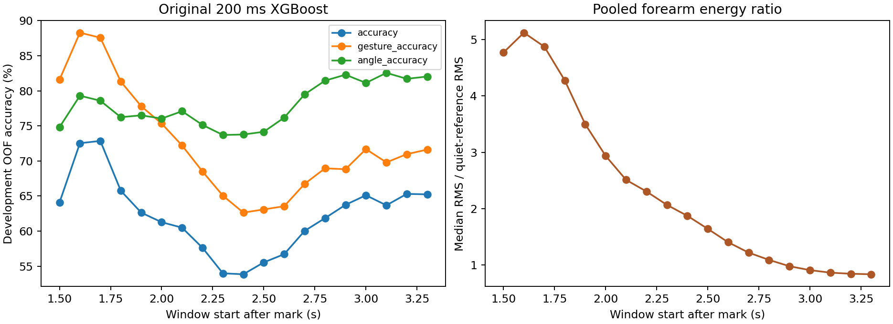

200ms·100ms 이동·19창·5채널·고정 2초를 유지한 후보 10개를 [결과 전 계획](experiments/diagnostic_v2/PLAN.md)에 고정했다. 개발 자료 안에 outer 3-fold와 inner 3-fold를 만들고, 각 outer의 학습 자료 안에서 후보를 선택한 뒤 분리된 outer 평가 시행에서 기준 XGB와 비교한다. 이 자료는 과거 실험과 진단에 이미 사용됐으므로 중첩 평가도 완전히 독립적인 일반화 증거는 아니다. 이번 선택 과정의 학습·검증 재사용을 줄이는 장치다. 현재 실행 결과와 다음 판단은 [2차 개선 기록](experiments/diagnostic_v2/LOG.md)에 이어서 남긴다.

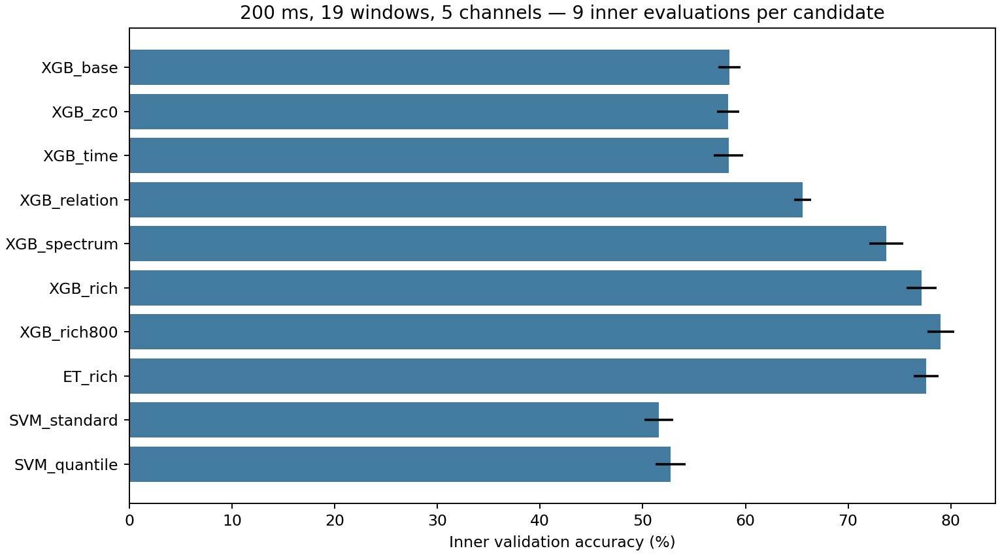

그림. 각 후보의 내부 평가 9회 평균과 SD(ddof=0). 원래 특징의 XGB는 58.44%, ZC 교체는 58.32%, 시간 특징 추가는 58.36%였다. 채널 관계 추가는 65.57%, 대역 특징 추가는 73.70%, 결합 특징 400회는 77.17%, 800회는 79.02%였다. 이 비교의 학습 규모는 fold당 682 또는 683시행이며, 최초 전체 5-fold와 다르다. 원래 ZC를 무임계값으로 교체하는 것만으로는 개선되지 않았고, 정보 복구의 주된 이득은 채널 관계와 주파수 분포에서 나왔다. 결합 뒤의 800회 추가 이득은 약 1.85%p였다. [후보별 집계](results/diagnostic_v2/inner_summary.csv)를 제공한다.

세 outer 모두 내부 정확도로 결합 특징 XGB 800회를 선택했다. 각 outer에서는 1,024시행을 학습하고 별도 512시행의 9,728창을 평가했다. 세 평가를 합치면 개발 1,536시행의 29,184창을 중복 없이 한 번씩 평가한다.

|중첩 평가 조건|입력 범위|정답 창 / 전체 창|창 정확도|Macro F1|
|---|---|---:|---:|---:|
|강의 XGB 대조군, 25특징·400회|현재 200ms|17,981 / 29,184|61.61±0.48%|0.6161|
|결합 특징 XGB, 240특징·800회|현재 200ms|24,062 / 29,184|82.45±0.44%|0.8245|
|같은 개선 모델 + 고정 과거 5창 집계|현재와 과거, 최대 600ms|26,409 / 29,184|90.49%|별도 문맥 조건|

단독 창의 각도 정확도는 90.98%, 동작 정확도는 87.19%였다. 세 outer의 창 정확도는 81.88%, 82.95%, 82.52%로 모두 대조군보다 높았다. 주점수는 두 번째 행의 200ms 단독 창 결과다. [바깥 평가 원수치](results/diagnostic_v2/outer.csv)와 [전체 집계](results/diagnostic_v2/outer_pooled.csv)를 제공한다.

과거 문맥 조건은 현재 창과 직전 네 창의 최빈 예측을 쓰고, 알려진 시행 경계에서 초기화한다. 동률이면 현재 예측을 우선하고 그렇지 않으면 최소 클래스 ID를 택한다. 첫 네 창을 포함한 모든 평가 창을 유지하며 미래 창과 정답은 사용하지 않는다. 2,837창을 정정하고 490창을 악화시켰다. 미래 대기는 없지만 실제 동작 전환에 대한 반응 지연이 생길 수 있다. 시행 안의 레이블이 일정한 이 자료로 연속 전환 지연을 검증하지는 못했다. [고정 문맥 계획](experiments/diagnostic_v2/CAUSAL_CONTEXT_PLAN.md)과 [fold별 결과](results/diagnostic_v2/causal_context.csv)를 함께 읽어야 한다.

96회 실행의 저장 예측과 지표를 정수 혼동행렬에서 다시 계산했고, 모든 scaler를 해당 학습 창에서 재계산해 일치함을 확인했다. 학습·평가 시행 교집합과 기존 시험 384시행의 교집합은 모두 0이다. [검증 결과](results/diagnostic_v2/verification.json)를 제공한다. 이 성과를 독립 외부 시험이나 논문 정확재현이라고 표현하지 않는다. 다음에는 [창 길이·ZC·60Hz 성분의 원인 분리](experiments/mechanisms_v3/PLAN.md)와 [복구한 특징의 모델 용량·SVM 대조](experiments/capacity_v4/PLAN.md)를 이어간다.

### 원인 분리: ZC, 창 길이, 60Hz 성분

기존 개발 5-fold를 사용해 여섯 조건을 사전 고정하고 30회 학습했다. 모두 XGB 400회이며, scaler는 해당 학습 창으로만 계산했다. 이 단계는 앞의 중첩 평가와 학습 규모가 다른 원인 분석이다. 반복 개발에 사용한 분할이므로 새 독립 성능으로 표현하지 않는다.

|검증한 변화|변경 전 → 후의 창 정확도|차이|상승한 fold|
|---|---:|---:|---:|
|기존 25특징에 무임계 ZC 5개만 추가, 200ms·19창|62.22 → 62.61%|+0.39%p|4/5|
|학습·평가 모두 18시작 위치로 맞춘 200 → 300ms, 25특징|62.33 → 67.39%|+5.05%p|5/5|
|200ms·18창에 대역 특징 추가, 25 → 120특징|62.33 → 77.53%|+15.20%p|5/5|
|300ms·18창에 같은 대역 특징 추가, 25 → 120특징|67.39 → 82.21%|+14.83%p|5/5|
|대역 특징을 쓴 동일 18위치의 200 → 300ms|77.53 → 82.21%|+4.68%p|5/5|
|200ms·19창의 대역 특징 입력에서 60Hz 투영 성분 제거|77.92 → 76.46%|−1.46%p|0/5|

학습 위치까지 맞춘 후에도 300ms의 이득이 남았다. 따라서 초기 사후 집계의 학습 표본 수 차이만으로 설명되는 상승은 아니었다. 다만 창 길이가 늘면 정보량과 겹침 비율도 함께 늘어나며, 18창 조건은 원래 19창 주평가와 구분한다. 대역 특징의 이득은 두 창 길이 모두에서 나타났다. 원래 ZC를 보존한 추가는 작은 이득이 있었지만 주요 격차를 설명하지 못했다.

60Hz 대조는 각 200ms 안에서 사인·코사인 성분만 추정해 빼고 특징을 다시 계산했다. 창 밖이나 미래 신호를 사용하지 않았다. 모든 fold에서 약간 떨어졌지만 주파수 특징의 큰 상승이 사라지지는 않았다. 이 결과만으로 남은 성분을 모두 생리 신호라 하거나 60Hz 성분을 모두 잡음이라 판정하지 않는다. 기준 전처리도 변경하지 않았다. [짝지은 원수치](results/mechanisms_v3/paired_comparisons.csv)와 [30회 지표·6개 모델 복원 검증](results/mechanisms_v3/verification.json)을 제공한다.


### 학습 목표를 세분화한 비교

개발 특징의 중심을 비교하면 같은 클래스의 사람 간 거리가 한 사람 내 클래스 간 거리보다 컸다. 사람·기록 조건에 따라 같은 클래스의 신호 분포가 여러 갈래로 나뉠 가능성을 검토했다. 학습에서만 사람×8클래스를 64목표로 구분하고, 예측 때 얻은 64확률을 원래 8클래스별로 합산했다. **평가 사람 코드나 기록 ID는 예측 입력에 넣지 않았다.** [사전 계획](experiments/latent_subclass_v5/PLAN.md)에 두 모델과 새 개발 3-fold를 고정했다.

|같은 240특징·200ms·19창 조건|정답 창 / 전체 창|창 정확도 평균±SD|Macro F1|총 트리 수|
|---|---:|---:|---:|---:|
|직접 8클래스 목표, XGB 400회|23,473 / 29,184|80.43±0.30%|0.8043|3,200|
|학습 목표 64개, 출력 8클래스, XGB 400회|24,914 / 29,184|85.37±0.39%|0.8537|25,600|

세 fold에서 +5.02, +5.21, +4.58%p 상승했다. 각도 정확도는 92.57%, 동작 정확도는 88.86%였다. [전체 집계](results/latent_subclass_v5/pooled.csv)와 [6회 지표·모델 복원 검증](results/latent_subclass_v5/verification.json)을 제공한다. 이 비교는 앞의 중첩 평가와 분할·선택 과정이 다르므로 82.45→85.37%를 그대로 짝지은 개선 폭으로 쓰지 않는다. 직접 대조군과의 차이는 80.43→85.37%다.

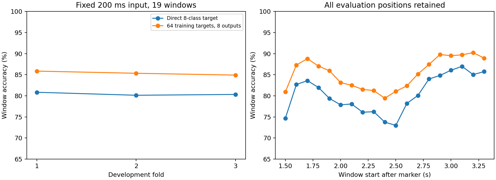

그림. 모든 19창을 유지한 세 개발 fold의 결과와 창 시작 위치별 집계. 동일한 240개 신호 특징을 쓰지만 목표 세분화로 전체 트리 수도 늘었다. 이 효과를 분리하기 위해 [같은 트리 수와 대역별 채널 관계 대조](experiments/cross_spectrum_v6/PLAN.md)를 이어간다. 과거 5창 문맥을 더한 값은 93.29%이며, 최대 600ms 이력과 시행 경계를 쓰는 별도 결과다. 단독 200ms 주점수는 85.37%다. 자료는 반복 개발에 사용됐고 같은 사람·기록의 다른 시행을 평가하므로 외부 일반화 결과로 해석하지 않는다.


### 용량 증가와 시간 특징 제외

별도 중첩 평가에서 후보 다섯 개를 내부 45회와 바깥 6회로 비교했다. 세 바깥 분할 모두 1,600회 XGB가 선택됐고, 같은 29,184개 창에서 800회 **82.02%**(23,936개 정답)에서 1,600회 **82.96%**(24,211개 정답)로 0.94%p 올랐다. 모델 크기는 대표 fold에서 21.65→35.88MB였다. 학습 정확도는 모든 후보가 100%였으며, 검증 이득은 학습 정확도만으로 설명되지 않았다. [51회 검증](results/capacity_v4/verification.json)과 [바깥 집계](results/capacity_v4/outer_pooled.csv)를 제공한다.

내부 평균은 240개 특징·800회 79.79%,155개 특징·800회 79.73%,240개 특징·1,600회 80.45%였다. 추가 시간 특징 85개를 제외해도 거의 같았으므로 155개 특징은 비용 대안으로 비교한다. SVM C100은 표준화 72.83%, 분위수 변환 73.56%로 이번 설정에서 낮았다. 새 특징을 넣었을 때도 SVM이 자동으로 높은 성능을 내지는 않았다. [실험 기록](experiments/capacity_v4/LOG.md)에 해석과 후속 판단을 남겼다.

### 같은 트리 수와 대역별 채널 관계

240개 특징은 각 채널의 대역 파워와 전체 채널 상관을 포함하지만, 특정 대역에서 두 채널의 위상이 어떻게 맞물리는지는 나타내지 않았다. 각 200ms 창의 복소 교차 스펙트럼을 8대역·10개 채널 쌍으로 정규화해 실수·허수 160개 특징을 추가했다. 합성파와 독립적인 CSD 계산으로 검증했으며 생리적 coherence 추정과 같은 의미로 부르지 않는다. [사전 계획과 수식](experiments/cross_spectrum_v6/PLAN.md)을 제공한다.

|동일 25,600개 트리·동일 200ms·19개 창의 고정 3-fold|정답 창 / 전체 창|창 정확도 평균±SD|Macro F1|
|---|---:|---:|---:|
|직접 8클래스,240개 특징,3,200회|24,462 / 29,184|83.82±0.87%|0.8381|
|학습 목표 64개,240개 특징,400회|24,977 / 29,184|85.58±0.52%|0.8559|
|학습 목표 64개,400개 특징,400회|25,796 / 29,184|88.39±0.24%|0.8839|

같은 총 트리 수에서도 목표 세분화의 이득이 남았고, 대역별 관계 추가는 세 fold 모두 올랐다. 최종 행의 각도 정확도 94.34%, 동작 정확도 91.14%보다 두 조건을 동시에 맞히는 8클래스 점수가 낮다. **주점수는 독립 200ms 창의 88.39%**다. 과거 5개 창을 더한 94.84%는 최대 600ms 문맥과 알려진 시행 경계를 쓰는 별도 결과다. [전체 집계](results/cross_spectrum_v6/pooled.csv)와 [9회 지표·9개 모델 복원](results/cross_spectrum_v6/verification.json)을 확인할 수 있다.

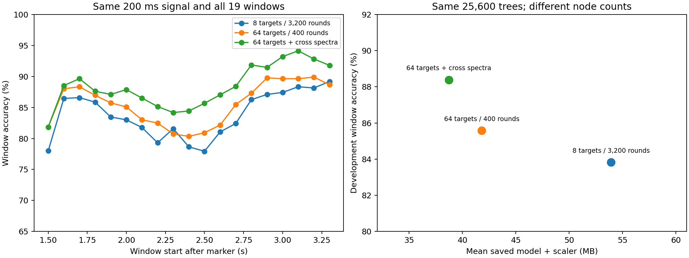

그림. 왼쪽은 모든 19개 창을 유지한 위치별 평균, 오른쪽은 같은 분할에서의 평균 저장 크기와 정확도다. 더 많은 입력 특징이 항상 더 큰 학습 모델을 만들지는 않았다. 첫 분할에서 세 모델은 각각 53.68/41.72/38.71MB였다. 트리 수는 같아도 노드 수가 달랐다. 추론 지연과 메모리는 [고정 비용 측정 계획](experiments/cost_benchmark/PLAN.md)에 따라 별도 측정하며, 학습이 경합한 시간으로 독점 GPU 속도를 주장하지 않는다.

첫 교차 모델은 학습 gain의 큰 부분을 250–350Hz 관계에 배분했지만, 이 대역의 평균 파워는 전체의 약 0.4–0.7%였다. 이 성분이 생리 신호인지 기록·전극·공통 성분인지 아직 분리되지 않았다. [용량과 해당 관계 제거의 후속 계획](experiments/cross_capacity_v7/PLAN.md)을 고정해 검증을 이어간다. 현재 결과는 같은 사람·기록의 다른 시행을 분류한 개발 결과이며, 새 사람·기록의 외부 일반화나 원논문 정확재현을 뜻하지 않는다.


## 용량 증가와 고주파 관계의 비용

새로 고정한 개발 3분할에서 교차 특징의 부스팅 횟수와 특정 대역 관계를 분리했다. 각 분할의 학습은 1,024시행, 평가는 512시행이다. 앞선 6차와 seed가 다르므로 88.39%와 아래 수치의 차이를 같은 시험에서의 개선으로 해석하지 않는다. 이번 비교의 모든 조건은 같은 분할과 200ms·19창을 사용했다.

| 조건 | 창 정답 수 / 29,184 | 정확도 | 평균 저장 크기 | 평균 관측 학습 시간 |
|---|---:|---:|---:|---:|
| 교차 관계, 400회 | 25,657 | 87.91% | 38.66 MB | 131.68초 |
| 교차 관계, 800회 | 25,817 | 88.46% | 60.11 MB | 209.61초 |
| 250–350 Hz 관계 20개 제거, 400회 | 24,772 | 84.88% | 41.06 MB | 128.92초 |

트리를 25,600→51,200개로 늘린 이득은 **0.55%p**였다. 평균 저장 크기는 약 56%, 관측 학습 시간은 약 59% 늘었다. 사전 기준인 +0.5%p를 넘겨 800회를 선택했지만 작은 성능 차이에 큰 비용이 든다. 위 시간은 당시 실행한 `model.fit`의 실측이며 하드웨어를 독점한 성능 보증은 아니다. [9회 전체 결과](results/cross_capacity_v7/scores.csv), [복원 검증](results/cross_capacity_v7/verification.json), [판단 기록](experiments/cross_capacity_v7/LOG.md)을 남겼다.

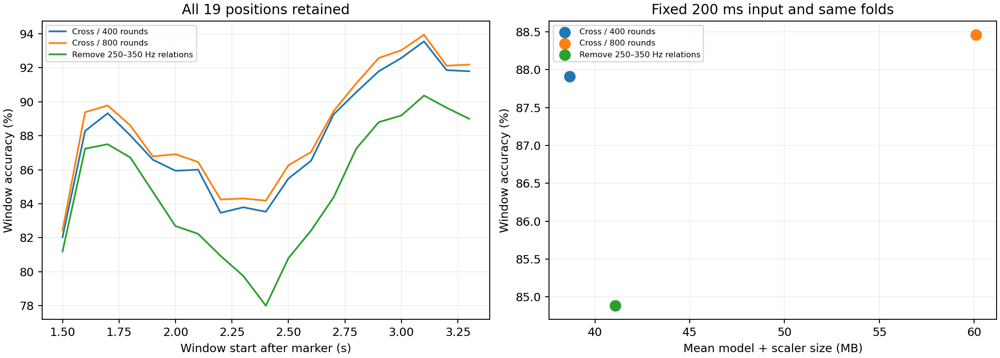

그림. 고주파 관계만 제외하면 모든 분할에서 점수가 낮아져 평균 3.03%p 하락했다. 원신호를 필터링한 결과가 아니며 기존 대역 파워 특징은 보존했다. 관계 특징에 대한 의존은 확인했지만 성분의 생리적 기원은 미확인이다. 최대 600ms의 과거 5창을 쓰는 94.76%는 단독 200ms 점수와 분리한다. 다음에는 [세부 주파수 파워 보존 계획](experiments/fine_spectrum_v8/PLAN.md)에 따라 같은 입력 길이에서 넓은 대역 내부의 정보를 검사한다.

## 세부 스펙트럼을 보존한 개선

대역 합계 안에 가려진 주파수 분포를 확인하기 위해 기존 400특징에 채널별 5Hz 간격 파워 505개를 추가했다. 같은 200ms 신호의 periodic Hann periodogram이며 zero padding이나 신호 길이 변경은 없다. 파워에는 log10을 적용하고 원신호 단위 제곱의 수치 바닥값 1e-12를 사용했다. [사전 계획](experiments/fine_spectrum_v8/PLAN.md)에 후보·분할·채택 기준을 결과 전에 고정했다.

| 같은 v7 개발 분할 | 정답 창 / 29,184 | 정확도 평균±SD | 평균 저장 크기 | 평균 관측 학습 시간 |
|---|---:|---:|---:|---:|
| 400특징, 400회 | 25,657 | 87.91±0.28% | 38.66 MB | 131.68초 |
| 400특징, 800회 | 25,817 | 88.46±0.34% | 60.11 MB | 209.61초 |
| 905특징, 400회 | 26,201 | **89.78±0.35%** | **36.17 MB** | 234.51초 |

세부 파워를 넣으면 같은 25,600트리 대조보다 세 분할 모두 높아져 평균 1.86%p 올랐다. macro F1은 0.89778, 각도 정확도는 95.54%, 동작 정확도는 91.95%였다. 최대 600ms의 과거 문맥을 쓰는 95.38%는 별도 보조 결과다. 특징은 늘었지만 저장 모델은 작아졌고, 학습 시간은 늘었다. 대표 첫 분할 모델의 크기는 36.34MB, CPU 전체 처리 중앙값/p95는 6.10/7.49ms였다. [3회 모델·scaler·예측 복원 검증](results/fine_spectrum_v8/verification.json)과 [실험 기록](experiments/fine_spectrum_v8/LOG.md)을 제공한다.

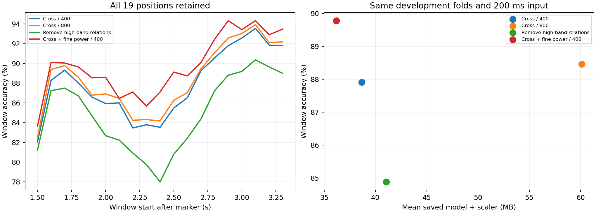

그림. 19개 위치를 모두 평가했다. 정확도 상승은 특정 위치를 제외한 결과가 아니다. 같은 모델 수로 주파수 분포를 자세히 표현한 이득이며, 이미 사용한 개발 분할의 비교다. 새로운 외부 시험이나 논문과 동등한 평가를 뜻하지 않는다.

개발 시행별로는 589개가 개선되고 297개가 낮아졌으며 650개는 같았다. 시행을 묶어 다시 뽑은 기술적 bootstrap의 평균 차이 구간은 +1.50~2.23%p였지만, 반복 개발로 선택된 모델에 조건부인 값으로 외부 일반화 신뢰구간은 아니다. 학습 gain의 29.5%가 추가 파워 특징에 배분됐고, 300Hz와 420Hz가 각각 전체의 17.8%, 3.0%를 차지했다. 두 성분은 60Hz의 배수이나 생리 신호·전원·기록 조건의 기원을 아직 구분하지 못했다. [집계 진단](results/fine_spectrum_v8/diagnosis.json)과 [학습 gain](results/fine_spectrum_v8/training_gain.csv)을 남기고 이 의존을 후속 대조에서 검사한다.

초기 기준 구간도 별도로 검사했다. 원본을 다시 읽고 해당 시행을 학습에서 제외한 저장 OOF 모델을 그대로 적용했을 때 mark+0.0–0.2초의 200ms 창은 **1,389/1,536개, 90.43%**를 맞혔다. 원래 마지막 창 mark+3.3–3.5초는 93.49%였다. 이는 입력 시점을 바꾼 진단으로 주평가 점수를 대체하지 않는다. 학습·평가 시행 교집합은 0이지만 기록 64개는 공유됐다. 초기 구간이 완전한 휴식이라고 확인한 것도 아니다. 현재 특징은 CSV의 해당 200표본만 쓰지만, 제공 CSV의 사전 필터가 비인과적이었는지는 검증하지 못했다. 300Hz·420Hz 로그 파워의 큰 기록 간 차이가 초기와 후기 모두 남았다. 같은 피험자·조건에 기록이 하나이므로 동작·자세·사람·기록 효과를 구분할 수 없으며, 높은 개발 점수를 근육 수축 인식이나 새 기록 일반화로만 해석하기 어렵다. [계획과 범위](experiments/reference_phase_probe/PLAN.md), [진단 결과](experiments/reference_phase_probe/LOG.md)를 함께 남겼다.

## 초기창의 기록 공유 진단

초기창에 남은 정보가 다른 기록에도 유지되는지, 같은 초기 200ms에서 학습·평가하는 작은 대조를 추가했다. 두 조건 모두 905특징·직접 8클래스 XGB400을 사용했다. 모든 개발 시행은 프로토콜별로 한 번씩 평가했고 원래 시험은 제외했다.

| 초기창 학습·평가 조건 | 정답 / 1,536시행 | 전체 합산 정확도 | 4-fold 평균±SD |
|---|---:|---:|---:|
| 시행 분리, 64기록 공유 | 1,249 | 81.3151% | 81.3151±2.7149% |
| 기록 분리, 48기록 학습·16기록 평가 | 40 | 2.6042% | 2.6029±1.2156% |

기록 분리에서는 클래스별로 기록 6개를 학습하고 2개를 평가했다. 클래스별 학습 139–148시행, 평가 44–53시행으로 모든 클래스가 존재했고, 8개 모델의 확률 열과 레이블 순서도 일치했다. 학습에는 8명이 모두 있어 새 사람을 제외한 검증은 아니다. [클래스 지원 수](results/record_reference_control/class_support.csv)와 [매핑 검사](results/record_reference_control/label_support_verification.json)를 확인할 수 있다. 학습 시행 수는 1,139–1,164개로 시행 분리의 1,152개와 조금 다르다. 기록 분리의 fold 크기가 달라 합산 정확도와 fold 평균을 구분했다. 이 초기창 대조에서 높은 점수는 기록을 바꾸면 유지되지 않았다. 사람×조건별 기록이 하나이므로 기록 효과와 사람·조건의 결합 효과는 분리하지 못한다.

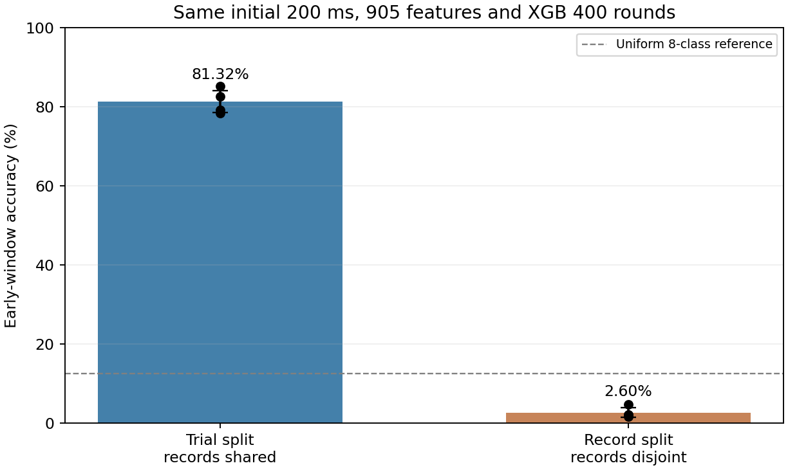

그림. 점은 각 fold, 막대는 fold 평균, 오차막대는 fold 표준편차다. 신뢰구간이 아니다. 초기 90.43%와는 학습 구간·모델·표본 수가 달라 두 점수의 차이를 기록 분리 효과로 해석하지 않는다. 활동 구간의 19창 주평가도 이 대조로 대체하지 않는다. 초기창이 실제 휴식인지는 여전히 미확인이다. [사전 계획](experiments/record_reference_control/PLAN.md), [전체 결과와 해석](experiments/record_reference_control/LOG.md), [8개 모델 복원 및 분할 검증](results/record_reference_control/verification.json)을 남겼다.

인계 후 별도 코드로 8개 모델을 CPU에서 복원하고, 클래스 지원 수·확률 열·정수 혼동행렬·학습 scaler를 다시 확인했다. 기록 분리 **40/1,536=2.6042%**가 재현됐고 레이블/클래스 누락/확률 열 순서 오류는 발견되지 않았다. 초기창905특징의 재계산과 창 밖 표본 변형 검사도 통과했다. 제공 CSV의 사전 필터 인과성과 생리적 휴식 여부는 이 검사에 포함되지 않는다. [독립 검증 범위와 근거](docs/HANDOFF_VERIFICATION.md)를 남겼다.

## 활동 구간에서도 남는 기록 의존성

초기창의2.60%만으로 활동 구간을 판단하지 않기 위해, 고정1.5–3.5초의19창 전체에서 직접8클래스 XGB400을 시행 분리와 기록 분리로 각각4회 학습했다. 이어905특징의 결과를 본 뒤, 강의의 기본25특징만 복원한 동일 분할 대조8회를 추가했다. 후자는 사후 진단이며 새 독립 확증 실험으로 표시하지 않는다. 모델·창·분할·레이블은 같고 특징 표현만 다르다.

| 같은 직접8클래스 XGB400 | 기록 공유: 정답 / 29,184창 | 전체 정확도 | 기록 분리: 정답 / 29,184창 | 전체 정확도 |
|---|---:|---:|---:|---:|
| 강의 기본25특징 | 18,116 | 62.0751% | 2,585 | 8.8576% |
| 확장905특징 | 25,435 | 87.1539% | 1,973 | 6.7606% |

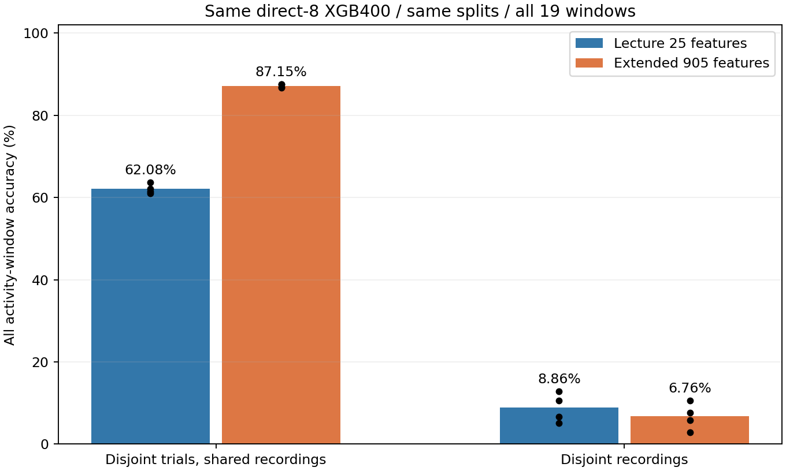

그림. 막대는 전체 정답 수를 합친 정확도, 점은4개 fold다. 모든200ms 창과5채널을 유지했다. 기록 분리의 fold 크기는 서로 달라 전체 정확도와 fold 평균을 구분한다. [동일 분할 집계](results/active_record_control/matched_feature_summary.csv)에 둘 다 기록했다.

기록 분리는 클래스마다6기록 학습·2기록 평가이며, 모든 학습·평가 부분에8클래스가 남는다. 클래스별 학습139–148시행·평가44–53시행, 전체 평가 지원 수는 클래스마다3,648창이다. 학습에는8명이 모두 포함돼 새 사람 전체를 제외한 검증은 아니다. 16개 모델을 CPU에서 복원한 예측, train-only scaler, 분할 재구성과 확률 열이 일치했다. 기존384시험은 제외했다. [905특징 검증](results/active_record_control/verification.json), [25특징 검증](results/active_record_baseline/verification.json), [사후 기준 대조 계획](experiments/active_record_control/BASELINE_PLAN.md)을 제공한다.

기록 간 전이 실패는 주파수 특징 확장에만 생긴 문제가 아니었다. 확장은 기록 공유에서24.91%p 높았지만 기록 분리에서는2.10%p 낮았다. 사람×조건별 기록이 하나이므로 기록 특성·개인별 조건 반응·획득 조건을 분리할 수 없다. 이 대조만으로 신호를 잡음으로 단정하거나 원래 강의 문제를 새 기록 분류 문제로 바꾸지 않는다. 또한 이 직접8개 목표·3,200트리의 진단 점수를64개 목표·25,600트리 모델의 정확한 기록 분리 성능으로 대체하지 않는다.

64개 학습 목표는 이 자료에서 사람×조건의64개 기록과 일대일로 대응한다. 예측에 사람·파일 ID를 입력하지는 않지만, 기록마다 안정적으로 남는 신호 특징을 이용할 가능성은 남는다. 현재의 높은 기록 공유 점수를 일반적인 근육 수축 인식이나 외부 일반화로 확대할 근거는 부족하다.

### 공통 진폭을 제거해도 기록 전이는 해결되지 않았다

같은 클래스의 기록별 RMS 중앙값이 약2.00–7.53배 다른 관측을 근거로 한 가지 고정 대조8회를 추가했다. 현재200ms×5채널에서 DC를 빼지 않고 `g=sqrt(mean(x*x))`로 계산해5채널 전체를 같은g로 나눴다. 양수이면 작은g도 그대로 사용하며 epsilon은 없다.0이면 영신호다. 실제 분모는0.00111666–0.556939로0인 창은 없었다. ZC0.01은 정규화된 무차원 파형의 임계값으로 의미가 달라지고 SSC는 무임계값을 유지한다. 계산·분할·seed·XGB 설정은 학습 전 `c41f96e`에 고정했다.

| 같은25특징·XGB400·19창 | 원파형 | 공통 RMS 정규화 | 차이 |
|---|---:|---:|---:|
| 기록 공유 | 62.0751% | 56.2911% | −5.7840%p |
| 기록 분리 | 8.8576% | 9.8650% | +1.0077%p |

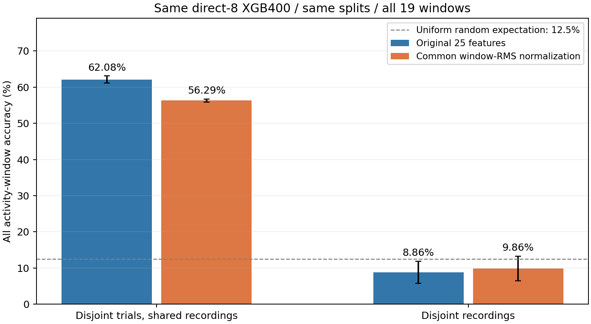

그림. 막대는 전체29,184창의 합산 정확도,오차막대는4fold SD로 신뢰구간이 아니다.12.5% 선은 균등 무작위 기대값이다.19겹친 창을 독립 표본으로 가정한 검정은 하지 않았다. 이 특정 공통 배율 제거는 전이 실패를 해소하지 못했다. 채널별 상대 크기·주파수 차이는 남으므로 진폭 가설 전체를 기각하지 않는다. 모든8모델 복원·분할·scaler·클래스 열 검증을 통과했고 기존시험384시행은 사용하지 않았다. [고정 계획](experiments/gain_invariance_v14/PLAN.md), [결과·해석](experiments/gain_invariance_v14/LOG.md), [검증](results/gain_invariance_v14/verification.json)을 남겼다.

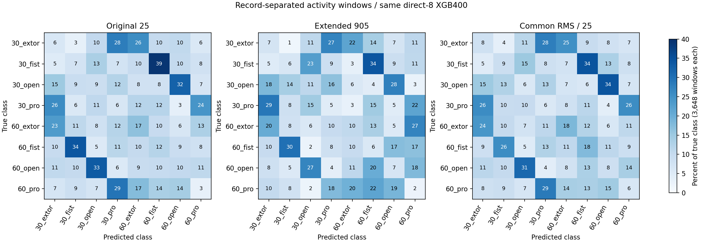

그림. 각 행은3,648창이고 칸은해당 정답 클래스의비율(%)이다. 모든8클래스가 출력됐으며 전체 예측에서 가장 큰 클래스 비중은 기본25의14.25%,905의16.01%,정규화25의14.69%다. 한 클래스만 출력하는 붕괴는 없었다. 기본25의 `30_fist→60_fist`는1,425창, `30_open→60_open`은1,175창이고 `30_extor→30_pro`도1,024창이다. 새로운 기록에서 여러 방향의 체계적 혼동이 남으며 단순 각도 반전만으로 설명되지 않는다.12.5%는 학습된 모델 정확도의 하한이 아니다. [클래스별 재현율·예측 수](results/gain_invariance_v14/record_class_errors.csv), [fold별 쏠림](results/gain_invariance_v14/record_fold_prediction_counts.csv)을 공개 집계로 남겼으며, 이 결과로 레이블을 재배열하지 않았다.

대표 CPU 비용도 별도로 측정했다. 기록 공유 fold0의 원파형→정규화는11.01→11.26MB,전체 중앙값0.571→0.602ms였고,기록 분리 fold0은10.92→11.33MB,0.540→0.751ms였다. 학습은 약5.4–5.6초였다. 같은256개 입력·6스레드·20회 예열·200회 측정이며 신호 취득200ms는 제외했다. [비용4조건](results/gain_invariance_v14/cost_summary.csv), [캐시·저장 예측·원시 시간 검증](results/gain_invariance_v14/report_verification.json)을 제공한다.

## 두 주파수와 학습 목표의 대조

v8의 상승이 넓은 스펙트럼 정보에 의존하는지, 특정 주파수에 집중되는지 분리했다. 같은 3개 fold·200ms·19창·총 25,600트리를 유지했다. 특징 열 제거는 원신호 필터링과 다른 변경이다.

| 같은 분할의 조건 | 정답 / 29,184창 | 평균±fold SD | 평균 저장 크기 | 평균 관측 학습 시간 |
|---|---:|---:|---:|---:|
| 전체 905특징, 64개 목표 | 26,201 | 89.7786±0.3530% | 36.17 MB | 234.51초 |
| 기존 400특징+300/420Hz의 10특징 | 26,257 | **89.9705±0.2374%** | 36.83 MB | 122.29초 |
| 905특징에서 두 주파수의 10열 제외 | 25,650 | 87.8906±0.3053% | 37.66 MB | 247.32초 |
| 전체 905특징, 직접 8클래스 | 25,632 | 87.8289±0.1532% | 46.19 MB | 290.38초 |

좁은 표현은 v8보다 56창, 평균 0.1919%p 높았다. fold별 차이는 +0.2981/−0.0103/+0.2878%p로 작고 세 fold 모두 개선된 것은 아니다. 학습 시간은 약 48% 줄었지만 저장 크기는 약 0.65MB 늘었으며, 이 후보의 별도 바깥 대표 모델 CPU 비용은 아래 최신 표에서 측정했다. 두 주파수 열을 빼면 세 fold 모두 점수가 낮아졌다. 인접 bin과 기존 대역·교차 정보는 남으므로 신호 기원은 이 대조만으로 확정할 수 없다. 직접 8클래스도 같은 트리 수에서 낮았지만 학습 목표와 boosting 단계의 차이를 함께 포함한다.

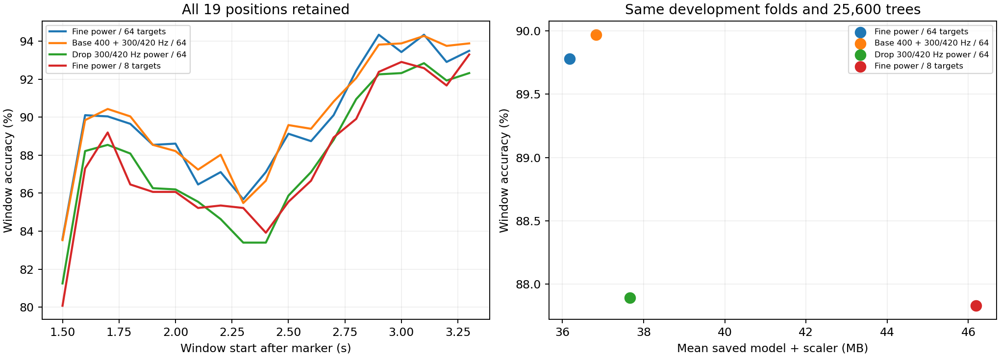

그림. 모든 평가 위치를 유지했다. 오른쪽은 같은 분할의 평균 저장 크기이며, 정확도와 크기만의 관측 비교다. [사전 계획](experiments/spectral_controls_v9/PLAN.md), [완료 기록](experiments/spectral_controls_v9/LOG.md), [9개 모델 복원 검증](results/spectral_controls_v9/verification.json), [같은 fold 차이](results/spectral_controls_v9/paired_differences.csv)를 제공한다. 최종 후보는 별도로 등록한 내부 선택 규칙으로 정하고 바깥 평가를 수행한다. 반복 사용한 개발 자료이므로 외부 독립 성능으로 해석하지 않는다.

## 후보 선택을 분리한 후속 평가

넓은 표현,300/420Hz만 명시적으로 추가한 좁은 표현,두 주파수 열 제외,직접8클래스의4후보를 미리 고정했다. 개발1,536시행을 바깥 학습1,024·평가512로3회 나누고, 각 학습 부분을 다시 내부 학습768·선택256으로 나눴다. 내부 정답 창 수로 후보를 고른 뒤 바깥 학습 전체에서 재학습했다. 바깥 점수는 이 선택에 쓰지 않았다. 총12회 내부 학습과6회 바깥 학습,18회가 모두 완료됐다.

세 fold 모두410특징의 좁은 표현을 선택했다. 내부 정답 합계는 전체 표현13,028창,좁은 표현13,083창,두 주파수의10열 제외12,740창,직접8클래스12,605창이었다. 고정 전체 표현을 같은 바깥 분할에서 다시 학습해 선택 절차와 비교했다.

| 같은 바깥3-fold | 정답 / 29,184창 | 평균±fold SD | 평균 저장 크기 | 평균 관측 학습 시간 |
|---|---:|---:|---:|---:|
| 고정 전체905특징 | 26,273 | 90.0254±0.4323% | 36.19 MB | 246.82초 |
| 내부 선택410특징 | 26,270 | 90.0151±0.4240% | 36.83 MB | 126.54초 |

선택 모델은3창 적게 맞혀 정확도 향상을 확인하지 못했다. 학습 시간은 약49% 짧았고 저장 크기는 약0.64MB 컸다. 앞의89.9705%와는 바깥 분할이 달라 그 차이를 개선량으로 계산하지 않는다. 각도·동작을 합친 현재 창8클래스 점수이며 과거창 투표나 시행 다수결을 쓰지 않았다.

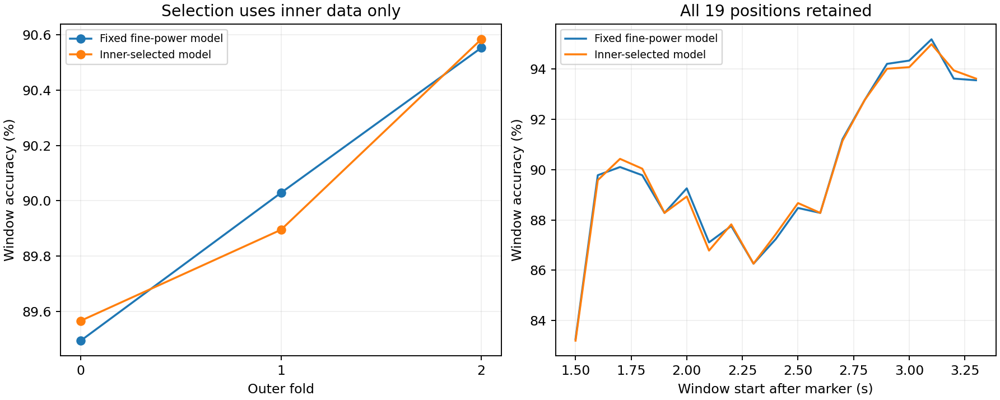

그림. 왼쪽은 같은3개 바깥 fold,오른쪽은 모든19시작 위치의 합산 정확도다. 전체 표현과 선택 모델의 위치별 차이가 작다. [18개 모델 복원·분할·scaler 검증](results/nested_selection_v10/verification.json), [선택 기록](results/nested_selection_v10/selection.json), [정수 집계](results/nested_selection_v10/outer_pooled.csv)를 제공한다. 별도 산술로 내부 확률의8클래스 합산과 동점 규칙을 다시 확인했고 클래스별 평가 지원 수는 모두3,648창이었다.

중첩 구조는 이번4후보 선택 안의 분리다. 특징 설계와 이전 실험은 같은 개발 자료를 보았고 학습·평가에 같은 기록이 남는다. 따라서 이90%를 새 기록·새 사람·미관측 외부시험 성능이나 논문 정확재현으로 표현하지 않는다.

## 성분 의존과 추가 개선의 검증

### 두 성분 제거는 개선에 실패했다

특징 열을 지우는 것과 달리, 각200ms 신호에서300Hz·420Hz의 sin/cos 네 성분을 최소제곱 투영으로 제거한 뒤905특징을 다시 계산했다. 원본 캐시는 보존하고 전체1,920시행을 변환했다. 같은 개발3-fold와 XGB64·400회에서 **89.7786±0.3530% → 78.9405±0.2160%**로10.8381%p 하락했다. 평균 저장 크기는36.17→43.61MB, 관측 학습 시간은234.51→284.88초였다.

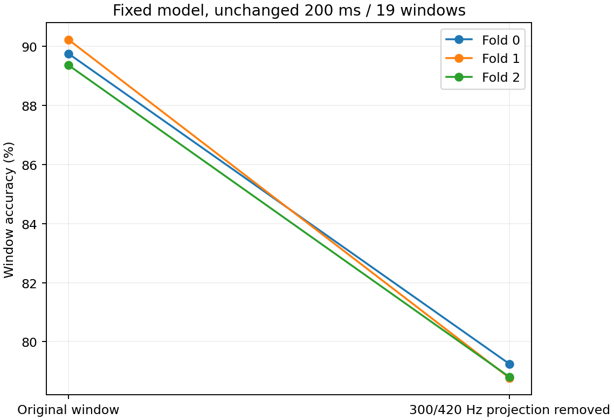

그림. 같은 fold끼리 연결했다. 입력 구간·창 수·모델 규모를 유지했으며 모든 fold에서 하락했다. 두 성분이 예측에 기여했지만 그 기원이 생리 신호·전원·기록 조건 중 무엇인지는 확정하지 못한다. 다른 주파수 정보는 남는다. [계획과 완료 기록](experiments/line_projection_v11/LOG.md), [3개 모델 검증](results/line_projection_v11/verification.json)을 남기고 이 제거 조건은 개선안으로 채택하지 않았다.

### 두 표현의 확률 결합은 작게 개선됐다

전체 표현과 좁은 표현의 오류가 일부 달라, 현재 창의8클래스 확률을 결합했다. 좁은 표현의 비중a를0/.25/.5/.75/1 중 내부 예측으로 고정했으며 세 fold 모두a=.75를 선택했다. 바깥 모델이 이미 있어 추가 fit은0회였다. 원본 모델·확률 해시를 보존하고18개 참조 파일과6개 모델의 복원 검증을 마쳤다.

| 동일한 바깥3-fold | 정답 / 29,184창 | 평균±fold SD | 평균 저장 크기 |
|---|---:|---:|---:|
| 전체 표현 하나 | 26,273 | 90.0254±0.4323% | 36.19MB |
| 좁은 표현 하나 | 26,270 | 90.0151±0.4240% | 36.83MB |
| 사전 고정50:50 대조 | 26,364 | 90.3372±0.3820% | 73.02MB |
| 내부 선택25:75 | 26,313 | **90.1624±0.4303%** | 73.02MB |

선택 결합은 전체 표현보다40창(+0.1370%p) 높았다. 결합만 맞힌385창과 기준만 맞힌345창이 있었고, 시행별로는256개가 개선·231개가 악화·1,049개가 같았다. log loss는.30594→.29674, Brier sum은.14907→.14507이었다. 고정50:50의 바깥 점수가 더 높았지만, 이 결과로 선택 가중치를 바꾸거나90.3372%를 내부 선택 결과라고 보고하지 않았다.

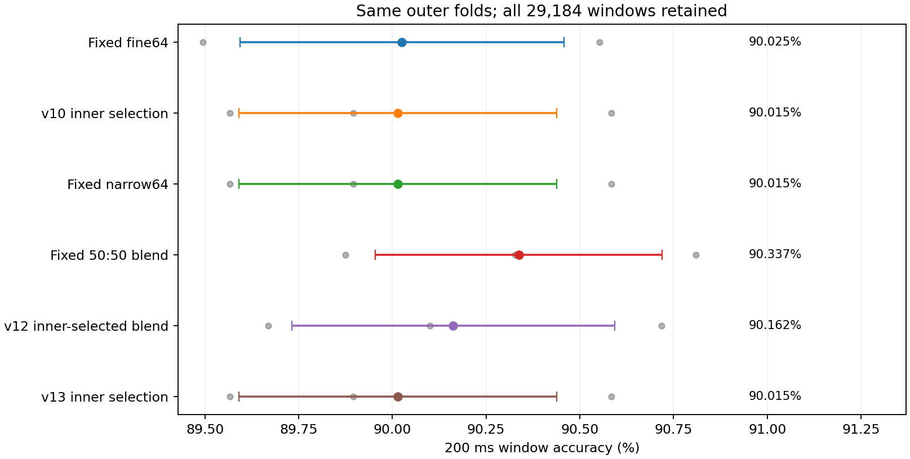

그림. 색 점은 평균, 선은fold SD, 회색 점은 각 fold다. 신뢰구간이 아니다. v10·v13의 선택 모델과 고정 narrow64는 동일한 모델·예측을 재사용하므로 독립 반복검증3개가 아니다. [가중치 선택](results/probability_blend_v12/selection.json), [원수치](results/probability_blend_v12/summary.csv), [검증](results/probability_blend_v12/verification.json)을 제공한다.

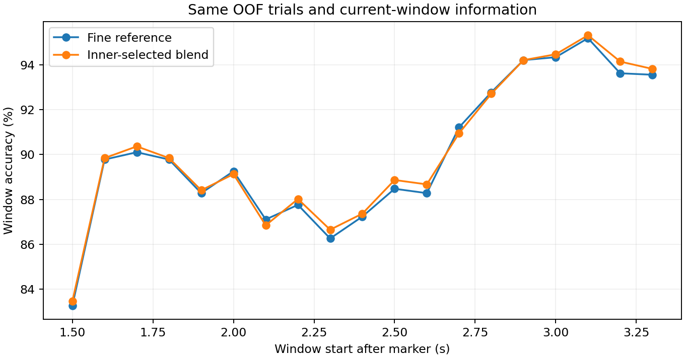

그림. 쉬운 위치만 골라 점수를 높이지 않았다. 과거·미래 창이나 시행 다수결을 추가하지 않은 현재 창 결합이다. 작은 개선을 외부 일반화의 확증으로 해석하지 않는다.

### RF·ExtraTrees 확장은 채택되지 않았다

학습 정확도100%와 평가 약90%의 차이가 남아, 같은905특징에서 무작위 숲의 평균 효과를 확인했다. 내부 학습768·선택256시행의 고정3분할에서 RF100과 ExtraTrees400을 각각3회 학습했다. 내부 정확도는 RF **74.75±0.56%**, ExtraTrees **83.94±0.76%**로 좁은 XGB **89.66±0.84%**보다 낮았다. 평균 크기는 각각69.12/369.62MB로 XGB의33.62MB보다 컸다.

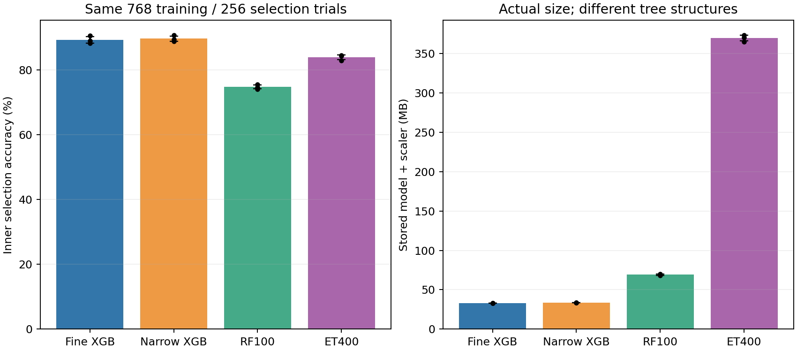

그림. 내부 선택 점수와 실제 저장 크기다. 숲은 직접8개 목표, XGB는64개 목표를 합산하며 트리 구조도 달라 동일 용량의 순수 알고리즘 대조가 아니다. 세 fold 모두 기존 narrow64를 선택해 바깥 새 학습은0회였고 점수도v10과 같은90.0151%다. 이 고정 숲 후보들의 이점은 확인하지 못했다. [완료 기록](experiments/forest_transfer_v13/LOG.md), [6개 모델·54개 참조 파일 검증](results/forest_transfer_v13/verification.json)을 남겼다.

## AR 계수와 잔차를 추가한 고정 대조

기본 특징이 현재 창의 시간 상관구조를 충분히 표현하지 못하는지 확인하려고 채널별6차 AR 계수30개와 잔차 RMS5개를 추가했다. [Pan 등의 연구 초록](https://pubmed.ncbi.nlm.nih.gov/26737970/)은 AR 계수에 잔차가 주는 추가 정보를 조사했다. 전문의 추정법·평가 조건은 미확보이므로, 이번 최소제곱 AR와 잔차 RMS는 [사전 명세](experiments/ar_residual_v15/PLAN.md)에 정의한 별도 대조다. 해당 연구를 그대로 재현했다고 주장하지 않는다.

각200ms 창의 채널별 평균을 뺀 뒤, 앞6표본으로 현재 표본을 예측하는 최소제곱 계수를 구했다. 잔차 RMS는 예측하지 못한 성분의 크기다. 미래 창이나 시행 전체를 참조하지 않고 기본25특징의 ZC .01·SSC 수식을 유지했다. 전체1,920시행의19창을 계산했고, 새 학습·선택·평가는 기존 개발1,536시행에 한정했다. 주평가지표는 창 정확도다. 모델은 동일 XGB400이며 시료 수·채널·라운드를 줄이지 않았다.

|동일 직접8클래스 XGB400|특징 수|기록 공유 창 정확도|기록 분리 창 정확도|
|---|---:|---:|---:|
|기본 TD25|25|62.0751%|8.8576%|
|TD25+AR 계수|55|68.8391%|8.6212%|
|TD25+AR 계수+잔차 RMS|60|72.4232%|8.6554%|

각 열은 같은4fold의29,184창을 합산했다. **계수와 잔차 추가는 기록 공유에서+10.3481%p(3,020창)를 얻었지만, 기록 분리에서는−0.2022%p(59창 감소)**였다. 잔차를 계수에 추가한 이득은 공유 조건에서+3.5842%p다. 이미 원래 RMS가 포함돼 있어도 잔차가 같은 기록의 패턴을 구분하는 데 도움이 됐지만, 기록 전이를 해결했다는 근거는 없다. 원인 해석에는 제공 필터와 실제 마커 정렬의 미확인 부분이 남는다.

기존90% 후보에도 계수/잔차를 추가해 별도로 검증했다. 기존v10의 내부768학습/256검증3분할에서 정답 합계는410특징13,083창,AR440특징13,079창,AR445특징13,078창이었다. 내부 합계에서는 기존 모델이 가장 높았다. 각 분할 내부 정답 수로 고정한 선택은410/410/445였고, 선택된445만 바깥1,024학습/512평가로 새로 학습했다. 바깥 전체 정확도는 **90.0151→90.1350%**로35창(+0.1199%p) 늘었다. 시행별 정답 창 수는110시행 증가·78시행 감소·1,348시행 동일했다. 세 분할 중 한 분할에서 생긴 작은 차이이며 반복 개발 선택 이력도 있어 일반적인 개선이나 통계적 확증으로 해석하지 않는다. 단일 기준 설정은 내부 합계와 비용을 고려해 기존410특징을 유지한다.

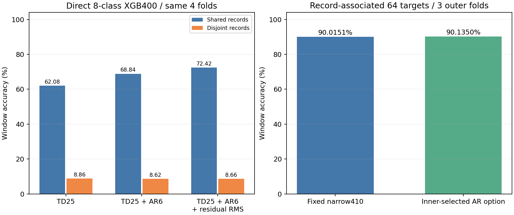

왼쪽은 직접8클래스의동일4fold 비교, 오른쪽은64기록과 일대일 대응하는64목표의동일3개 바깥 개발 분할 비교다. 두 패널은 학습 목표와 분할이 달라 서로 정확도를 직접 비교하지 않는다.19창은 겹치며 독립 반복 표본이 아니다.

|대표 모델 / 비용 측정 범위|크기(MB)|실제 학습(s)|CPU 특징+추론 중앙값/p95(ms)|
|---|---:|---:|---:|
|직접8클래스55특징,공유 fold0|11.608|7.519|0.900/1.735|
|직접8클래스60특징,공유 fold0|11.563|7.716|0.914/1.560|
|기존64목표410특징,바깥 fold2|37.002|130.890|4.868/5.274|
|추가64목표445특징,같은 바깥 fold2|36.467|129.785|5.043/6.037|

비용은 CPU6thread,동일256개 개발 창에서20회 준비 호출 후200회 batch1로 측정했다. 신호200ms 취득과 모델 로딩은 제외했다. 학습은 각각 원래 GPU 실행 시간이며 작은 차이를 속도 개선으로 해석하지 않는다.445특징은 이 대표 측정에서 CPU 지연이 증가했다. 모델 크기는 직렬화 파일 크기다.

신규23fit(내부6,바깥1,직접8클래스16)를 모두 복원해 분할·학습 전용scaler·확률 열·수동 지표를 검증했다. 모든 학습 목표와8개 출력 클래스가 존재한다. 내부 평가의 기록 수는64/63/63으로, 학습 목표 누락과는 다르다. 초기 검증조건 오인과 비용 import 충돌은 [실행 기록](experiments/ar_residual_v15/LOG.md)에 남겼다. 저장된2개 완료 모델을 보존하며 재개했고, 기존 결과 내용이 달라지지 않았음을 확인했다. 전체 테스트45개가 통과했다.누적 관측fit358개·저장모델138개이며 개수 자체를 정확성의 근거로 삼지 않는다.

50ms×4의log-RMS 변화는 기존40ms×5특징과 겹치고 기존 시간 특징 추가의 이득이 없어 생략했다. 내부 오류의 최대 클래스쌍은 분할마다 바뀌고 전체 오류의8.99–13.70%에 그쳐 쌍별 LDA/SVM 보정도 생략했다. 각도·동작을 분리하는 방법은 아직 실험하지 않았다. 현재 결과는 다른 모델 구조로 기록 전이가 해결된다고 예측할 근거를 주지 않는다. 이 대조 뒤에는 새 후보를 임의로 늘리지 않았다. 새로운 기록 일반화와 논문 비교를 판단하려면 독립 반복 세션, 필터·마커의 실제 처리 정보와 논문 전문이 필요하다.

[집계표](results/ar_residual_v15/comparison.csv), [바깥 비교](results/ar_residual_v15/outer_comparison.csv), [복원 검증](results/ar_residual_v15/verification.json), [비용6조건](results/ar_residual_v15/cost_summary.csv), [출처 범위](experiments/ar_residual_v15/SOURCES.md)에 재검산 근거가 있다.

## 모델 크기와 실행 비용

v10–v13의8개 비용 조건은 모든 학습이 끝난 뒤, 같은256개 개발 창·CPU6스레드·20회 예열·200회 측정으로 실행했다. 같은 수식의 벡터화 특징, XGB CPU inplace_predict, 숲의 predict_proba를 사용했다. 각 모델의 특징·확률 열·저장 평가 예측과 모델 해시를 확인했고 원시 시간에서 중앙값과p95를 다시 계산했다. 신호 취득200ms와 모델 로드 시간은 제외했다.

| 대표 모델 | 학습 시행 | 모델+scaler 크기 | CPU 전체 중앙값 / p95 |
|---|---:|---:|---:|
| 전체 XGB, 내부fold0 | 768 | 32.88MB | 4.44 / 5.84ms |
| 좁은 XGB, 내부fold0 | 768 | 33.41MB | 4.40 / 5.19ms |
| 선택 결합, 내부fold0 | 768 | 66.29MB | 6.80 / 7.81ms |
| RF100, 내부fold0 | 768 | 68.16MB | 14.54 / 15.81ms |
| ExtraTrees400, 내부fold0 | 768 | 365.09MB | 46.11 / 47.77ms |
| 전체 XGB, 바깥fold0 | 1,024 | 36.07MB | 4.60 / 5.68ms |
| 좁은 XGB, 바깥fold0 | 1,024 | 36.75MB | 4.69 / 6.08ms |
| 선택 결합, 바깥fold0 | 1,024 | 72.82MB | 7.78 / 9.56ms |

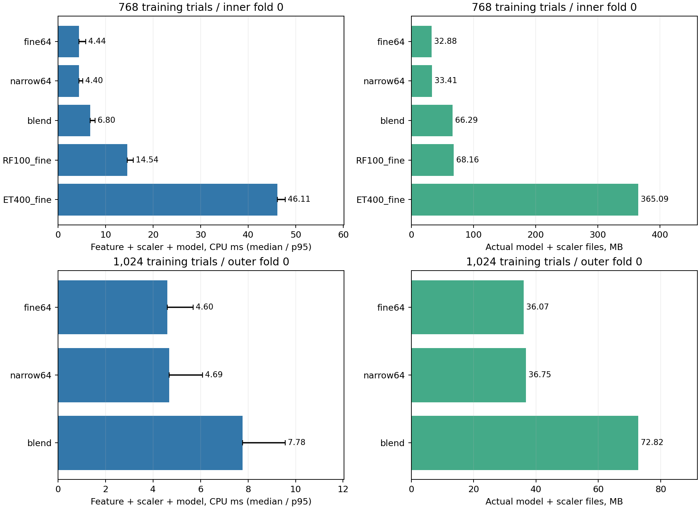

그림. 막대는중앙값, 표시선 끝은p95, 숫자는중앙값이다. 위·아래의 학습 규모가 달라 각각 묶어 비교한다. 선택 결합은 특징을 한 번 계산해도 두 모델 추론이 필요하다. 바깥 대표 모델에서40창의 작은 정확도 이득에 대해 저장 크기는약2.02배, 계산 중앙값은약1.69배였다. 좁은 표현의 학습 시간은 줄었지만 이 구현의 추론 지연 우위는 확인하지 못했다. [측정 계획](experiments/continuation_cost/PLAN.md), [전체 수치](results/continuation_cost/summary.csv), [시간 재계산 검증](results/continuation_cost/verification.json)을 제공한다.

아래는 앞선 단계에서 측정한 비용 기록이며, 호출 API·학습 규모·측정 시점이 다른 표를 직접 뺄셈하지 않는다.

같은 PC에서 스레드 상한 6, 입력 풀 256개, 단일 창 warmup 20회와 측정 200회로 비교했다. 특징 추출·scaler·모델·전체 처리를 각각 쟀고, GPU 호출 앞뒤에는 동기화했다. batch 256은 warmup 5회와 측정 30회로 처리량을 따로 구했다. 다른 GPU 학습은 동시에 실행하지 않았다. 그래픽 데스크톱은 남아 있었다. [시간 원값 재계산 검증](results/cost_benchmark/verification.json), [전체 비용 표](results/cost_benchmark/accuracy_cost.csv), [측정 과정과 판단](experiments/cost_benchmark/LOG.md)을 제공한다.

| 같은 v7 분할의 조건 | 정확도 | 대표 크기 | CPU 전체 중앙값 / p95 | GPU 전체 중앙값 / p95 |
|---|---:|---:|---:|---:|
| 400회 | 87.91% | 38.84 MB | 5.93 / 6.98ms | 244.42 / 258.76ms |
| 800회 | 88.46% | 60.37 MB | 7.22 / 8.34ms | 407.05 / 438.04ms |
| 고주파 관계 제거 | 84.88% | 41.29 MB | 6.31 / 8.94ms | 258.45 / 275.13ms |
| 세부 파워 추가, 400회 | 89.78% | 36.34 MB | 6.10 / 7.49ms | 232.95 / 249.22ms |

정확도는 고정 3분할 집계, 비용은 첫 분할의 대표 모델을 측정한 값이다. 크기는 scaler를 포함한 실제 저장 바이트이며, 위의 분할 평균 크기와 구분한다. 모델 400/800회의 실제 구조는 각각 25,600/51,200트리, 646,510/783,950노드였다. RF100은 1,371,220노드·175.56MB였다. [상세 구조](results/cost_benchmark/model_structure.csv), [저장 모델 목록](results/cost_benchmark/all_saved_models.csv), [학습 시간과 측정 범위](results/cost_benchmark/observed_fit_times.csv)를 확인할 수 있다.

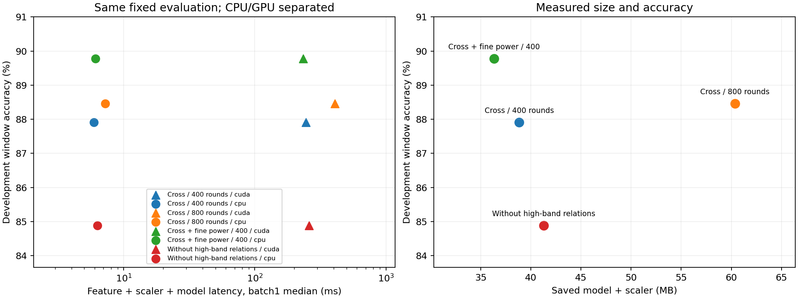

그림. 왼쪽 지연 축은 로그 눈금이다. 800회는 정확도가 조금 높지만 더 크고 느리다. 제거 조건은 400회보다 정확도·크기·지연 모두 불리했다. Pareto 여부는 같은 분할과 장치 안에서만 계산했으며 통계적 우열을 뜻하지 않는다. 현재 GPU 값은 매 호출의 DMatrix 생성·전송·CPU 확률 반환을 포함한다. GPU 하드웨어 자체의 한계로 단정하지 않고 [공식 inplace 경로 대조](experiments/cost_benchmark/INPLACE_PLAN.md)를 별도로 수행했다.

추가 호출 대조는 같은 저장 모델 4개·장치 8조합에서 수행했다. 이미 측정한 특징·문맥 시간을 반복하지 않고 단일 창 100회와 batch256 10회로 모델·전체만 비교했다. CPU/GPU 동기화, 복사 포함 범위, warmup 조건은 유지했다. 원래 200/30회 결과는 보존했다. fine400의 inplace 전체 중앙값은 CPU **5.97ms**, GPU **168.45ms**였다. batch256 전체 처리량은 CPU **3,212.85창/s**, GPU **1,017.32창/s**였다. API 개선 후에도 이 PC와 모델에서는 CPU가 빨랐다. 배치를 모으는 대기시간은 처리량에 포함하지 않는다. [호출 경로 표](results/cost_benchmark/api_comparison.csv)와 [원시 시간·출력 대조](results/cost_benchmark/inplace_verification.json)를 제공한다.

교차 특징의 Python 반복을 같은 수식의 행렬 계산으로 바꿨다. 전체 36,480창에서 float32 특징이 같았으며 v8의 모든 29,184개 개발 평가창에서 CPU/GPU 분류도 일치했다. 같은 입력을 번갈아 실행한 쌍 비교에서 v8의 CPU 특징 추출은 **3.19→1.89ms**, 전체 처리는 **6.37→4.88ms**, 전체 p95는 **8.90→6.51ms**였다. 모델이나 정확도를 바꾸지 않은 계산 개선이다. [특징·예측 동등성](results/cost_benchmark/fast_verification.json), [전체 CPU 예측 대조](results/fine_spectrum_v8/cpu_prediction_verification.json), [쌍 비교 시간 재계산](results/cost_benchmark/fast_timing_verification.json)을 확인할 수 있다.

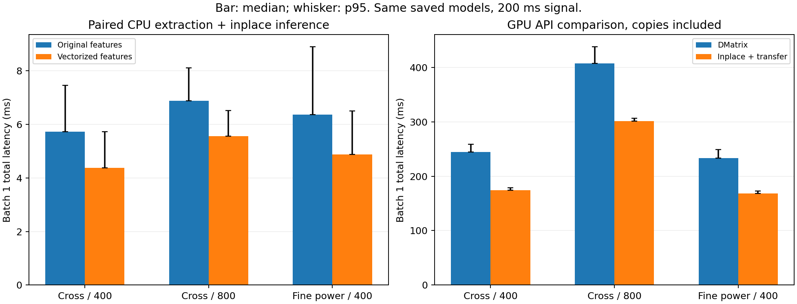

그림. 막대는 중앙값, 위쪽 표시선은 p95다. 왼쪽은 동일 모델에서 번갈아 측정한 CPU 쌍 비교이며 오른쪽은 별도로 측정한 GPU 호출 경로 비교다. 두 그래프의 시간 축 범위는 다르다. 신호를 모으는 200ms와 이 계산 시간은 별개다.

더 작은 표현도 확인했다. 4차 내부 비교에서 155특징 대안은 79.73%, 240특징은 79.79%였고 CPU 전체 중앙값은 2.24/3.10ms였다. 크기는 19.56/19.46MB로, 특징을 줄여도 저장 크기는 줄지 않았다. 같은 자료의 바깥 평가 수치와 섞지 않는다. 6차 교차 모델은 CPU 특징 추출 2.83ms, 모델 2.60ms여서 같은 수식의 계산 최적화도 검증한다.

400/800회 CPU 측정 프로세스의 최대 RSS는 약 591/750MiB였다. Python·라이브러리·입력·모델을 합친 생애 peak이며 모델만의 메모리가 아니다. GPU 사용량은 warmup 뒤와 측정 뒤 166MiB가 관측됐고 순간 peak나 학습 peak는 측정하지 못했다. CPU 실행에서도 CUDA 모델 로드로 만든 context의 148MiB가 남았지만 booster의 예측 장치는 CPU였다.

첫 출력에는 200ms 신호가 필요하고, 과거 5창이 모두 쌓이면 600ms 정보를 사용한다. 첫 창부터 출력하므로 미래 대기는 없으며 알려진 시행 경계에서 reset한다. mark+1.7초의 첫 신호 종료, mark+2.1초의 완성된 문맥, 수 ms의 CPU 계산 시간은 서로 다른 항목이다. 실제 연속 동작 전환의 응답 지연은 이 정적 시행 자료로 측정하지 못했다.

## 오류 분석

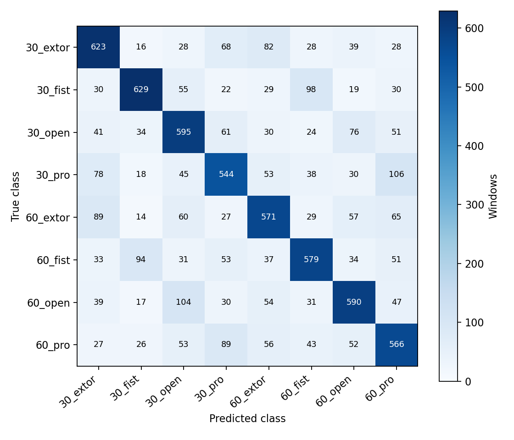

그림 5. RF의 hold-out 혼동행렬. 행은 정답, 열은 예측이며 각 행은 912창이다. 4697/7296창을 맞췄다. `30_pro→60_pro` 106창, `60_open→30_open` 104창처럼 각도 혼동이 있지만 동작 혼동도 함께 발생했다. 전체 2599오류 중 각도만 틀린 경우는 738개(28.4%), 동작만 틀린 경우는 1052개(40.5%), 둘 다 틀린 경우는 809개(31.1%)였다. 이번 결과를 ‘각도 오류가 대부분’이라고 요약할 수 없다. [SVM 그림](results/figures/confusion_SVM.png), [XGB 그림](results/figures/confusion_XGB.png), [오류 분류표](results/error_categories.csv)도 제공한다.

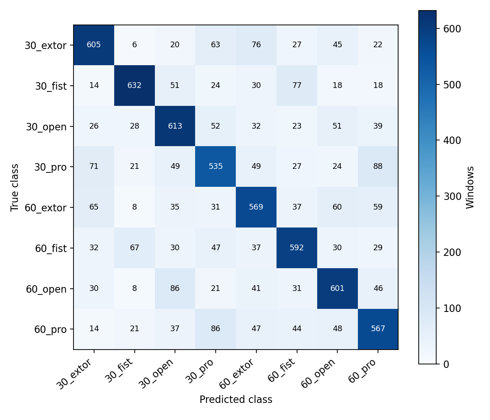

그림 6. 선택 모델은 4714/6912창을 맞췄다. 각 클래스는 864창이며, 남은 2198오류는 각도만 596개(27.1%), 동작만 934개(42.5%), 둘 다 668개(30.4%)였다. `30_pro→60_pro` 88창과 `60_pro→30_pro` 86창의 각도 혼동, `30_pro→30_extor` 71창의 동작 혼동이 남았다. [선택 모델 오류표](results/selected_errors.csv)와 [혼동행렬 수치](results/confusion_selected.csv)를 제공한다.

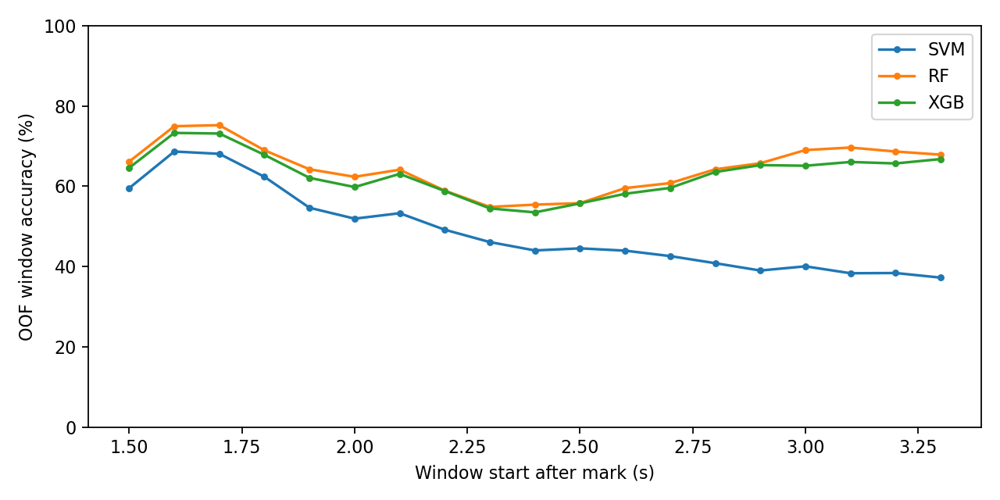

그림 7. 전체 5-fold의 평가 예측을 창 시작 시각별로 집계했다. 각 점은 1920창이다. SVM은 뒤쪽 창에서 성능이 낮아졌고, RF와 XGB도 위치에 따라 달라졌다. 신호 반응의 시간 변화와 연관될 가능성이 있으나, 이 그림만으로 낮은 성능의 원인을 휴식 구간이나 데이터 문제로 확정하지 않았다.

시행별 다수결은 보조지표로만 [원수치표](results/baseline.csv)의 `trial_vote_accuracy`에 남겼다. 창 점수와 평가 단위가 다르므로 주결과나 논문 점수를 대체하지 않는다.

## 검증한 범위와 결론

- 최종 코어·확장·분할·선택·투영·확률 결합·RMS·AR 검사45개를 통과했다. 그중 최초 기준의 합성 신호·수동 계산 단위검증은12개다. 이름, 채널 순서, 마커, 누락, 시간 간격, 창 경계, ZC 임계값, SSC, scaler, 집계와 지표를 검사했다.
- 200ms·300ms 실제 30창의 750특징을 별도 Python 스칼라 합으로 계산했다. 최대 절대차이는 3.55×10⁻¹⁵였다.
- 기준 18회·개발 40회·선택 모델 시험 1회, 총 59회 실행의 예측으로 혼동행렬과 지표를 재계산했다. 시행 ID·다수결·모델 규모·학습 부분의 scaler 평균과 분산도 일치했다. [검증 결과](results/verification.json)를 제공한다.
- 분석 구간 사이 최소 간격은 2999표본이며, 36480특징 벡터의 완전 중복은 0개다. 같은 시행의 겹친 창이 학습·평가를 가로지르지 않는다.
- 원본 전체를 별도 출력 위치에서 다시 처리했을 때 입력 해시, 특징 해시와 시행 ID 분할이 모두 일치했다.

강의 기준은 전체1,920시행을 사용했고 RF가64.54%로 가장 높았다. 초기300ms의68.20%는 입력 길이·창 수가 다른 별도 결과다. 후속 주평가는200ms·19창·5채널을 유지하고 원래시험384시행을 제외한 개발1,536시행을 사용했다. 모델을 임의로 줄인 실험이 아니라, 특징과 학습 목표를 명시적으로 확장하고 그 대조·실패를 함께 기록했다.

최신 선택 결합은 기록을 공유하는 바깥 개발 평가에서90.1624%였으나 단일 모델보다40창의 작은 이득에 크기와 지연이 증가했다. 고정 성분 제거와 두 숲 후보는 개선에 실패했고, 공통 진폭 정규화도 기록 전이를 해결하지 못했다. 기록이 바뀌면 직접8클래스 기준·확장 모델 모두 낮아졌으므로, 현재 결과로 논문 수준의 외부 일반화 성능을 달성했다고 말할 수 없다.

파일명 레이블·클래스 지원 수·확률 열·분할·학습 scaler·모델 복원은 검사 범위에서 일치했다. 제공자의 extor=회외 설명은 확인했지만, 원필터의 실제 위상·계수와 마커의 생리적 정렬은 미확인이다. 다음 검증은 추가 후보 숫자보다, 같은 사람×조건을 별도로 반복 수집한 기록과 고정된 평가 절차를 확보하는 것이 필요하다. [확인된 사실·의도한 변경·미확인 사항과 최소 검증](docs/CONTINUATION_REPORT.md)을 구분해 기록했다.

남은 클래스별 혼동만으로 채널별 정규화나 새 분류기가 동작 정보와 기록 특성을 분리할 것이라는 근거는 확보되지 않았다. 가능한 모든 방법을 부정하는 것이 아니라, 기록 일반화를 개선할 근거가 확인된 다음 변환이 없어 무작정 튜닝을 늘리지 않은 것이다. 같은 사람×8조건을 **별도 반복 세션**에서 수집하고 조건 순서·전극·단위·이득·필터·동작 시작을 기록해야 세션 전이와 사람 전이를 나눌 수 있다. 논문 전문의 입력·분할·평가 단위와 원필터 정보도 필요하다. 따라서 논문급 동작 일반화라는 목표는 아직 미달이며, 현재 재현 가능한 성과는 제공 자료의 강의 기준과 기록 공유 개발 개선이다.

## 실행법

Python 3.13과 지원되는 NVIDIA 드라이버를 준비한다. 새 가상환경에서는 다음처럼 공식 패키지를 설치한다. 이번 작업의 버전은 [requirements.txt](requirements.txt)에 고정했다.

```bash
python3 -m venv .venv
.venv/bin/python -m pip install -r requirements.txt
export SEMG_PYTHON="$PWD/.venv/bin/python"
export SEMG_RAW="/path/to/original_csv_directory"
export SEMG_RUN_DIR="$PWD/private/reproduction_01"

bash run.sh test
bash run.sh prepare
bash run.sh baseline
bash run.sh verify
# 기준 결과를 확인한 뒤
bash run.sh improve
bash run.sh verify
bash run.sh analyze
```

`SEMG_RUN_DIR`를 새 디렉터리로 지정하면 저장된 결과를 덮어쓰지 않고 재실행한다. 같은 출력 위치에 이미 baseline이 있으면 prepare와 baseline을 중단한다. 결과는 `$SEMG_RUN_DIR/results`, 예측·모델·캐시는 `$SEMG_RUN_DIR/private`에 생긴다. XGB는 CUDA가 실제로 활성화됐는지 검사하므로 GPU 접근이 막히면 CPU 결과로 조용히 대체하지 않는다.

추가 진단과 개선은 같은 `SEMG_RUN_DIR`에서 아래 순서로 실행한다. 원래 `improve`와 `analyze`가 만든 특징·개발 예측·RMS 프로파일이 필요하다. 각 단계는 등록된 전체 입력을 쓰며 새 특징 생성과 학습은 기존 출력을 덮어쓰지 않는다.

```bash
bash run_extensions.sh test
bash run_extensions.sh features
bash run_extensions.sh diagnose
bash run_extensions.sh nested
bash run_extensions.sh mechanisms
bash run_extensions.sh capacity
bash run_extensions.sh subclass
bash run_extensions.sh cross
bash run_extensions.sh cross-capacity
bash run_extensions.sh fine-spectrum
bash run_extensions.sh spectral-controls
bash run_extensions.sh reference-phase
bash run_extensions.sh record-reference
bash run_extensions.sh fit-gap
bash run_extensions.sh nested-selection
bash run_extensions.sh line-projection
bash run_extensions.sh probability-blend
bash run_extensions.sh forest-transfer
bash run_extensions.sh verify
bash run_extensions.sh benchmark
```

활동 구간 기록 진단과 그 결과를 본 뒤 등록한 기본25특징 대조는 별도 결과 경로를 사용한다. 아래 순서를 유지한다.

```bash
"$SEMG_PYTHON" experiments/active_record_control/run.py
"$SEMG_PYTHON" experiments/active_record_control/verify.py
"$SEMG_PYTHON" experiments/active_record_control/run.py --baseline
"$SEMG_PYTHON" experiments/active_record_control/verify.py --baseline
"$SEMG_PYTHON" experiments/active_record_control/report.py
"$SEMG_PYTHON" experiments/continuation_cost/report.py
# 다른 학습이 끝난 상태에서 비용8조건을 각각 새 프로세스로 측정
for case in inner_fine64 inner_narrow64 inner_blend inner_RF100_fine inner_ET400_fine outer_fine64 outer_narrow64 outer_blend; do
  "$SEMG_PYTHON" experiments/continuation_cost/benchmark.py --case "$case"
done
"$SEMG_PYTHON" experiments/continuation_cost/verify_report.py
# 사후 등록한 공통 RMS 대조: 기존 결과와 별도 경로
"$SEMG_PYTHON" experiments/gain_invariance_v14/features.py
"$SEMG_PYTHON" experiments/active_record_control/run.py --gain
"$SEMG_PYTHON" experiments/active_record_control/verify.py --gain
for kind in raw25 normalized25; do
  for protocol in trial_shared record_disjoint; do
    "$SEMG_PYTHON" experiments/gain_invariance_v14/cost.py --kind "$kind" --protocol "$protocol"
  done
done
"$SEMG_PYTHON" experiments/gain_invariance_v14/report.py
"$SEMG_PYTHON" experiments/gain_invariance_v14/confusion_diagnostic.py
# 후속 AR 고정 대조: 새 경로, 최대25fit, 실제23fit
bash run_extensions.sh ar-residual
```

중단된 4–11차 학습은 해당 단계 뒤에 `--resume`을 붙인다. 완료 행과 필수 파일을 확인하고 기존 산출물의 해시를 보존하며, 점수 없는 불완전 산출물이 있으면 덮어쓰지 않고 중단한다. 실행 시간을 비교할 때에는 CPU 예측 시간, 동시 GPU 작업과 실제 모델 크기도 고려한다. 출력 경로 분리 후 새 경로에서 다시 만든 교차 특징의 SHA-256이 원래 배열 파일과 일치했다. [경로 검증](results/extension_path_verification.json)을 제공한다.

추가 API와 벡터화 검증은 기본 비용 측정이 완료된 뒤 다른 학습이 없을 때 실행한다. 공식 CuPy는 별도의 가상환경에 설치하며, 같은 출력 위치에 환경이 있으면 설치 스크립트가 보존을 위해 중단한다.

```bash
export PYTHONPATH="$PWD/src"
bash scripts/setup_inference_env.sh
"$SEMG_RUN_DIR/private/inference_env/bin/python" experiments/cost_benchmark/run_inplace.py
"$SEMG_RUN_DIR/private/inference_env/bin/python" experiments/cost_benchmark/report_inplace.py
"$SEMG_PYTHON" experiments/cost_benchmark/fast_probe.py
"$SEMG_PYTHON" experiments/cost_benchmark/verify_fast.py
"$SEMG_PYTHON" experiments/fine_spectrum_v8/verify_cpu.py
"$SEMG_PYTHON" experiments/cost_benchmark/report_paths.py
```

원본 데이터·강의·모델·개별 예측과 신호 그림은 Git에 포함하지 않았다. 공개 후보에는 새 코드·명세·집계표·집계그림만 있다. 로컬 Git은 새 루트 커밋에서 시작했다. 검증된 공개 파일만 별도 Git으로 구성해 [새 공개 저장소](https://github.com/KyunghoCha/semg-coursework-clean-reproduction)에 게시했으며 비공개 실험 이력은 push하지 않았다. [게시 이력](docs/PUBLICATION.md)에 공개 범위와 최초 ZIP 해시가 있다. [진행 기록](PROGRESS.md)과 [근거자료](docs/SOURCES.md)에 실행 순서와 미확인 범위를 남겼다.
