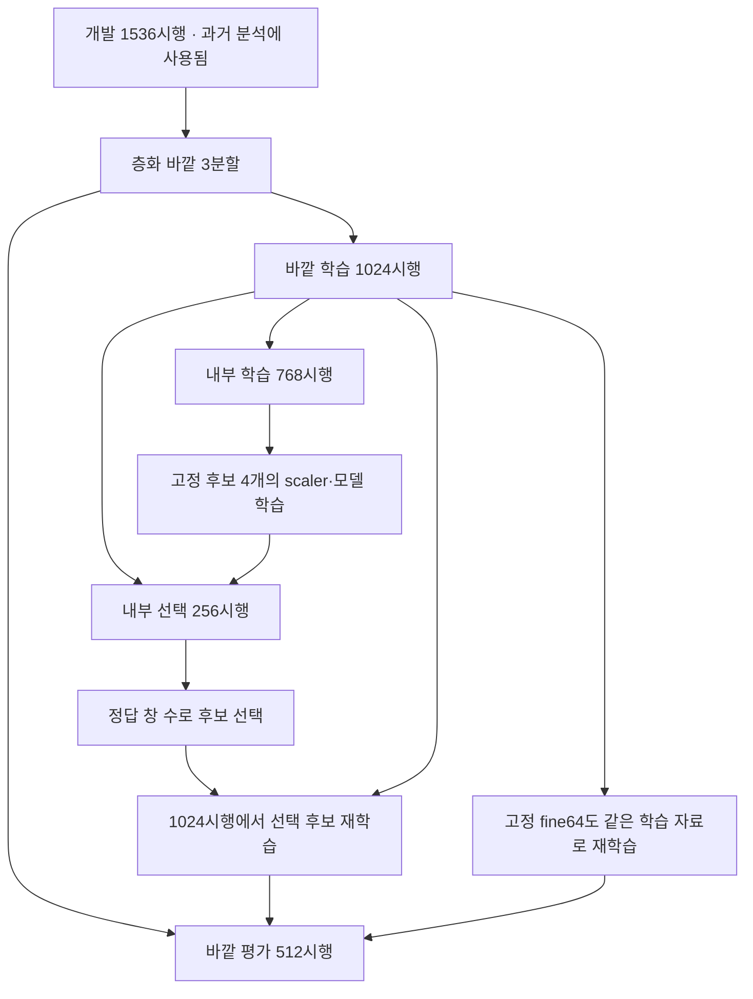

# 평가 자료의 사용 이력과 선택 범위

현재 데이터의 어떤 부분도 전체 작업 과정에서 완전히 미관측인 독립 외부 시험으로 남아 있지 않다. 새 seed와 중첩 분할은 이번 선택 과정 안에서 학습·선택·평가를 나누지만, 앞선 특징 설계와 진단이 이미 같은 자료를 보았다는 사실은 바꾸지 못한다.

## 자료가 쓰인 범위

| 자료·절차 | 수량 | 무엇을 측정하는가 | 남아 있는 제한 |
|---|---:|---|---|
| 최초 강의 기준 전체 5-fold | 1,920시행 | 강의 설정을 제공 자료에 적용한 창 분류 | 같은 기록의 시행 공유, 이후 개발에 노출 |
| 원래 20% 시험 | 384시행 | 최초 holdout와 초기 300ms 선택 결과 | 전체 5-fold에 이미 학습 4회·평가 1회로 노출 |
| 후속 개발 | 1,536시행 | 특징·모델·원인 대조 | 반복 CV 및 특징 선택의 편향 |
| v10 내부 학습 | 각 fold 768시행 | 후보별 scaler와 모델 학습 | 기록 공유, 과거 개발 노출 |
| v10 내부 선택 | 각 fold 256시행 | 네 후보의 현재 창 정답 수 비교 | 선택을 위해 직접 사용하므로 성능 보고의 최종 평가가 아님 |
| v10 바깥 평가 | 각 fold 512시행 | 내부에서 선택한 절차와 고정 표현의 비교 | 이번 내부 선택에는 미사용이나 과거 특징 설계에는 노출 |
| 초기창 기록 분리 | 매 fold 48/16기록 | 특정 사람×조건 기록을 제외했을 때 초기창 분류 | 클래스는 남고 사람 전체를 제외하지 않음; 사람·조건·기록 효과 결합 |

원래 시험 384시행은 v2 이후 후보 선택·진단·추가 평가에서 계속 제외했다. 이 제한을 지킨다고 해서 최초 전체 CV의 노출이 사라지지는 않는다. 같은 데이터가 이전 실패 작업에도 사용됐다는 이력 역시 새 Git을 만들었다고 없어지지 않는다. 새 구현의 독립성은 코드·캐시·실험을 새로 작성하고 계산했다는 뜻이다.

## v10의 선택과 바깥 평가

fine64·narrow64·drop_two64·direct8의 조건과 내부 점수 동점 규칙을 결과 전에 고정했다. 내부 선택에는 각 fold의 바깥 평가 시행이 포함되지 않는다. scaler도 실제 모델을 학습하는 부분에만 맞춘다. 바깥 평가 결과를 보고 같은 fold의 후보를 다시 고르지 않는다. 최종 개발 후보는 세 내부 선택 부분의 정답 수 합으로 결정한다.

바깥 학습과 평가에는 같은 원본 기록의 서로 다른 시행이 존재한다. 파일 하나는 특정 사람×손동작×각도의 반복 30시행으로, 기록과 조건이 독립적으로 반복 수집된 설계가 아니다. 따라서 기록의 일정한 신호 특성이 레이블과 연관될 수 있다. 초기창 대조는 그 가능성을 뒷받침하지만 신호가 생리적 반응인지 획득·필터·전극 조건인지는 확정하지 못한다.

## 결과를 읽는 단위

주평가는 mark+1.5–3.5초의 현재 200ms 창, 100ms 이동, 시행당 19창이다. 겹친 창은 같은 시행과 함께 분할한다. 창 하나씩 예측한다는 의미와 창들이 통계적으로 독립이라는 의미를 구분한다. 이 자료의 겹친 창은 서로 상관되어 있다.

과거 5창 집계는 최대 600ms의 입력 이력을 쓰는 별도 결과다. 초기창 하나의 진단과 300ms·18창 대조 역시 다른 입력 범위다. fold의 평균±SD에서 SD는 분할 간 표준편차(ddof=0)이며 신뢰구간이 아니다. 기록 분리처럼 fold 표본 수가 다르면 전체 정답 수를 합친 정확도와 fold 평균을 둘 다 표시한다.

v12는 현재 창의 두 모델 확률을 결합한다. 결합 계수는 v10의 내부 예측으로 고르고 바깥 예측에는 고정하여 적용한다. 이 역시 새로운 외부 검증을 만들지 않는다. 실제 독립 일반화 성능을 확인하려면 이번 개발 과정과 분리하여 수집한 기록과 획득·필터 정보가 필요하다. 현재의 로컬 개선 작업은 이 제한을 명시한 채 계속 진행한다.

## 완료한 활동 구간 대조와 사후 진단

활동19창의 직접8클래스 XGB400 대조는 개발1,536시행을 같은4fold로 나눴다. 시행 분리는 매회1,152/384시행이며64기록을 공유한다. 기록 분리는1,139–1,164시행 학습·372–397시행 평가,48/16기록이며 각 클래스6/2기록이다. 두 경우 모든 학습·평가 클래스가 존재하고 전체 평가 지원 수는 클래스마다3,648창이다. 모든 학습에는8명이 남아 새 사람 전체를 제외한 검증이 아니다.

905특징 대조 뒤 기본25특징 대조를, 이어 공통 RMS 정규화를 등록했다. 각8fit의 사후 진단이며 같은 시행·창·seed·모델을 유지했다. 기록 분리 결과를 보고 새 분할을 고르거나 레이블을 재배열하지 않았다. 세 표현 모두 기존384시험과 교집합0이고 각 프로토콜에서 개발 시행을 정확히 한 번 평가했다. 결과·한계는 [통합 보고](CONTINUATION_REPORT.md)에 있다.

v11의3fit,v12의기존6모델 결합,v13의6개 내부 fit도 모두 완료·검증했다. v13은 내부에서 기존 좁은 XGB만 선택돼 새 바깥 학습이 없었다. v12 바깥 결과가 더 높은50:50을 보고 내부 선택25:75를 바꾸지 않았다. 모든 보고의 SD는 fold 간 분산의 기술 통계이고 독립 시험의 신뢰구간이 아니다.19겹친 창을 독립 표본으로 놓은 추가 통계 검정은 하지 않았다.

## v17–v20의 고정 결정경계 대조

QDA(v17), 공분산 공유 LDA(v18), 작은 LDA 결합(v19), RBF SVM(v20)은 v10의 같은 내부 학습768시행·평가256시행과 바깥 학습1,024시행·평가512시행을 사용한다. 내부 세 평가 부분을 합친14,592관측은 전체 OOF 예측이 아니며, 서로 다른 내부 평가에 같은 시행이 다시 나타날 수 있다. 주지표의 단위는 계속 200ms·19창의8클래스 창 정확도다.

QDA와 LDA 단독은 내부에서 기존 XGB보다 낮아 새 바깥 모델을 학습하지 않았다. v19는 내부에서만0/5/10/20% 중 LDA 비중20%를 고른 뒤 바깥 LDA3개를 새로 학습했다. 바깥 결과를 보고 비중 범위를 늘리지 않았다. 이후 v20의 비교 기준은 이 고정 XGB80%+LDA20%다.

v20의 RBF SVM은410특징·64목표 한 설정이다. 과거240특징·직접8목표 SVM과 입력, 학습 목표, 분할, 확률 보정이 다르므로 둘의 차이를 특징 수만의 효과로 해석하지 않는다. 보정은 각 내부 학습 부분 안에서 시행 단위 층화3fold로 수행했다. 같은 시행의19창을 함께 이동하고, 각 보정 학습 부분에서 scaler를 새로 맞췄다. 학습 OOF 점수로64개 sigmoid를 맞춘 뒤 전체 내부 학습 부분에서 최종 SVM을 맞췄다. 모델당 SVM 학습은4회이며, 평가256시행은 이 과정에서 제외했다.

v20 내부3분할에서 모두 기존 고정 결합을 유지하도록 선택돼 바깥 SVM 학습은0회다. 바깥90.5942%가 그대로인 것은 기존 결합을 재사용한 결과이며 SVM 성능이 아니다. SVM 자체의 성능은 내부 비교86.2390%로만 보고한다. 반복 개발 및 이전 바깥 평가의 노출은 남아 있고, 기존384시험을 다시 평가하지 않았다.64목표가 사람×조건의64기록과 일대일이라는 해석상 한계도 유지한다.

## v21의 작은 SVM 결합

v20의 세 내부 예측만으로 SVM 비중 0/5/10/20%를 비교했다. 각 내부 분할에서 20%를 선택한 뒤 해당 바깥 학습 부분에서만 SVM을 3회 새로 맞췄다. 각 확률모델은 시행 보정 3fold와 전체 재학습을 포함해 4개의 base SVM fit를 사용한다. 기존 XGB/LDA의 비중 80/20을 다시 선택하지 않았으므로 최종 XGB/LDA/SVM 비중은 64/16/20이다.

바깥 정확도 91.3857%는 이 고정된 선택 절차의 개발 평가이며 새로운 외부 시험이 아니다. 전체 개발 1,536시행을 한 번씩 평가하고 기존 384시험은 제외했다. 내부와 바깥의 역할, 모든 학습 전용 scaler, 64목표와 기록의 일대일 관계를 유지한다. 큰 모델과 CPU 시간 증가를 성능 개선과 함께 보고한다.

## v22의 라벨 동등성과 비용 범위

v22는 가중치나 모델 선택을 추가하지 않는다. beta=.2일 때 기준 확률 1·2위 차이가 .25+1e-8보다 크면 결합 후 argmax가 바뀔 수 없다는 하한으로 SVM 호출을 생략한다. 전체 내부 관측 및 바깥 예측과 실제 바깥 CPU 라벨이 모두 일치했고 확률값의 동등성은 주장하지 않는다.

기존 200개 비용 입력의 호출률 2.5%가 전체 바깥의 8.09%보다 낮음을 발견해 해당 p95를 일반화하지 않았다. 바깥 fold0의 전체 9,728창을 추가 측정했고 호출률 8.14%, 중앙값 4.52ms·평균 7.31ms·p95 38.11ms였다. 비용 입력의 학습 노출 가능성과 정확도 평가의 시행 분리를 구분한다. 추가 측정으로 모델·분할·임계값을 바꾸지 않았다.

## v23의 인과적 평균과 늘어난 입력 범위

v21의 고정 확률에 k1/3/5를 적용하고 v10 내부 세 분할에서만 선택했다. 세 분할 모두 k5이며, 선택 파일을 먼저 저장·해시 고정한 뒤 바깥에는 해당 k를 그대로 사용했다. 새 학습0, 전체개발1,536시행·29,184창, 원래384시험과의교집합0이다. 내부14,592관측은 전체 OOF가 아니며 기존 반복 노출과 기록 공유는 남는다.

이 평가는 시행 경계를 아는 정적 자료에서 현재와 과거 확률을 평균한다. 첫 창을 포함한19창을 모두 평가하고 매시행 초기화했다. 각 현재 창은200ms지만 k5는 최대600ms의 실제 신호 범위를 사용하므로,96.6488%는200ms 주결과91.3857%와 다른 입력 조건이다. 전체 시행 다수결·미래 참조·초기창 제외를 사용하지 않았다. 원래 q와 시간 평균의 지표·혼동·오류 구간을 함께 보존했다.

동작 전환이나 경계 자동 검출 자료가 없어 실제 무구간 연속 사용의 성능과 반응 지연을 확인할 수 없다. 단일 창 오류가 줄어도5창 이상 연속 오류가 늘어난 결과를 함께 보고한다.19겹친 창을 독립 관측으로 신뢰구간을 계산하지 않는다. 매창 전체 확률을 요구해v22의 라벨 전용 호출 생략도 적용하지 않는다. [사전 명세](../experiments/causal_probability_v23/PLAN.md), [검증](../results/causal_probability_v23/verification.json), [집계](../results/causal_probability_v23/summary.json)에 범위를 고정했다.

## v24·v25의 같은 입력 조건과 두 단계 내부 선택

v24는 v21의 410특징·64목표·같은 시행 분할에서 XGB 구성 요소만 바꾼다. 내부 학습 768시행·평가 256시행의 세 분할에서 고른 XGB를 각 바깥 학습 1,024시행으로 다시 맞췄다. 비중 64/16/20은 고정했고 세 분할 모두 얕은 XGB800을 골랐다. v25는 선택된 XGB를 바꾸지 않고 같은 내부 예측에서 SVM 비중 0/10/20/30/40/50%를 비교해 40/20/30%를 고정했다. 이 후보 범위는 첫 v24 새 바깥 점수 전에 등록했으나 바깥 학습 시작 후에 등록됐다. 등록 시점을 학습 시작 전으로 표현하지 않는다.

바깥 91.9819%는 전체 개발 1,536시행·29,184창의 점수다. 기존 시험 384시행과 교집합은 0이고 새 시험 평가는 없다. XGB 선택과 비중 선택이 동일 내부 자료를 순차 재사용하므로 전체 선택 복잡성이 증가했다. 내부 세 평가 부분의 합은 전체 OOF가 아니며, 이전 바깥 개발 점수의 반복 노출도 사라지지 않는다. 신규 외부 시험 또는 완전히 미관측인 중첩 검증으로 부르지 않는다.

현재 200 ms 입력·100 ms 이동·19창을 모두 유지했고, 입력 시간 확대·시행 투표·경계 힌트·기록 ID 추론 입력은 사용하지 않는다. 64목표와 64기록의 일대일 관계, 시행 분할의 기록 공유는 그대로다. 전체 61개 테스트와 9개 모델 복원·수동 지표·분할·scaler·클래스 지원 검사를 통과했으나 이 범위를 넘어 새 기록의 일반화를 입증하지 않는다.

라벨 전용 분기는 고정 beta의 수학적 상위 확률 차이 조건만 쓰고 정답으로 임계값을 고르지 않는다. 전 29,184창의 실제 CPU 라벨이 같았다. 대표 분할 전체 9,728창의 지연과 전체 확률 380창의 지연은 서로 다른 측정 범위이며 속도 비율로 나누지 않는다. 시간 원시값을 독립 재집계했고 19겹친 창을 독립 관측으로 놓는 신뢰구간을 추가하지 않았다.

## v26·v27의 고정 실패 대조

v26은 학습 전용 PCA64열을 원래410열에 붙인 하나의 후보를 내부에서 비교했다. 세 분할 모두 기존보다 낮아 새 바깥 학습은0이다. 결과의91.9819%는 기존v25 유지 점수이며 PCA 후보가 바깥에서 평가된 값이 아니다.

v27은 기존v25만을 기준으로 LDA 확률의 온도1/1.5/2를 비교했다. v26 선택과 결합하지 않았다. 내부에서1.5/1/2를 고정한 뒤 바깥91.9613%로6개 감소했다. 내부+4개와 바깥−6개를 모두 보존한다. 반복 내부 선택을 미관측 외부 검증으로 바꾸어 설명하지 않는다. 모두 200 ms·전 19창·개발 1,536시행·기존 384시험과의 교집합 0을 유지했고, 해당 단계의 65개 테스트와 모델 복원·독립 수식·지표 검증을 통과했다.

## v28의 비용 제한 숲과 기존 모델 유지

기존 905특징·직접 8목표 숲과 구분해 410특징·64목표의 ExtraTrees 한 설정을 비교했다. 내부 세 분할에서 고정 10% 결합이 기존보다 −2/−9/0개여서 모두 기존 유지다. 바깥 91.9819%는 v25 재사용이며 새 숲의 바깥 점수가 아니다. bootstrap=False의 모든 학습 표본 사용, 트리·잎 상한과 저장 크기 제한은 사전 설정이다. 새 학습은 내부 3회이며 최초 로그 오류 뒤 완성된 첫 모델을 재사용해 중복 학습하지 않았다. 현재 창·전 19창·개발 1,536시행·기존 384시험 교집합 0을 유지하고, 외부 일반화로 확대하지 않는다.

## v29의 410특징 SVM 제한 비교

과거 240특징 SVM과 구분해 현재 410특징·64목표의 C와 gamma를 비교한다. 세 후보와 파일 크기 제한을 새 학습 전에 등록했고, 기존 v25의 XGB/LDA 및 fold별 SVM 비중은 바꾸지 않는다. 같은 내부 768/256시행의 선택을 고정한 뒤 필요한 후보만 바깥 1,024/512시행에서 학습한다. 내부 보정도 학습 시행 단위 3-fold이며 같은 시행의 19창은 보정 학습·검증을 넘지 않는다. 이 보정 OOF와 후보 선택용 내부 평가, 최종 바깥 평가를 서로 구분한다.

공유 특징 캐시에는 원래 1,920시행이 들어 있지만 새 모델의 scaler·SVC·sigmoid·후보 점수·바깥 점수에는 기존 시험 384시행을 넣지 않는다. 전체 캐시를 읽는 기존 입력 로더를 사용하므로 파일 수준에서 시험 행을 전혀 읽지 않았다고 표현하지 않는다. 시험을 새로 평가하거나 설정 선택에 사용하지 않았다는 범위다. 반복 개발 자료 사용, 이전 바깥 점수 노출, 기록 공유의 한계는 그대로다.
