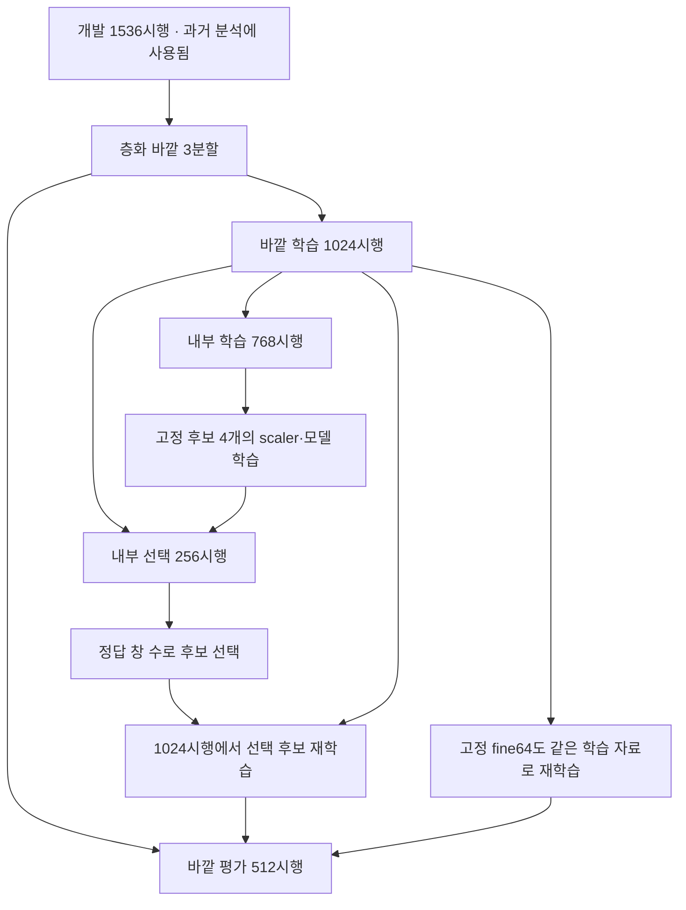

# 평가 자료의 사용 이력과 선택 범위

현재 데이터의 어떤 부분도 전체 작업 과정에서 완전히 미관측인 독립 외부 시험으로 남아 있지 않다. 새 seed와 중첩 분할은 이번 선택 과정 안에서 학습·선택·평가를 나누지만, 앞선 특징 설계와 진단이 이미 같은 자료를 보았다는 사실은 바꾸지 못한다.

## 자료가 쓰인 범위

| 자료·절차 | 수량 | 무엇을 측정하는가 | 남아 있는 제한 |
|---|---:|---|---|
| 최초 강의 기준 전체 5-fold | 1,920시행 | 강의 설정을 제공 자료에 적용한 창 분류 | 같은 기록의 시행 공유, 이후 개발에 노출 |
| 원래 20% 시험 | 384시행 | 최초 holdout와 초기 300ms 선택 결과 | 전체 5-fold에 이미 학습 4회·평가 1회로 노출 |
| 후속 개발 | 1,536시행 | 특징·모델·원인 대조 | 반복 CV 및 특징 선택의 편향 |
| v10 내부 학습 | 각 fold 768시행 | 후보별 scaler와 모델 학습 | 기록 공유, 과거 개발 노출 |
| v10 내부 선택 | 각 fold 256시행 | 네 후보의 현재 창 정답 수 비교 | 선택을 위해 직접 사용하므로 성능 보고의 최종 평가가 아님 |
| v10 바깥 평가 | 각 fold 512시행 | 내부에서 선택한 절차와 고정 표현의 비교 | 이번 내부 선택에는 미사용이나 과거 특징 설계에는 노출 |
| 초기창 기록 분리 | 매 fold 48/16기록 | 특정 사람×조건 기록을 제외했을 때 초기창 분류 | 클래스는 남고 사람 전체를 제외하지 않음; 사람·조건·기록 효과 결합 |

원래 시험 384시행은 v2 이후 후보 선택·진단·추가 평가에서 계속 제외했다. 이 제한을 지킨다고 해서 최초 전체 CV의 노출이 사라지지는 않는다. 같은 데이터가 이전 실패 작업에도 사용됐다는 이력 역시 새 Git을 만들었다고 없어지지 않는다. 새 구현의 독립성은 코드·캐시·실험을 새로 작성하고 계산했다는 뜻이다.

## v10의 선택과 바깥 평가

fine64·narrow64·drop_two64·direct8의 조건과 내부 점수 동점 규칙을 결과 전에 고정했다. 내부 선택에는 각 fold의 바깥 평가 시행이 포함되지 않는다. scaler도 실제 모델을 학습하는 부분에만 맞춘다. 바깥 평가 결과를 보고 같은 fold의 후보를 다시 고르지 않는다. 최종 개발 후보는 세 내부 선택 부분의 정답 수 합으로 결정한다.

바깥 학습과 평가에는 같은 원본 기록의 서로 다른 시행이 존재한다. 파일 하나는 특정 사람×손동작×각도의 반복 30시행으로, 기록과 조건이 독립적으로 반복 수집된 설계가 아니다. 따라서 기록의 일정한 신호 특성이 레이블과 연관될 수 있다. 초기창 대조는 그 가능성을 뒷받침하지만 신호가 생리적 반응인지 획득·필터·전극 조건인지는 확정하지 못한다.

## 결과를 읽는 단위

주평가는 mark+1.5–3.5초의 현재 200ms 창, 100ms 이동, 시행당 19창이다. 겹친 창은 같은 시행과 함께 분할한다. 창 하나씩 예측한다는 의미와 창들이 통계적으로 독립이라는 의미를 구분한다. 이 자료의 겹친 창은 서로 상관되어 있다.

과거 5창 집계는 최대 600ms의 입력 이력을 쓰는 별도 결과다. 초기창 하나의 진단과 300ms·18창 대조 역시 다른 입력 범위다. fold의 평균±SD에서 SD는 분할 간 표준편차(ddof=0)이며 신뢰구간이 아니다. 기록 분리처럼 fold 표본 수가 다르면 전체 정답 수를 합친 정확도와 fold 평균을 둘 다 표시한다.

v12는 현재 창의 두 모델 확률을 결합한다. 결합 계수는 v10의 내부 예측으로 고르고 바깥 예측에는 고정하여 적용한다. 이 역시 새로운 외부 검증을 만들지 않는다. 실제 독립 일반화 성능을 확인하려면 이번 개발 과정과 분리하여 수집한 기록과 획득·필터 정보가 필요하다. 현재의 로컬 개선 작업은 이 제한을 명시한 채 계속 진행한다.

## 완료한 활동 구간 대조와 사후 진단

활동19창의 직접8클래스 XGB400 대조는 개발1,536시행을 같은4fold로 나눴다. 시행 분리는 매회1,152/384시행이며64기록을 공유한다. 기록 분리는1,139–1,164시행 학습·372–397시행 평가,48/16기록이며 각 클래스6/2기록이다. 두 경우 모든 학습·평가 클래스가 존재하고 전체 평가 지원 수는 클래스마다3,648창이다. 모든 학습에는8명이 남아 새 사람 전체를 제외한 검증이 아니다.

905특징 대조 뒤 기본25특징 대조를, 이어 공통 RMS 정규화를 등록했다. 각8fit의 사후 진단이며 같은 시행·창·seed·모델을 유지했다. 기록 분리 결과를 보고 새 분할을 고르거나 레이블을 재배열하지 않았다. 세 표현 모두 기존384시험과 교집합0이고 각 프로토콜에서 개발 시행을 정확히 한 번 평가했다. 결과·한계는 [통합 보고](CONTINUATION_REPORT.md)에 있다.

v11의3fit,v12의기존6모델 결합,v13의6개 내부 fit도 모두 완료·검증했다. v13은 내부에서 기존 좁은 XGB만 선택돼 새 바깥 학습이 없었다. v12 바깥 결과가 더 높은50:50을 보고 내부 선택25:75를 바꾸지 않았다. 모든 보고의 SD는 fold 간 분산의 기술 통계이고 독립 시험의 신뢰구간이 아니다.19겹친 창을 독립 표본으로 놓은 추가 통계 검정은 하지 않았다.
